> 2026-10-06부터 Grafana Cloud에서 **자체 모니터링 서버**로 이전 (#368, #370)
- 개발·운영 모두 새 서버로만 전송, 과거 데이터는 이관하지 않음
- Grafana Cloud는 **온콜(IRM)** 용도로만 사용
- 아직 끝나지 않은 항목은 **(예정)** 으로 표시
- 전체 구성 그림은 인프라 구성  참고
> 

# 0. 전체 구성

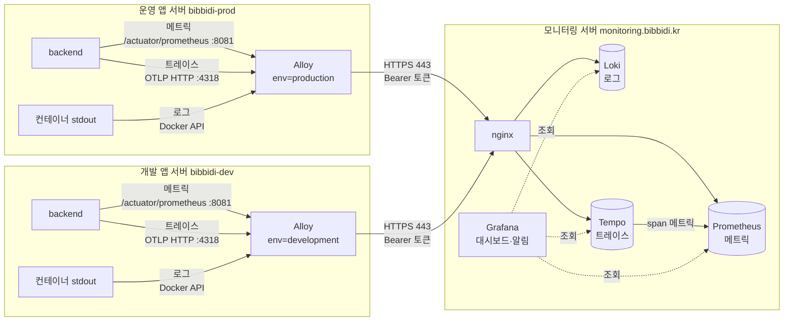

- `수집 (Alloy)` → `저장 (Loki · Prometheus · Tempo)` → `조회 (Grafana)` 순서
- 개발·운영 구분 : `deployment_environment_name` 라벨 (`development` / `production`)

### 모니터링 서버

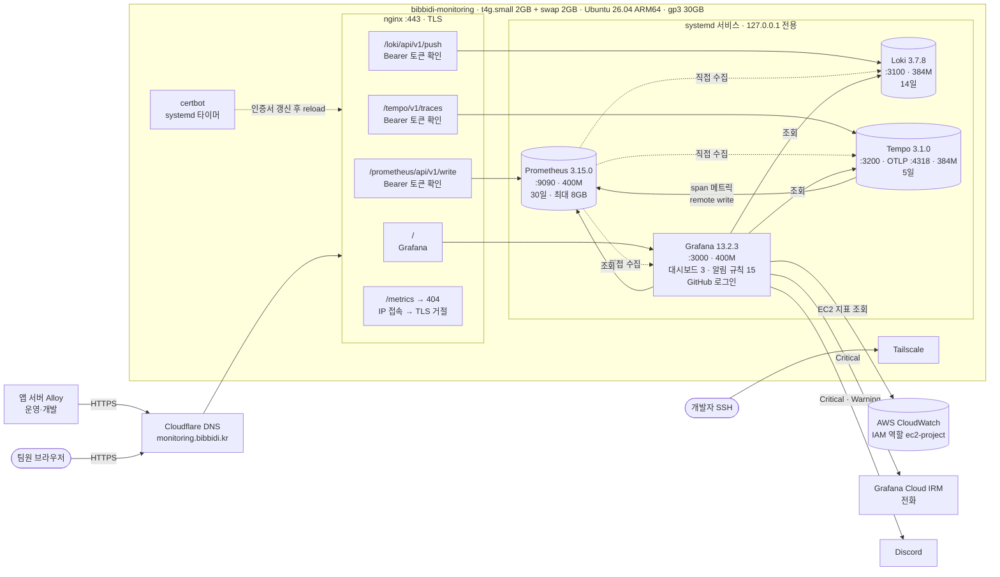

- 주소 : `https://monitoring.bibbidi.kr`
- 서버 : EC2 `bibbidi-monitoring`, 앱 서버와 같은 VPC
    - SSH : Tailscale
    - DNS : Cloudflare (`monitoring` A 레코드)
    - Elastic IP 없음 : **중지 → 시작** 시 퍼블릭 IP가 바뀌므로 A 레코드 수정 필요 (재부팅은 무관)
- 로그인
    - GitHub 로그인 : 등록된 팀원만, 권한 `Editor`
    - `admin` : GitHub 장애 시 비상용 (비밀번호는 팀 비밀번호 관리 도구)
    - 팀원 추가 : 서버 `/etc/grafana/github-oauth.env` 의 `GF_AUTH_GITHUB_ROLE_ATTRIBUTE_PATH` 에 GitHub 아이디 추가 후 Grafana 재시작
- 설정 원본
    - `Infra/monitoring/grafana/{prometheus,loki,tempo}`, `Infra/monitoring/grafana/datasources.yaml`, `Infra/monitoring/nginx/monitoring.conf`
    - 적용 방법 : `Infra/monitoring/README.md` (CD가 아니라 서버에 직접 설치)
    - systemd 설정(메모리 상한, 보존 플래그)·비밀 값(수집 토큰, GitHub OAuth secret)은 서버에만 있음
- 알림 규칙·정책·연락처·대시보드 원본 : 서버 `/var/lib/grafana/grafana.db` 하나뿐 (저장소 보관 X)

---

# 1. 수집

### `Alloy`

- [공식 문서](https://grafana.com/docs/alloy/latest/)
    - Grafana의 수집기. OTel Collector 기반 + Prometheus·Loki 수집 기능, 컴포넌트(수집 → 가공 → 전송)를 이어 파이프라인 구성
- 설정 파일 : 프로젝트에서 `Infra/monitoring/grafana/alloy/config.alloy` 을 참고
    - 해당 파일에서 필요한 변수는 설정 파일 정보 의 `BIBBIDI_ALLOY_ENV` 부분을 참고해주세요.
    - 해당 변수 적용 방식은 CI/CD 를 참고해주세요.
- 앱 서버에만 설치 (개발·운영 모두), MySQL 서버에는 설치 X
- Spring 이 저장소로 직접 보내지 않는 이유 : 마스킹·필터링을 Alloy 한 곳에서 처리, 앱은 모니터링 서버 주소·토큰을 몰라도 됨

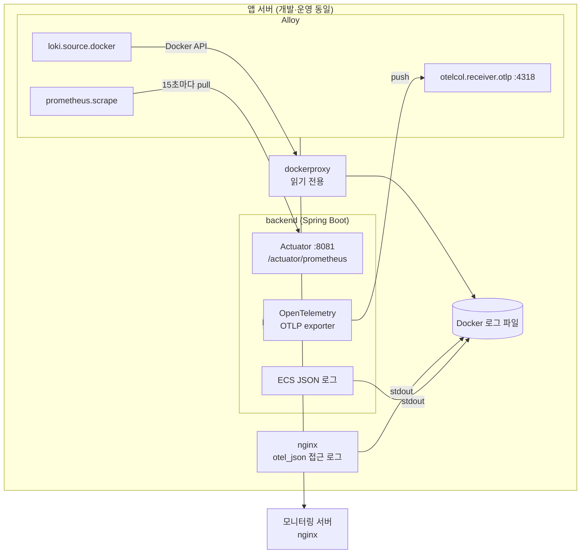

### 데이터

| 종류 | 출처 | 방식 | 컴포넌트 | 보내는 곳 |
| --- | --- | --- | --- | --- |
| 메트릭 | `backend:8081/actuator/prometheus` | Alloy 가 가져감 (pull) | `prometheus.scrape` → `prometheus.remote_write` | Prometheus |
| 로그 | docker container `stdout` | Alloy 가 Docker API 로 읽음 | `loki.source.docker` → `loki.process` → `loki.write` | Loki |
| 트레이스 | backend OTLP (`:4318`) | backend 가 보냄 (push) | `otelcol.receiver.otlp` → `otelcol.processor.batch` → `otelcol.exporter.otlphttp` | Tempo |

### 수집 대상

#### Spring Boot (`bibbidi-backend`)

- 메트릭
    - `actuator` 의존성 활성화, `/actuator/prometheus` 노출 (Micrometer)
    - 관리 포트 `8081` 로 분리 (`management.server.port`)
        - 사용자 요청 포트 `8080` 에는 Actuator 없음
        - 호스트의 `8080`, `8081` 은 `127.0.0.1` 에만 열림, 외부 nginx 의 `/actuator` 는 404
        - Alloy 는 Docker 네트워크 안에서 `backend:8081` 로 접근
- 로그
    - 구조화 로그 : ECS(Elastic Common Schema) JSON 으로 stdout 출력
    - 설정 : `logging.structured.format.console: ecs`
    - 로그에 `trace_id`, `span_id` 가 함께 찍힘
- 트레이스
    - `spring-boot-starter-opentelemetry` 의존성 사용 (Micrometer Tracing + OTel)
    - `management.opentelemetry.tracing.export.otlp.endpoint` = `${OTEL_EXPORTER_OTLP_ENDPOINT:http://alloy:4318}/v1/traces`
    - **100% 수집** (기존 tail sampling 제거)
- 공통 리소스 정보 (`BE/compose.prod.yml` 의 `OTEL_RESOURCE_ATTRIBUTES`)
    - `service.name`, `service.version`, `service.instance.id`, `deployment.environment.name`

```yaml
# BE/compose.prod.yml (backend 일부)
environment:
  OTEL_RESOURCE_ATTRIBUTES: service.name=bibbidi-backend,service.version=1.0.0,service.instance.id=bibbidi-backend-prod,deployment.environment.name=production
  OTEL_EXPORTER_OTLP_ENDPOINT: http://alloy:4318
ports:
  - "127.0.0.1:8080:8080"   # 사용자 요청
  - "127.0.0.1:8081:8081"   # Actuator (관리 포트)
```

#### nginx

- 로그만 수집 (메트릭 X → nginx 상태 코드는 로그로 집계)
- 접근 로그 : OTel 이름 규칙 JSON 으로 stdout 출력 (`log_format otel_json`)
    - 주요 필드 : `severity_text`, `http.request.method`, `url.path`, `http.response.status_code`, `http.request.duration`, `client.address`
    - `severity_text` : 응답 코드로 결정 (nginx `map`) → 5xx `error`, 4xx `warn`, 나머지 `info`
    - `/healthz`, `/actuator` 접근은 로그 남기지 않음 (`access_log off`)

```nginx
# Infra/nginx/nginx.conf.template (일부)
map $status $log_severity {
    ~^5 error;
    ~^4 warn;
    default info;
}

log_format otel_json escape=json
    '{"timestamp":"$time_iso8601",'
    '"severity_text":"$log_severity",'
    '"http.request.method":"$request_method",'
    '"url.path":"$uri",'
    '"http.response.status_code":$status,'
    '"http.request.duration":$request_time,'
    '"client.address":"$remote_addr"}';   # 실제 파일에는 필드가 더 있음
```

#### Docker

- 모든 컨테이너 로그는 `json-file` 드라이버로 앱 서버에 보관 (컨테이너별 10MB × 5개)
- `dockerproxy` (`tecnativa/docker-socket-proxy`)
    - Alloy 가 Docker 소켓을 직접 열지 않도록 하는 읽기 전용 중계
    - 허용 : 컨테이너·네트워크·이벤트 조회, 쓰기(`POST`) 차단
- 수집 대상 컨테이너 : `bibbidi-backend`, `nginx`, `alloy` (`dockerproxy` 로그는 버림)

### 전송

- 세 데이터 모두 `https://monitoring.bibbidi.kr` 로 전송, 같은 Bearer 토큰 사용
    - `MONITORING_INGEST_TOKEN` : 모니터링 서버 nginx 수집 토큰과 같은 값

| 종류 | Alloy 가 보내는 주소 | 모니터링 서버 nginx 가 넘기는 곳 |
| --- | --- | --- |
| 메트릭 | `/prometheus/api/v1/write` | `127.0.0.1:9090/api/v1/write` |
| 로그 | `/loki/api/v1/push` | `127.0.0.1:3100/loki/api/v1/push` |
| 트레이스 | `/tempo/v1/traces` | `127.0.0.1:4318/v1/traces` |
- 토큰이 틀리면 nginx 가 401 반환 → 데이터 저장 X

### 용어

- **OpenTelemetry (OTel)** : 로그·메트릭·트레이스를 만들고 보내는 방법을 정한 오픈 표준 + SDK, 저장소를 바꿔도 앱 코드는 그대로 → [공식 문서](https://opentelemetry.io/docs/what-is-opentelemetry/)
- **OTLP** : OTel 전송 프로토콜. HTTP(`4318`) / gRPC(`4317`), 비비디는 HTTP만 사용 → [공식 문서](https://opentelemetry.io/docs/specs/otlp/)
- **Semantic Conventions** : OTel 필드 이름 규칙 (`http.request.method` 등), nginx 로그에 사용 → [공식 문서](https://opentelemetry.io/docs/specs/semconv/)
- **Micrometer** : Spring 메트릭 라이브러리, 측정값을 Prometheus 형식으로 내보냄 → [공식 문서](https://docs.micrometer.io/micrometer/reference/)
- **ECS** : Elastic 이 정한 로그 필드 이름 규칙 → [공식 문서](https://www.elastic.co/guide/en/ecs/current/index.html)
- 기타 : [Spring Boot 메트릭](https://docs.spring.io/spring-boot/4.0/reference/actuator/metrics.html), [Actuator 관리 포트](https://docs.spring.io/spring-boot/4.0/reference/actuator/monitoring.html), [Spring Boot 구조화 로그](https://docs.spring.io/spring-boot/4.0/reference/features/logging.html#features.logging.structured), [Spring Boot 트레이싱](https://docs.spring.io/spring-boot/4.0/reference/actuator/tracing.html), [nginx log_format](https://nginx.org/en/docs/http/ngx_http_log_module.html#log_format), [docker-socket-proxy](https://github.com/Tecnativa/docker-socket-proxy), [Docker json-file](https://docs.docker.com/engine/logging/drivers/json-file/), [Alloy 컴포넌트 목록](https://grafana.com/docs/alloy/latest/reference/components/)

---

# 2. 로그 : Loki

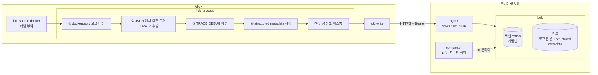

### Alloy 처리 (`config.alloy`)

- `loki.source.docker` : 컨테이너 로그를 읽고 라벨 부여 (`discovery.relabel`)
- `loki.process` : 아래 순서로 가공
    1. `stage.match` : `service_name="dockerproxy"` 로그 버림
    2. `stage.json` : JSON 에서 값 추출
        - `level` ← `log.level` (backend) 또는 `severity_text` (nginx)
        - `scope_name` ← `log.logger`
        - `trace_id`, `span_id` ← `traceId` / `trace.id`, `spanId` / `span.id`
    3. `stage.drop` : `level` 이 TRACE·DEBUG 이면 버림 → INFO 이상만 전송
    4. `stage.structured_metadata` : 추출한 값을 structured metadata 로 저장
    5. `stage.replace` : 민감 정보 마스킹
- `loki.write` : 모니터링 서버로 push

### Loki 에 저장되는 형태

| 구분 | 이름 | 값 | 비고 |
| --- | --- | --- | --- |
| 라벨 (색인) | `service_name` | `bibbidi-backend`, `nginx`, `alloy` | 컨테이너 이름 |
| 라벨 (색인) | `deployment_environment_name` | `production`, `development` |  |
| 라벨 (색인) | `service_instance_id` | `bibbidi-backend-prod` 등 |  |
| structured metadata | `severity_text` | `ERROR`, `WARN`, `info` 등 | backend 는 대문자, nginx 는 소문자 |
| structured metadata | `scope_name` | 로거 이름 | backend 만 |
| structured metadata | `trace_id`, `span_id` | 트레이스 ID | 로그 → 트레이스 이동용 |
| 본문 | - | 원래 JSON 한 줄 (마스킹 후) |  |
- 이전 라벨 `job="bibbidi"`, `compose_service`, `severity_text` 는 **없앰** → 쿼리에 쓰면 결과 없음
- 이전 이름 `traceId`, `spanId` → `trace_id`, `span_id`

예시 : backend 로그 한 줄이 Loki 에 들어가는 모양

```
# backend stdout (ECS JSON, 예시)
{"@timestamp":"2026-10-10T01:23:45.678Z","log":{"level":"ERROR","logger":"kr.bibbidi.auth.OidcClient"},"message":"token request failed, Authorization=Bearer eyJhbGciOi...","traceId":"4bf92f3577b34da6a3ce929d0e0e4736","spanId":"00f067aa0ba902b7"}

# Loki 저장 결과
라벨                : {service_name="bibbidi-backend", deployment_environment_name="production", service_instance_id="bibbidi-backend-prod"}
structured metadata : severity_text="ERROR", scope_name="kr.bibbidi.auth.OidcClient", trace_id="4bf92f...", span_id="00f067..."
본문                : {...,"message":"token request failed, Authorization=[REDACTED]",...}
```

### 민감 정보 마스킹

- `access_token`, `refresh_token`, `authorization`, `cookie`, `password`, `passwd` 값 → `[REDACTED]` (`key=value`, JSON `"key":"value"` 모두)
- `Bearer ...`, `Basic ...` 토큰 → `[REDACTED]`
- 2026-10-06 수정 : 이전 규칙은 값이 그대로 남았음 (`password=abc` → `$1=[REDACTED]=abc`). Grafana Cloud 에 남은 이전 로그는 14일 뒤 자동 삭제

### 저장 (`loki.yaml`)

- 색인 : TSDB (`schema: v13`, structured metadata 에 필요), 24시간 단위
- 본문 : 로컬 디스크 청크 (`/var/lib/loki/chunks`, S3 X)
- 보존 : 14일 (`retention_period: 336h`), compactor 가 10분마다 정리
- 조회 결과 캐시 : 메모리 50MB
- 보관 정리
    - 앱 서버 : 컨테이너별 10MB × 5개
    - Loki : 14일
- **(예정)** 반복 노이즈 로그 제외 (#370 2-4, 운영 로그량 보고 결정)

### 용어

- **라벨 vs structured metadata** : 라벨은 색인(값 종류가 적어야 함, 스트림 선택용), structured metadata 는 색인 X (`trace_id` 처럼 매번 다른 값) → [공식 문서](https://grafana.com/docs/loki/latest/get-started/labels/structured-metadata/)
- 기타 : [loki.source.docker](https://grafana.com/docs/alloy/latest/reference/components/loki/loki.source.docker/), [loki.process](https://grafana.com/docs/alloy/latest/reference/components/loki/loki.process/), [Loki](https://grafana.com/docs/loki/latest/)

---

# 3. 메트릭 : Prometheus

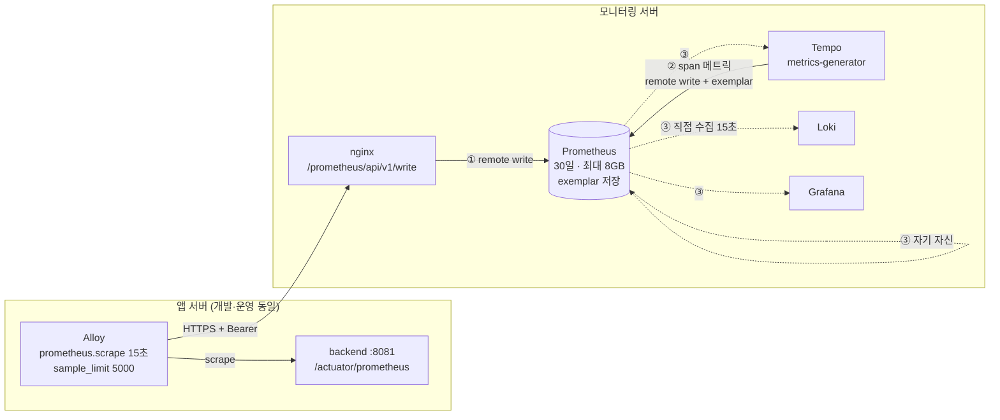

Prometheus 에 들어오는 길은 세 가지

### ① 앱 메트릭 : Alloy → remote write

- `Alloy` 가 `/actuator/prometheus`(`backend:8081`)를 15초마다 `scrape`
    - 이후 모니터링 서버의 `Prometheus` 로 `remote write` 수행
    - 단, `sample_limit = 5000` : 시리즈 폭증 시 수집 포기를 통해 모니터링 서버 부하 방지
- 붙는 라벨
    - `job="prometheus.scrape.bibbidi_backend"` (Alloy 컴포넌트 이름)
    - `instance="backend:8081"`
    - `deployment_environment_name`
- `up` : 수집 성공 1, 실패 0 → backend 가 죽거나 수집 경로가 끊기면 0 또는 없음

```alloy
// Infra/monitoring/grafana/alloy/config.alloy (일부)
prometheus.scrape "bibbidi_backend" {
  targets = [{
    __address__                 = "backend:8081",
    deployment_environment_name = sys.env("DEPLOYMENT_ENVIRONMENT_NAME"),
  }]
  scrape_interval = "15s"
  metrics_path    = "/actuator/prometheus"
  sample_limit    = 5000
  forward_to      = [prometheus.remote_write.monitoring.receiver]
}
```

### ② 트레이스로 만든 메트릭 : Tempo → remote write

- `Tempo` 의 metrics-generator 가 받은 트레이스를 세어 메트릭 생성 → `Prometheus` 로 remote write
    - `traces_spanmetrics_calls_total` : 요청 수 (`status_code` 로 에러 구분)
    - `traces_spanmetrics_latency_bucket` : 응답 시간 분포 (p50·p95·p99 계산용)
    - `traces_service_graph_*` : 서비스 간 호출
- 라벨 : `service`, `span_name`, `span_kind`, `status_code`, `deployment_environment_name`, `source="tempo"`
- exemplar 함께 전송 (`send_exemplars: true`) → 그래프의 점에서 해당 트레이스로 이동
- **API 응답 시간(p95)은 이 메트릭으로 계산** (Spring 히스토그램 사용 X, 앱 변경 없이 사용 가능)
    - 전제 : 트레이스 100% 수집. 샘플링을 낮추면 응답 시간 알림(W2·W3)도 다시 봐야 함

```yaml
# Infra/monitoring/grafana/tempo/tempo.yaml (일부)
metrics_generator:
  storage:
    remote_write:
      - url: http://127.0.0.1:9090/api/v1/write
        send_exemplars: true
overrides:
  defaults:
    metrics_generator:
      processors: ["span-metrics", "service-graphs"]
      processor:
        span_metrics:
          dimensions: ["deployment.environment.name"]   # → deployment_environment_name 라벨
```

### ③ 모니터링 스택 자체 : Prometheus 직접 수집

- `Prometheus` 가 15초마다 직접 `scrape` (`prometheus.yaml`)
    - `job="prometheus"` : 자기 자신 (`127.0.0.1:9090`)
    - `job="loki"` (`:3100`), `job="tempo"` (`:3200`), `job="grafana"` (`:3000`)
- 모니터링 스택이 정상인지, 메모리·수집량·Loki 거부를 보는 데 사용

### 저장

- 보존 : 30일 또는 8GB 중 먼저 닿는 쪽 (systemd 실행 플래그)
- `--web.enable-remote-write-receiver` : remote write 수신 허용
- `--enable-feature=exemplar-storage` : exemplar 저장

### 주요 메트릭

| 메트릭 | 들어오는 길 | 의미 |
| --- | --- | --- |
| `up` | ① | Alloy 가 backend 를 수집할 수 있는지 |
| `http_server_requests_seconds_count` | ① | API 요청 수, 상태 코드 (`status`), 경로 (`uri`) |
| `hikaricp_connections_active` / `_idle` / `_pending` / `_max` | ① | DB 커넥션 풀 |
| `jvm_memory_used_bytes` / `jvm_memory_max_bytes` | ① | 힙 (`area="heap"`) |
| `jvm_gc_live_data_size_bytes` / `jvm_gc_max_data_size_bytes` | ① | GC 직후 남은 데이터 |
| `jvm_gc_pause_seconds_*`, `process_cpu_usage` | ① | GC 일시 정지, JVM CPU |
| `system_cpu_usage`, `system_load_average_1m`, `system_cpu_count` | ① | 앱 서버 CPU·부하 |
| `disk_free_bytes` / `disk_total_bytes` | ① | 앱 서버 디스크 |
| `traces_spanmetrics_calls_total` | ② | API 요청 수·에러 |
| `traces_spanmetrics_latency_bucket` | ② | API 응답 시간 |
| `loki_discarded_samples_total` | ③ | Loki 가 거부한 로그 |
| `process_resident_memory_bytes` | ③ | 모니터링 스택 메모리 |
| `prometheus_tsdb_head_series` | ③ | Prometheus 시리즈 수 |
- 모니터링 서버·DB 서버의 디스크·메모리는 Prometheus 에 없음 (CloudWatch 로 CPU·네트워크·상태 검사만 조회, 5. 조회 참고)

### 용어

- **scrape (pull)** : 수집기가 앱의 메트릭 주소를 주기적으로 가져감 → [prometheus.scrape](https://grafana.com/docs/alloy/latest/reference/components/prometheus/prometheus.scrape/)
- **remote write (push)** : 수집기가 Prometheus 로 밀어 넣음, 모니터링 서버가 앱 서버로 접속할 필요 없음 → [공식 문서](https://prometheus.io/docs/specs/remote_write_spec/)
- **span 메트릭** : Tempo 가 스팬을 세어 만든 메트릭 → [공식 문서](https://grafana.com/docs/tempo/latest/metrics-from-traces/span-metrics/span-metrics-metrics-generator/)
- **exemplar** : 메트릭 값에 그때의 `trace_id` 를 붙인 것 → [공식 문서](https://grafana.com/docs/grafana/latest/fundamentals/exemplars/)
- 기타 : [Prometheus](https://prometheus.io/docs/introduction/overview/)

---

# 4. 트레이스 : Tempo

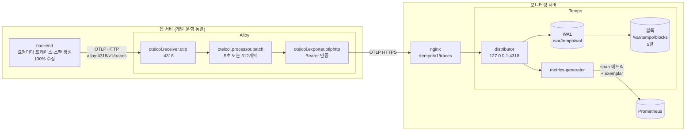

### 흐름

- `backend` 가 요청마다 트레이스·스팬 생성 → `OTLP HTTP` 로 `Alloy` 에 push
- `Alloy`
    - `otelcol.receiver.otlp` : `0.0.0.0:4318` 에서 수신 (Docker 네트워크 안에서만 접근)
    - `otelcol.processor.batch` : 5초 또는 512개 단위로 묶음 (최대 2048개)
    - `otelcol.exporter.otlphttp` : `https://monitoring.bibbidi.kr/tempo` 로 전송, Bearer 토큰 인증 (`otelcol.auth.bearer`)
- 모니터링 서버 `nginx` → `Tempo` distributor (`127.0.0.1:4318`)
- `Tempo`
    - WAL(임시 기록) → 로컬 디스크 블록으로 저장 (S3 X)
    - 보존 5일 (`block_retention: 120h`)
    - metrics-generator 가 span 메트릭 생성 → Prometheus (3. 메트릭 ② 참고)

### Tempo 에 저장되는 정보

- 리소스 속성 (`OTEL_RESOURCE_ATTRIBUTES`) : `service.name`, `service.version`, `service.instance.id`, `deployment.environment.name`
- 스팬 : 이름(`GET /api/...` 형식), 종류(`kind=server` 등), 시작·끝 시각, 상태(`status=error` 등), HTTP·DB 속성
- `trace_id` 는 로그(Loki structured metadata)에도 같은 값으로 남음 → 로그 ↔ 트레이스 이동 가능

### 용어

- **트레이스** : 요청 하나가 시스템을 지나간 전체 경로, 고유 `trace_id`
- **스팬** : 트레이스 안의 작업 한 단위 (HTTP 처리, DB 쿼리, 외부 호출 등) → [공식 문서](https://opentelemetry.io/docs/concepts/signals/traces/)
- **컨텍스트 전파** : `trace_id` 를 로그·다음 호출에 넘겨 같은 요청으로 묶음, 표준은 W3C Trace Context (`traceparent` 헤더) → [공식 문서](https://www.w3.org/TR/trace-context/)
- **샘플링** : 트레이스를 전부 저장할지 일부만 저장할지 정하는 것 (비비디는 100%)
- 기타 : [otelcol.receiver.otlp](https://grafana.com/docs/alloy/latest/reference/components/otelcol/otelcol.receiver.otlp/), [Tempo](https://grafana.com/docs/tempo/latest/)

---

# 5. 조회 : Grafana

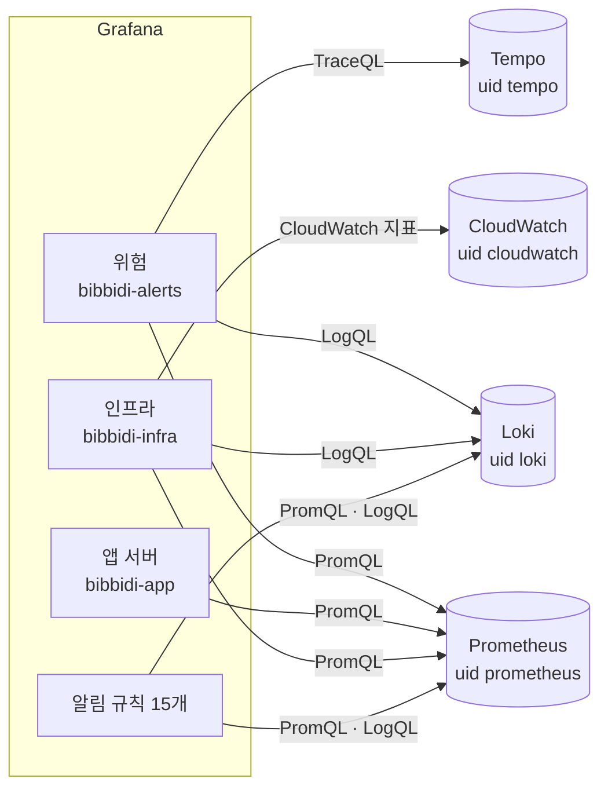

### 데이터소스

| 데이터소스 | uid | 주소 | 조회 언어 | 무엇을 가져오나 |
| --- | --- | --- | --- | --- |
| Prometheus | `prometheus` | `127.0.0.1:9090` | **PromQL** | 앱 메트릭, span 메트릭, 모니터링 스택 메트릭 |
| Loki | `loki` | `127.0.0.1:3100` | **LogQL** | backend·nginx·alloy 로그 |
| Tempo | `tempo` | `127.0.0.1:3200` | **TraceQL** | 트레이스, 서비스 맵 |
| CloudWatch | `cloudwatch` | AWS API (`ap-northeast-2`) | CloudWatch 지표 (네임스페이스·지표·차원) | EC2 4대 CPU·크레딧·네트워크·상태 검사 |
- 모두 `datasources.yaml` provisioning 으로 생성 (화면에서 수정 X, 화면에서 추가하면 uid 가 달라져 패널이 깨짐)
- CloudWatch 인증 : 모니터링 서버 IAM 역할 `ec2-project` (키 없음), 조회마다 `GetMetricData` 요금 발생

조회 언어

- **PromQL** : 메트릭 시계열 조회. `rate()` 로 초당 증가량, `histogram_quantile()` 로 백분위 계산 → [공식 문서](https://prometheus.io/docs/prometheus/latest/querying/basics/)
- **LogQL** : 로그 조회. `{라벨} | 필터 | 파서` 순서, `count_over_time()` 으로 로그 줄 수를 숫자로 변환 → [공식 문서](https://grafana.com/docs/loki/latest/query/)
- **TraceQL** : 트레이스 조회. `{조건}` 으로 스팬 속성·시간·상태 검색 → [공식 문서](https://grafana.com/docs/tempo/latest/traceql/)
- **CloudWatch** : 네임스페이스(`AWS/EC2`) + 지표 이름 + 차원(`InstanceId`) 지정 → [공식 문서](https://grafana.com/docs/grafana/latest/datasources/aws-cloudwatch/)

### 데이터소스 사이 이동

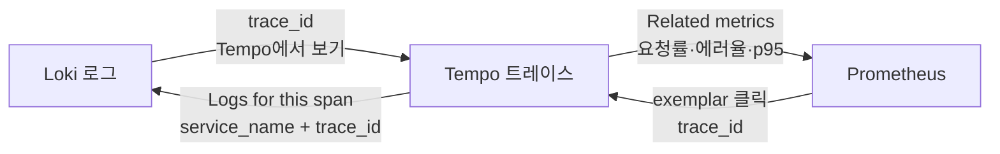

- 정의 : `Infra/monitoring/grafana/datasources.yaml`
    - Loki → Tempo : `derivedFields` (structured metadata `trace_id`)
    - Tempo → Loki : `tracesToLogsV2` (`{service_name=...} | trace_id="..."`)
    - Tempo → Prometheus : `tracesToMetrics` (요청률·에러율·p95 쿼리), `serviceMap`
    - Prometheus → Tempo : `exemplarTraceIdDestinations`
- [Tempo trace to logs 공식 문서](https://grafana.com/docs/grafana/latest/datasources/tempo/configure-tempo-data-source/configure-trace-to-logs/)

### 대시보드

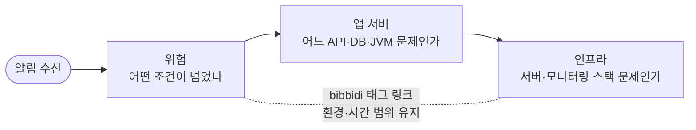

- 세 대시보드 공통
    - 환경 변수 `$env` : `label_values(up{job="prometheus.scrape.bibbidi_backend"}, deployment_environment_name)`
    - `bibbidi` 태그로 서로 링크, 환경·시간 범위 유지
- **(예정)** 대시보드 JSON 저장소 보관, 면접관용 공개 대시보드
- [Grafana 대시보드 공식 문서](https://grafana.com/docs/grafana/latest/dashboards/)

#### 위험 (`bibbidi-alerts`) : 알림 받았을 때

- 기본 환경 `production`, 색 = 알림 등급 (주황 Warning, 빨강 Critical)
- 알림 메시지의 대시보드 링크가 이 대시보드의 패널 번호 사용 → 패널 삭제·재생성 시 규칙 링크도 수정
- 조건 숫자 패널은 **알림 규칙과 같은 쿼리**

| 패널 | 데이터소스 |
| --- | --- |
| 울리는 알림 | Grafana 알림 목록 |
| C2 backend 수집, W1·C1 5xx, W8·C5 Hikari, W6·C4 디스크, C6 GC 직후 남은 데이터, W2·W3 p95, W9 힙, W7 Loki 수집 거부 | Prometheus |
| C3 nginx 502·503·504, W4 ERROR 로그, W5 OIDC 공개 키 | Loki |
| 에러 요청, 느린 요청 | Tempo |
| backend ERROR, nginx 5xx, OIDC 공개 키 로그 | Loki |

```promql
# C2 backend 수집
max(up{job="prometheus.scrape.bibbidi_backend", deployment_environment_name="$env"})

# W1·C1 5xx (5분)
round(sum(increase(http_server_requests_seconds_count{deployment_environment_name="$env", status=~"5.."}[5m]))) or vector(0)

# W2 API p95 (Tempo span 메트릭, 콜백·actuator 제외)
histogram_quantile(0.95, sum by (le) (rate(traces_spanmetrics_latency_bucket{deployment_environment_name="$env", span_kind="SPAN_KIND_SERVER", span_name!~".*/callback", span_name!~".*actuator.*"}[5m])))

# C6 GC 직후 남은 데이터 비율
max(jvm_gc_live_data_size_bytes{deployment_environment_name="$env"}) / max(jvm_gc_max_data_size_bytes{deployment_environment_name="$env"})
```

```logql
# C3 nginx 502·503·504 (5분)
sum(count_over_time({service_name="nginx", deployment_environment_name="$env"} | json | http_response_status_code=~"502|503|504" [5m])) or vector(0)

# W4 ERROR 로그 (5분, GlobalExceptionHandler 제외)
sum(count_over_time({service_name="bibbidi-backend", deployment_environment_name="$env"} | severity_text=~"(?i)error|fatal" | scope_name!~".*GlobalExceptionHandler" [5m])) or vector(0)

# nginx 5xx 로그 목록
{service_name="nginx", deployment_environment_name="$env"} | json | http_response_status_code >= 500
```

```traceql
# 에러 요청
{resource.deployment.environment.name="$env" && kind=server && status=error}

# 느린 요청 (API 1초, 소셜 콜백 3초 초과)
{resource.deployment.environment.name="$env" && kind=server && duration > 1s && name !~ ".*/callback"}
|| {resource.deployment.environment.name="$env" && kind=server && duration > 3s && name =~ ".*/callback"}
```

#### 앱 서버 (`bibbidi-app`) : 평소 상태 확인

- 모든 패널 Prometheus (PromQL)

| 행 | 패널 | 메트릭 |
| --- | --- | --- |
| 지금 상태 | backend 수집, 요청(초당), 5xx 비율, p95, 힙 사용률, 업타임 | `up`, `http_server_requests_seconds_count`, `traces_spanmetrics_latency_bucket`, `jvm_memory_*`, `process_uptime_seconds` |
| 트래픽과 API | 상태 코드별 요청, p50·p95·p99 (exemplar), 요청 많은·느린·에러 많은 API Top 10 | `http_server_requests_seconds_count`, `traces_spanmetrics_*` |
| DB · JVM | Hikari 커넥션, 힙, CPU · GC 일시정지 | `hikaricp_connections_*`, `jvm_memory_*`, `jvm_gc_*`, `process_cpu_usage` |

```promql
# 5xx 비율 (5분, actuator 제외)
sum(rate(http_server_requests_seconds_count{deployment_environment_name="$env", uri!~"/actuator.*", status=~"5.."}[5m]))
  / clamp_min(sum(rate(http_server_requests_seconds_count{deployment_environment_name="$env", uri!~"/actuator.*"}[5m])), 1e-9)

# 느린 API Top 10 (p95, 5분)
topk(10, histogram_quantile(0.95, sum by (span_name, le) (rate(traces_spanmetrics_latency_bucket{deployment_environment_name="$env", span_kind="SPAN_KIND_SERVER", span_name!~".*actuator.*"}[5m]))))

# 에러 많은 API Top 10 (5분)
topk(10, round(sum by (span_name) (increase(traces_spanmetrics_calls_total{deployment_environment_name="$env", span_kind="SPAN_KIND_SERVER", status_code="STATUS_CODE_ERROR"}[5m]))) > 0)
```

#### 인프라 (`bibbidi-infra`) : 서버 점검

- EC2 변수 : `이름 : 인스턴스 ID` Custom 변수 (`bibbidi-prod`, `bibbidi-dev`, `bibbidi-mysql`, `bibbidi-monitoring`) → 인스턴스 재생성 시 ID 수정
- 자동 새로고침 5분 (CloudWatch 조회 요금)

| 행 | 패널 | 데이터소스 |
| --- | --- | --- |
| 앱 서버 호스트 | 디스크 사용률, 서버 CPU · 부하 | Prometheus |
| 앱 서버 호스트 | nginx 상태 코드, 컨테이너별 로그량 | Loki |
| 모니터링 스택 | 구성 요소 UP, 메모리(RSS), 수집량, Loki 수집 거부, Prometheus 시리즈 | Prometheus |
| EC2 (서버별 반복) | CPU 사용률, CPU 크레딧 잔액, 네트워크, 상태 검사 실패 | CloudWatch |

```promql
# 앱 서버 디스크 사용률
1 - max(disk_free_bytes{deployment_environment_name="$env"}) / max(disk_total_bytes{deployment_environment_name="$env"})

# 모니터링 스택 메모리
process_resident_memory_bytes{job=~"prometheus|loki|tempo|grafana"}

# 수집량
sum(rate(loki_distributor_bytes_received_total[$__rate_interval]))            # Loki (B/s)
sum(rate(tempo_distributor_spans_received_total[$__rate_interval]))           # Tempo (spans/s)
sum(rate(prometheus_http_requests_total{handler="/api/v1/write"}[$__rate_interval]))  # Prometheus (req/s)
```

```logql
# nginx 상태 코드별 요청 수
sum by (http_response_status_code) (count_over_time({service_name="nginx", deployment_environment_name="$env"} | json | __error__="" | http_response_status_code != "" [$__auto]))

# 컨테이너별 로그량
sum by (service_name) (count_over_time({deployment_environment_name="$env"} [$__auto]))
```

```
# CloudWatch (Metrics 쿼리)
네임스페이스 : AWS/EC2
지표        : CPUUtilization, CPUCreditBalance, NetworkIn, NetworkOut, StatusCheckFailed
차원        : InstanceId = $instance
```

### 에러 추적 방법

1. Loki 에서 에러 로그 찾기

```logql
{service_name="bibbidi-backend", deployment_environment_name="production"} | severity_text=~"(?i)error|fatal"
```

1. nginx 5xx·느린 요청 확인

```logql
{service_name="nginx", deployment_environment_name="production"} | severity_text="error"
{service_name="nginx", deployment_environment_name="production"} | json | http_request_duration > 1
```

1. 로그 펼치기 → **Tempo에서 보기** 로 트레이스 열기 (`trace_id`)
    - 100% 수집이라 정상 요청의 트레이스도 있음
2. 트레이스에서 느리거나 실패한 구간 확인 (DB, 외부 OAuth 호출 등)
    - **Logs for this span** → 같은 `trace_id` 로그
    - **Related metrics** → 해당 서비스 요청률·에러율·p95
3. 반대로 메트릭에서 시작했다면 그래프의 exemplar 점 클릭 → 트레이스

---

# 6. 알림

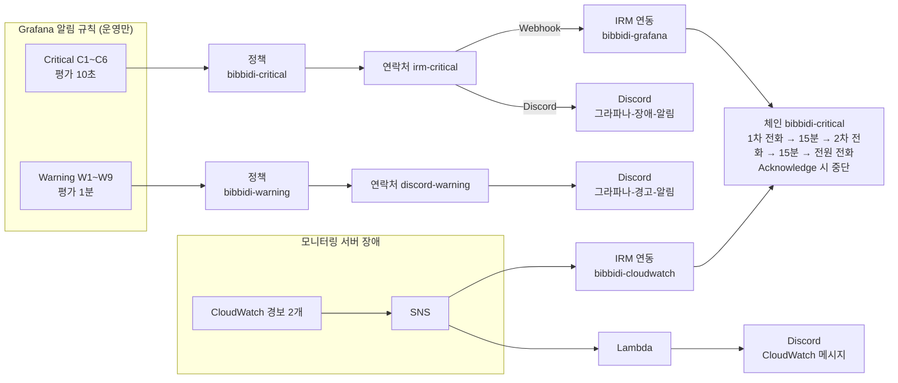

- 운영(`deployment_environment_name="production"`)만 알림
- 규칙 **15개** (Critical 6, Warning 9) + 모니터링 서버 장애 경보 2개 (CloudWatch)
- 규칙은 Grafana 화면에서만 관리 (저장소 보관 X)
    - 쿼리는 위험 대시보드의 조건 패널과 같음 (5. 조회 참고)
    - No data → Normal, Error → Error (데이터 끊김은 C2 가 따로 잡음)
    - 라벨 : `severity` (`critical` / `warning`), `alert_id` (`C1`~`C6`, `W1`~`W9`)

### 라우팅

| 등급 | 평가 주기 | 정책 | 연락처 | 도착지 |
| --- | --- | --- | --- | --- |
| Critical | 10초 | `bibbidi-critical` | `irm-critical` (Webhook + Discord) | IRM **전화** + `#그라파나-장애-알림` |
| Warning | 1분 | `bibbidi-warning` | `discord-warning` | `#그라파나-경고-알림` |
| (정책 미선택) | - | 기본 정책 | `discord-warning` | `#그라파나-경고-알림` |
- 규칙마다 정책을 직접 선택 (하위 정책 라우팅 X)
    - 새 규칙 만들 때 정책 선택 필수. Critical 규칙이 `#그라파나-경고-알림` 에 보이면 정책 선택 확인
- Warning 은 IRM 으로 보내지 않음 (전화 X)

### 온콜 : Grafana Cloud IRM

- 무료 플랜 (활성 사용자 최대 3명), 서버 개발자 3명 대상
- 일정
    - `bibbidi-oncall` : 1차 당번
    - `bibbidi-oncall-secondary` : 2차 당번 (1차 순서를 한 칸 민 보조 일정)
    - 주간 교대 (월요일 10:00 KST), 24시간
- 연동 (URL 은 비밀 값, 문서·저장소에 기록 X)
    - `bibbidi-grafana` (Alertmanager) : Grafana Critical 규칙
    - `bibbidi-cloudwatch` (Amazon SNS) : 모니터링 서버 장애
- 개인 설정 : IRM 앱 설치, 전화번호 인증, Default = 푸시, Important = 전화 → 푸시
- 당번 바꾸기 : 일정의 override 로 대신 설 사람 지정
- 새 당번 추가
    1. grafana.com 조직 역할 `Editor` 로 변경 (Viewer 는 일정에 못 넣음)
    2. IRM 앱 설치, 전화번호 인증
    3. 일정 2개와 체인 5단계에 추가
    - 4명 이상이면 유료 (1명당 월 $20)
- [Grafana Alerting 공식 문서](https://grafana.com/docs/grafana/latest/alerting/), [Grafana IRM 공식 문서](https://grafana.com/docs/grafana-cloud/alerting-and-irm/irm/)

### Critical : IRM 전화 + `#그라파나-장애-알림`

| # | 규칙 | 조건 | 데이터 |
| --- | --- | --- | --- |
| C1 | 500 반복 | 5분 안에 5xx 2건 이상 | Prometheus `http_server_requests_seconds_count` |
| C2 | backend 수집 실패 | `up < 1` 또는 지표 없음(`absent`), 1분 지속 | Prometheus `up` |
| C3 | nginx 게이트웨이 오류 | 5분 안에 502·503·504 10건 이상 (배포 중 교체 구간 허용) | Loki nginx `http_response_status_code` |
| C4 | 디스크 90% | 1분 지속 | Prometheus `disk_free_bytes` / `disk_total_bytes` |
| C5 | Hikari 포화 | 대기 3개 이상 또는 사용 중 = 최대, 30초 지속 | Prometheus `hikaricp_connections_pending`, `_active`, `_max` |
| C6 | 힙 고갈 직전 | GC 직후 남은 데이터 80% 초과, 1분 지속 | Prometheus `jvm_gc_live_data_size_bytes` / `jvm_gc_max_data_size_bytes` |

### Warning : `#그라파나-경고-알림`

| # | 규칙 | 조건 | 데이터 |
| --- | --- | --- | --- |
| W1 | 500 발생 | 5분 안에 5xx 1건 이상 | Prometheus `http_server_requests_seconds_count` |
| W2 | API p95 | 1초 초과, 10분 지속 (소셜 콜백·actuator 제외) | Prometheus `traces_spanmetrics_latency_bucket` (서버 스팬) |
| W3 | 소셜 로그인 p95 | 3초 초과, 10분 지속 (OIDC 콜백·탈퇴 동의 철회 콜백) | Prometheus `traces_spanmetrics_latency_bucket` (`span_name=~".*/callback"`) |
| W4 | ERROR 로그 | 5분 안에 1건 이상, `GlobalExceptionHandler` 제외 | Loki `severity_text`, `scope_name` |
| W5 | OIDC 공개 키 갱신 실패 | 5분 안에 WARN 1건 이상 | Loki `scope_name=~".*OidcPublicKeyWarmUpScheduler"` |
| W6 | 디스크 80% | 10분 지속 | Prometheus `disk_free_bytes` / `disk_total_bytes` |
| W7 | Loki 수집 거부 | 10분 안에 버려진 로그 1건 이상 (환경 구분 X) | Prometheus `loki_discarded_samples_total` |
| W8 | Hikari 대기 | 대기 1개 이상, 1분 지속 | Prometheus `hikaricp_connections_pending` |
| W9 | 힙 사용률 | 75% 초과, 3분 지속 | Prometheus `jvm_memory_used_bytes` / `jvm_memory_max_bytes` (heap) |

### 모니터링 서버 장애 : IRM 전화 + Discord

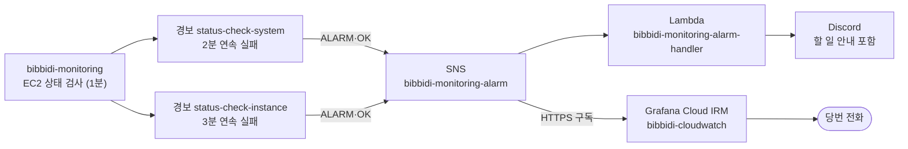

- 모니터링 서버가 죽으면 Grafana 알림도 멈춤 → AWS 가 따로 감시
- 경보별 대응 (Discord 메시지에 함께 옴)
    - `bibbidi-monitoring-status-check-system` (AWS 하드웨어) : EC2 콘솔에서 **중지 후 시작** + Cloudflare A 레코드 수정
    - `bibbidi-monitoring-status-check-instance` (OS 응답 없음) : EC2 콘솔에서 **재부팅**
- OK 가 오면 IRM 알림 자동 해소
- 자동 복구·재부팅 없음 (계정 권한 부족) → 사람이 직접 복구
- Lambda 코드 : `Infra/monitoring/lambda/lambda_function.py` (Python 3.13, arm64, 콘솔 수동 배포)
- 한계 : 인스턴스는 살아 있고 Grafana 만 죽은 경우는 못 잡음 **(예정: Synthetic Monitoring)**
- [EC2 상태 검사 공식 문서](https://docs.aws.amazon.com/AWSEC2/latest/UserGuide/monitoring-system-instance-status-check.html)

### 한계와 남은 일

- 컨테이너가 `mem_limit` (1200MB) 초과로 강제 종료되는 경우는 미리 못 잡음 → 재시작 후 C2 로만 확인
- 앱이 죽으면 디스크 메트릭도 끊김 → C2 가 먼저 울림
- **(예정)** Synthetic Monitoring (`https://monitoring.bibbidi.kr/api/health`, 서비스 주소 외부 점검)
- **(예정)** `/var/lib/grafana/grafana.db` 주기적 백업

---

# 7. 장애 등급 정의

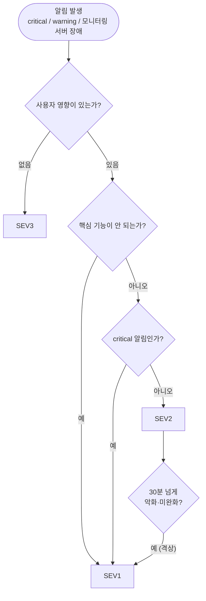

- 모든 규칙이 운영만 감시 → "운영 환경인가?" 판단은 알림 단계에서 끝남. 개발 환경 문제는 알림 없이 SEV3

### 등급

| 등급 | 판단 기준 (하나라도 해당) | 해당 알림 |
| --- | --- | --- |
| **SEV1 · 서비스 장애** | 운영 API 대부분 사용 불가 (5xx 반복, backend 다운, 게이트웨이 오류 급증) / 핵심 기능(로그인, 준비 목록·체크리스트) 동작 X / DB 커넥션 풀 포화로 타임아웃 / 디스크·힙 고갈 직전 / 데이터 손실·유출 의심 | Critical C1~C6 |
| **SEV2 · 기능 저하** | 쓸 수는 있지만 느리거나 일부 실패 (5xx 발생, p95 1초 초과, 소셜 로그인 3초 초과) / 핵심 아닌 기능 하나 동작 X 또는 우회 가능 / 장애로 번질 신호 (에러 로그, 디스크 80%, 커넥션 대기, 힙 75%) | Warning W1~W6, W8, W9 |
| **SEV3 · 경미** | 사용자 영향 없음 / 개발 환경 장애 전부 / 사용자와 무관한 운영 문제 (TLS 갱신 실패, 수집 일부 누락, **모니터링 서버 장애**) | W7, 모니터링 서버 장애 경보 2개 |
- 모니터링 서버 장애는 서비스 영향이 없지만 복구 전까지 모든 알림이 멈추므로 전화로 받음

### 등급별 목표 대응 시간

| 단계 | SEV1 | SEV2 | SEV3 |
| --- | --- | --- | --- |
| 인지·선언 | **15분 안에** IRM Acknowledge (없으면 2차 당번에게 넘어감) | 활동 시간 기준 **1시간 안에** | 다음 업무일 |
| 전파 | 선언 즉시 팀 채널 공지, **30분마다** 공유 | - | - |
| 완화 | **1시간 안에** 사용자 영향 제거 (롤백 우선) | **당일 안에** 원인 파악·완화 | - |
| 복구 | **당일 안에** 수정 배포 또는 계획 확정 | **3일(업무일) 안에** 수정 배포 | 일반 Issue 로 처리 (모니터링 서버 장애는 **당일**) |
| 회고 | **2일(업무일) 안에** 작성 | 반복되면 작성 | - |

### 등급 조정

- 알림 등급과 실제가 다르면 **사용자 영향 기준으로 재판단**
    - Warning 이라도 핵심 기능이 안 되면 SEV1
    - Critical 이라도 사용자 영향 없으면 SEV3 (예 : C1 이 울렸지만 한 사용자의 일시적 오류)
- **격상** : SEV2 가 **30분 넘게** 악화·미완화 → SEV1
- **애매하면 높은 등급으로** 시작, 확인 뒤 내림

### 알림 규칙과 등급 매핑

- **SEV1** (Critical, IRM 전화)
    - C1 500 반복 → 같은 오류가 반복되는 중
    - C2 backend 수집 실패 → backend 다운 (또는 수집 경로 장애)
    - C3 nginx 게이트웨이 오류 → backend 에 요청이 닿지 않음
    - C4 디스크 90% → 곧 로그·DB 쓰기 실패
    - C5 Hikari 포화 → DB 커넥션 풀 포화
    - C6 힙 고갈 직전 → 곧 OOM 또는 GC 로 멈춤
- **SEV2** (Warning, Discord)
    - W1 500 발생, W2 API p95 1초 초과, W3 소셜 로그인 3초 초과
    - 전조 : W4 ERROR 로그, W5 OIDC 공개 키 갱신 실패 (키가 바뀌면 로그인 실패), W6 디스크 80%, W8 Hikari 대기, W9 힙 75%
- **SEV3**
    - W7 Loki 수집 거부 → 로그 일부 누락
    - 모니터링 서버 상태 검사 실패 → 서비스 영향 없음, 단 당일 복구

---

# 8. 대응 절차 (Runbook)

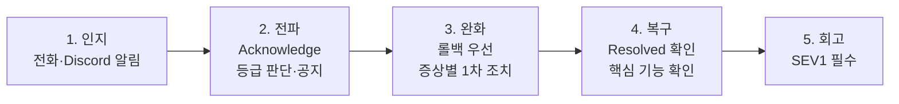

> 완화 단계에서는 원인을 찾기보다 **직전 정상 버전으로 되돌리는 것**을 먼저 검토
> 

### 1. 인지

- 알림 수신
    - Critical : IRM **전화** (당번) + `#그라파나-장애-알림`
    - Warning : `#그라파나-경고-알림`
    - 모니터링 서버 장애 : IRM **전화** + Discord (CloudWatch 메시지, 할 일 포함)
- 사용자 피드백 (Discord Webhook) 또는 팀원 제보
- 확인할 것
    - 알림의 `alert_id` (C1~C6, W1~W9) 와 규칙 이름
    - 최근 배포 여부 (GitHub Actions 운영 CD 실행 이력)
    - 알림 메시지 링크로 **위험** 대시보드 열기 (`https://monitoring.bibbidi.kr`, GitHub 로그인)

### 2. 전파

- Critical 이면 IRM 앱에서 **Acknowledge** (에스컬레이션 중단 = 1차 대응자 선언)
- `#그라파나-장애-알림` 해당 알림 스레드에 "확인함, 대응 중" 남기기
- 등급 판단 (7. 장애 등급 정의 참고)
- SEV1 이면 팀 채널 공지
    - 무엇이 : 증상 한 줄
    - 언제부터 : 알림 시각
    - 영향 : 어떤 기능이 안 되는지
    - 다음 공유 시각 : 30분 뒤 등

### 3. 완화

- **최근 배포가 있었다면** → 롤백 먼저 검토
    - 이전 SHA 이미지로 즉시 되돌리기 (CI/CD 문서 "롤백 실행 절차" 참고)
- 완화 조치마다 시각·내용을 스레드에 기록

| 증상 | 알림 | 1차 조치 |
| --- | --- | --- |
| backend 다운 · 수집 실패 | C2 | `docker ps` → `docker logs --tail=200 bibbidi-backend` 로 기동 실패 원인 확인. 스키마 불일치(`ddl-auto: validate`)면 마이그레이션 확인. backend 가 정상이면 alloy 로그에서 401·error 확인 (401 = `MONITORING_INGEST_TOKEN` 불일치), 모니터링 서버 상태도 확인 |
| 5xx | C1, W1 | 위험 대시보드에서 5xx API 확인 → Loki 에러 로그 → `trace_id` 로 Tempo 추적 (5. 조회 > 에러 추적 방법) |
| nginx 게이트웨이 오류 | C3 | `curl -s http://127.0.0.1:8081/actuator/health` 로 backend 생존 확인. 배포 중이면 교체 구간인지 확인. nginx 로그 `http.request.duration` 30초 초과 요청 확인 (`proxy_read_timeout` 30초) |
| 디스크 | C4, W6 | `df -h /`, `docker system df` 로 확인 → `docker image prune -a` (실행 중 이미지·롤백용 직전 이미지가 남는지 먼저 확인). Docker 로그는 컨테이너별 최대 50MB 라 보통 원인 아님 |
| DB 커넥션 풀 | C5, W8 | `bibbidi-mysql` 상태·느린 쿼리 확인. 풀 크기(`DB_POOL_SIZE`, 현재 10) 조정은 마지막에 |
| 힙 | C6, W9 | 최근 배포 변경, GC 일시 정지 확인. 임시 완화 : `docker restart bibbidi-backend` (compose 명령은 `IMAGE_TAG` 등 환경 변수가 필요해 컨테이너 직접 재시작) |
| 응답 지연 | W2, W3 | 위험 대시보드 느린 요청 트레이스에서 오래 걸린 구간 확인. W3 이면 Kakao·Google OAuth 응답 시간부터 |
| ERROR 로그 | W4 | 위험 대시보드 backend ERROR 로그에서 로거(`scope_name`)·메시지 확인 → `trace_id` 로 트레이스 |
| OIDC 공개 키 갱신 실패 | W5 | 위험 대시보드 OIDC 로그에서 제공자(Kakao·Google) 확인 → 앱 서버에서 제공자 공개 키 주소 접속 확인 |
| Loki 수집 거부 | W7 | 인프라 대시보드 Loki 거부 패널에서 이유 확인 (속도 제한, 오래된 로그 등), 컨테이너별 로그량 급증 확인 |

수집 경로 확인 (C2 인데 backend 는 정상일 때)

```bash
docker logs alloy --since 10m 2>&1 | grep -iE '401|error'
```

모니터링 서버 장애 (CloudWatch 경보, Grafana 접속 불가, 데이터 끊김)

- 서비스 영향은 없음. 단, 복구 전까지 Grafana 알림이 오지 않음
- CloudWatch 경보로 왔다면 Discord 메시지의 **할 일** 수행
    - 시스템 상태 검사 실패 : EC2 콘솔에서 **중지 → 시작** (재부팅으로는 호스트가 안 바뀜) → 새 퍼블릭 IP 로 Cloudflare `monitoring` A 레코드 수정
    - 인스턴스 상태 검사 실패 : EC2 콘솔에서 **재부팅**
- 인스턴스가 살아 있으면 SSH (Tailscale) 접속 후

```bash
systemctl status prometheus loki tempo grafana-server nginx
free -h
systemctl show <서비스> -p MemoryCurrent -p MemoryMax
df -h /
sudo journalctl -u <서비스> --since "30 min ago" --no-pager | tail -50
```

- 복구 후 `up{deployment_environment_name="production"}` 가 다시 1 인지 확인

### 4. 복구

- 확인 기준
    - 알림이 `Resolved` 로 바뀜 (IRM 알림 그룹도 자동 해소)
    - 위험 대시보드 조건 숫자가 기준 아래로 복귀
    - 핵심 기능 직접 확인 (로그인, 체크리스트 조회)
- 코드 수정이 필요하면 새 Issue 로 `hotfix/*` 브랜치에서 진행 (Git 컨벤션)
- 팀 채널에 복구 공지

### 5. 회고

- SEV1 필수, SEV2 는 반복될 때
- 템플릿
    - 요약 : 무엇이 얼마나 영향을 줬나
    - 타임라인 : 인지, 전파, 완화, 복구 시각
    - 원인 : 직접 원인과 그렇게 된 배경
    - 잘된 점 · 아쉬운 점
    - 후속 조치 : Issue 링크와 담당자
