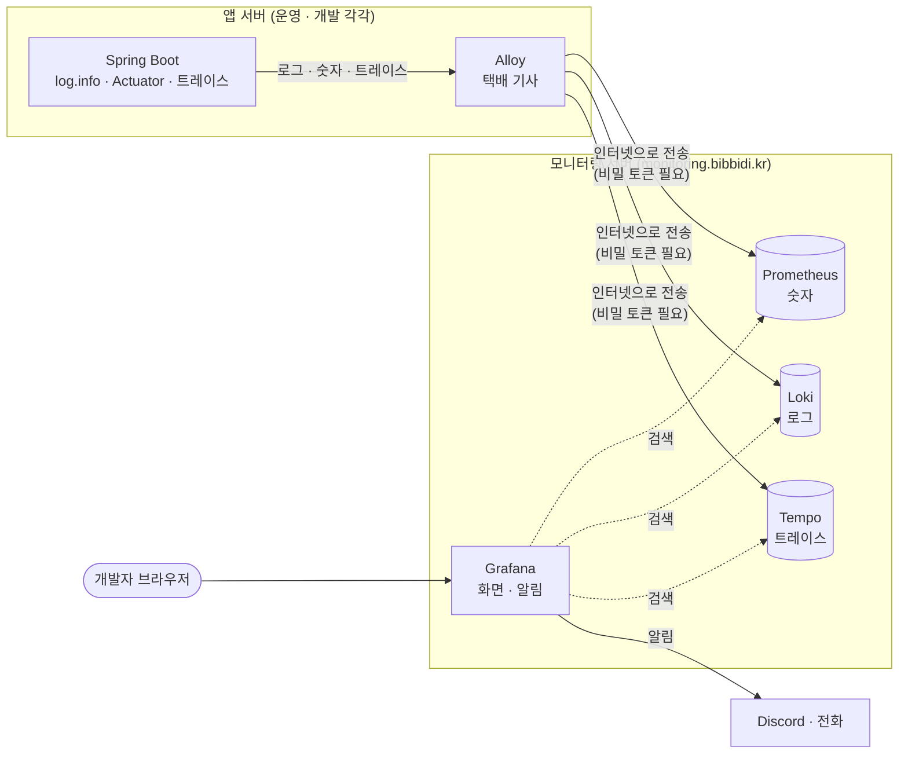

# 먼저 읽기 : `log.info()` 한 줄에서 시작하는 모니터링

> 이 문서는 SLF4J 로 `log.info()` 를 찍어 본 적만 있다고 가정하고 씁니다.
> 다섯 도구(Alloy · Prometheus · Loki · Tempo · Grafana)를 읽기 전에 이것부터 읽어 주세요.

---

## 1. 내가 찍은 로그는 어디로 가나

```java
@Slf4j
@RestController
class WeddingController {
    @GetMapping("/api/weddings/{id}")
    Wedding find(@PathVariable Long id) {
        log.info("결혼 정보 조회 id={}", id);
        return weddingService.find(id);
    }
}
```

- **내 컴퓨터에서 실행하면** : IntelliJ 콘솔에 찍힙니다. 끝
- **운영 서버에서는** : 앱이 Docker 컨테이너 안에서 돌고 있어서, 로그는 컨테이너의 **표준 출력(stdout)** 으로 나갑니다
    - 콘솔에 찍히는 것과 같은 곳이라고 생각하면 됩니다
    - Docker 가 이걸 서버 디스크의 파일에 모아 둡니다
    - 그래서 운영 로그를 보려면 서버에 접속해서 이렇게 해야 합니다

```bash
ssh bibbidi-prod
docker logs bibbidi-backend | grep ERROR
```

---

## 2. 이 방식이 왜 불편한가

운영에서 "로그인이 안 돼요" 라는 제보가 왔다고 해 봅시다.

| 하고 싶은 것 | `docker logs` 로는 |
| --- | --- |
| 에러 로그 찾기 | 서버마다 SSH 로 들어가서 grep. 운영 · 개발 서버를 따로 봐야 함 |
| 어제 로그 보기 | 컨테이너를 새로 띄우면(배포하면) 이전 로그가 사라짐 |
| "지금 1초에 요청이 몇 개 들어오지?" | 로그를 직접 세야 함 |
| "메모리가 얼마나 찼지?" | 로그에 안 찍혀 있음 |
| "로그인 API 가 3초 걸렸는데, 어디서 오래 걸렸지?" | 시작 로그와 끝 로그만 있어서 중간을 모름 |
| "에러가 나면 바로 알려 줘" | 누군가 계속 보고 있어야 함 |

그래서 모니터링 시스템을 만듭니다. 핵심은 **서버 안에 흩어진 정보를 한곳에 모아서, 브라우저로 검색하고, 이상하면 알려 주는 것**입니다.

---

## 3. 모으는 정보는 세 종류

로그만으로는 위 질문에 다 답할 수 없어서, 성격이 다른 정보 세 가지를 모읍니다.

### 로그 : "무슨 일이 있었나" (문장)

- 지금 `log.info()` 로 찍는 바로 그것입니다
- 예 : `토큰 요청 실패 provider=kakao`
- 자세하지만 양이 많아서, "몇 번" 같은 질문에는 약합니다

> 참고 영상 (10분 테코톡) : 로그 자체가 낯설다면
> - [밍구의 스프링에서 로그를 찍을 때 사용하는 SLF4J와 Logback](https://www.youtube.com/watch?v=7l7gFDhm4Nw)
> - [아마란스의 로깅](https://www.youtube.com/watch?v=X_iE36En9F4) · [이스트의 로깅](https://www.youtube.com/watch?v=1IMJCg68-lU) · [무늬의 로깅](https://www.youtube.com/watch?v=MxxeKXydn4A)
> - [검프의 Logging #1](https://www.youtube.com/watch?v=1MD5xbwznlI) · [검프의 Logging #2](https://www.youtube.com/watch?v=JqZzy7RyudI)

### 메트릭 : "지금 얼마나" (숫자)

- 일정 간격(비비디는 15초)마다 **숫자**를 적어 둔 것입니다
- 예 : 지금까지 들어온 요청 수 `1523`, 현재 힙 메모리 `412MB`, 사용 중인 DB 커넥션 `3개`
- 숫자를 시간순으로 이으면 **그래프**가 됩니다
- 직접 찍을 필요가 없습니다. **Spring Boot Actuator 가 알아서 세고 있습니다**

> 참고 영상 (10분 테코톡) : [몽이의 Metric](https://www.youtube.com/watch?v=mAbG2bY2yiA)

### 트레이스 : "요청 하나가 어디서 얼마나 걸렸나" (구간별 시간)

- 요청 하나를 처리하는 동안 거쳐 간 구간과 걸린 시간을 기록한 **영수증**입니다

```
GET /api/auth/kakao/callback                           총 3,020ms
 ├─ 카카오 토큰 요청 (외부 HTTP)                          2,800ms  ← 여기가 범인
 └─ 회원 조회 (DB)                                          150ms
```

- 이것도 직접 찍지 않습니다. **Spring 이 요청마다 자동으로 만듭니다**

### 셋을 같이 쓰는 이유

"로그인이 느려요" 를 예로 들면 이렇게 이어집니다.

1. **메트릭**으로 알아챈다 : "로그인 API 응답 시간 그래프가 3초로 튀었네"
2. **트레이스**로 범위를 좁힌다 : "카카오 토큰 요청이 2.8초 걸렸네"
3. **로그**로 이유를 본다 : "그 시각에 `카카오 응답 지연, 재시도 1회` 로그가 있네"

---

## 4. 세 가지를 잇는 열쇠 : `trace_id`

- 요청이 들어오면 Spring 이 그 요청에 **고유 번호(`trace_id`)** 를 하나 붙입니다
    - 예 : `4bf92f3577b34da6a3ce929d0e0e4736`
- 그 요청을 처리하는 동안 찍는 **모든 로그에 이 번호가 자동으로 붙습니다**
    - 내가 `log.info()` 에 따로 넣지 않아도 됩니다
    - 원리 : SLF4J 의 MDC(같은 요청을 처리하는 동안 로그마다 자동으로 붙는 값)에 Spring 이 넣어 줍니다
- 트레이스도 같은 번호를 가집니다

> 참고 영상 (10분 테코톡) : MDC 가 궁금하다면 [레오의 MDC](https://www.youtube.com/watch?v=lkuAxAVgAX0)

- 그래서 **에러 로그 한 줄 → 같은 번호의 트레이스 → 같은 번호의 다른 로그** 로 오갈 수 있습니다

비비디 운영 로그 한 줄은 실제로 이렇게 생겼습니다. 사람이 읽는 문장이 아니라 **JSON 한 줄**로 찍습니다. 기계가 레벨 · 로거 · `trace_id` 를 정확히 뽑아내기 위해서입니다.

```json
{"@timestamp":"2026-10-10T01:23:45.678Z","log":{"level":"ERROR","logger":"kr.bibbidi.auth.OidcClient"},"message":"token request failed","traceId":"4bf92f3577b34da6a3ce929d0e0e4736","spanId":"00f067aa0ba902b7"}
```

---

## 5. 도구 다섯 개는 각자 무엇을 하나

택배에 비유하면 이렇습니다.

| 도구 | 비유 | 하는 일 |
| --- | --- | --- |
| **Alloy** | 택배 기사 | 앱 서버에 살면서 로그 · 숫자 · 트레이스를 모아 모니터링 서버로 보냄 |
| **Prometheus** | 숫자 창고 | 메트릭(숫자)을 시간순으로 보관 |
| **Loki** | 로그 창고 | 로그를 보관하고 검색하게 해 줌 |
| **Tempo** | 영수증 창고 | 트레이스를 보관하고 검색하게 해 줌 |
| **Grafana** | 창고 열람실 + 경보기 | 세 창고를 한 화면에서 검색 · 그래프로 보고, 이상하면 알림을 보냄 |



- 왼쪽(앱 서버)에서 **모아서 보내고**, 오른쪽(모니터링 서버)에서 **저장하고 보여 줍니다**
- 개발자는 Grafana 화면만 열면 됩니다. 다른 도구 화면은 직접 볼 일이 거의 없습니다

---

## 6. 읽는 순서

데이터가 흘러가는 순서대로 읽으면 됩니다.

**앱 안에서 만들기 (Spring)**

1. [1. 로그 : SLF4J · Logback](01-로그-SLF4J-Logback.md) : `log.info()` 는 어떻게 찍히나, 좋은 로그란
2. [2. 메트릭 : Actuator · Micrometer](02-메트릭-Actuator-Micrometer.md) : Spring 은 숫자를 어떻게 세나
3. [3. MDC 와 trace_id](03-MDC와-trace_id.md) : 로그에 요청 번호가 어떻게 붙나
4. [4. OpenTelemetry 와 OTLP](04-OpenTelemetry와-OTLP.md) : 트레이스를 만들고 보내는 표준

**모으고 저장하고 보기 (모니터링 서버)**

5. [6. Alloy](06-alloy.md) : 어떻게 모아서 보내나
6. [7. Prometheus](07-prometheus.md) : 숫자는 어떻게 저장되고 어떻게 꺼내 보나
7. [8. Loki](08-loki.md) : 로그는 어떻게 저장되고 어떻게 검색하나
8. [9. Tempo](09-tempo.md) : 트레이스는 어떻게 저장되고 어떻게 찾나
9. [10. Grafana](10-grafana.md) : 화면에서 어떻게 보나

**알리고 버티기**

10. [14. 알림과 온콜](14-알림과-온콜.md) : 이상하면 누가 어떻게 알게 되나
11. [19. 성능 테스트와 지연](19-성능-테스트와-지연.md) : 얼마나 빠르고 얼마나 버티나

각 문서는 같은 순서로 되어 있습니다.

- 한 줄 요약 → 없으면 뭐가 불편한가 → 그림 → 비비디에서 실제로 일어나는 일 → 꼭 알아야 할 것 → 직접 해 보기 → 자주 하는 실수

설정 기본값, 내부 구조, 버전별 변경 같은 깊은 내용은 부록(`-상세` 문서)에 따로 있습니다. 처음에는 읽지 않아도 됩니다.

- [Alloy 상세](06-alloy-상세.md) · [Prometheus 상세](07-prometheus-상세.md) · [Loki 상세](08-loki-상세.md) · [Tempo 상세](09-tempo-상세.md) · [Grafana 상세](10-grafana-상세.md)
