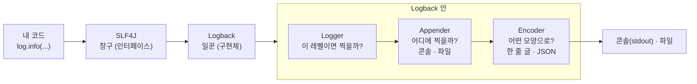

# 1. 로그 : SLF4J · Logback 과 좋은 로그 남기기

> **한 줄 요약** : 우리가 쓰는 `log.info()` 는 **SLF4J(창구)** 를 부르고, 실제로 찍는 건 **Logback(일꾼)** 입니다. 비비디는 이 로그를 사람이 아니라 **기계가 읽는 JSON** 으로 콘솔에 찍습니다.
> 
> 처음이라면 [먼저 읽기](00-먼저-읽기.md) 부터 읽어 주세요. 이 로그가 모니터링 서버로 가는 길은 [6. Alloy](06-alloy.md), 저장 · 검색은 [8. Loki](08-loki.md) 에 있습니다.

---

## 1. 로그는 왜 남기나

- **로그** = 프로그램이 돌면서 일어난 일을 기록한 것
- "모든 일" 을 다 남길 수는 없으니, 최소한 이 두 가지를 남깁니다
    - **서비스가 잘 돌고 있다는 흔적** : 앱 시작, 외부 API 호출, 중요한 요청 처리
    - **장애** : 개발자가 예상하지 못한 일 (예외, 외부 시스템 실패)
- 무엇을 남길지는 서비스 · 팀마다 다릅니다. 기준은 "**나중에 운영에서 문제를 찾을 때 이 기록이 필요할까?**" 입니다

### 로깅 vs 디버깅

| | 디버깅 | 로깅 |
| --- | --- | --- |
| 방법 | 브레이크포인트를 걸고 변수 · 메모리를 직접 봄 | 코드에 기록을 남겨 두고 나중에 읽음 |
| 장점 | 가장 정확함 | **운영 서버에서도** 쓸 수 있음 |
| 한계 | 운영 중인 서버를 멈출 수 없음 | 미리 남겨 둔 것만 볼 수 있음 |

→ 로컬에서는 디버깅, **운영에서는 로그가 거의 유일한 단서**입니다.

### `System.out.println` 으로 안 되나

| | `System.out` | 로깅 프레임워크 (SLF4J + Logback) |
| --- | --- | --- |
| 레벨 | 없음 (무조건 찍힘) | 레벨별로 켜고 끔 (운영에서는 DEBUG 끄기) |
| 모양 | 직접 문자열을 만듦 | 시각 · 스레드 · 클래스 이름 등을 자동으로 붙임, JSON 도 가능 |
| 출력 위치 | 콘솔뿐 | 콘솔 · 파일 · 외부 시스템, 설정만 바꿔서 |
| 성능 | 항상 문자열을 만듦 | 안 찍을 로그는 문자열도 안 만듦 (`{}`) |

---

## 2. `log.info()` 를 부르면 무슨 일이 일어나나

```java
@Slf4j   // Lombok 이 private static final Logger log = LoggerFactory.getLogger(WeddingService.class); 를 만들어 줌
@Service
class WeddingService {
    void find(Long id) {
        log.info("결혼 정보 조회 id={}", id);
    }
}
```



### SLF4J : 창구 (Simple Logging Facade for Java)

- "로그 찍어 줘" 라는 **인터페이스(약속)** 만 있고, 혼자서는 아무것도 찍지 못합니다
- 우리 코드는 SLF4J 만 알고, 실제로 누가 찍는지는 모릅니다
    - 그래서 구현체를 Logback 에서 Log4j2 로 바꿔도 **코드를 고치지 않습니다**
    - JDBC 인터페이스와 MySQL 드라이버의 관계와 같습니다 (의존 관계 역전)
- SLF4J 를 이루는 세 가지
    - **API** : 우리가 부르는 인터페이스 (`org.slf4j.Logger`)
    - **바인딩(구현 연결)** : API 를 실제 구현체(Logback 등)에 연결. **반드시 하나만** 있어야 합니다. 없으면 아무것도 안 찍히고, 여러 개면 어느 것이 쓰일지 모릅니다
    - **브리지** : 다른 로깅 API(예 : 옛날 라이브러리가 쓰는 Commons Logging, Log4j)로 찍은 로그를 SLF4J 로 모아 주는 어댑터
- Spring Boot 는 이 조합을 `spring-boot-starter-logging` 으로 알아서 맞춰 줍니다. 그래서 우리는 의존성을 따로 넣지 않아도 됩니다

### Logback : 일꾼

- SLF4J 를 직접 구현한 로깅 라이브러리. **Spring Boot 기본값**입니다
- 모듈 : `logback-core`(기반), `logback-classic`(SLF4J 구현), `logback-access`(웹 서버 접근 로그)
- 부품 세 가지

| 부품 | 하는 일 | 예 |
| --- | --- | --- |
| **Logger** | 로그 요청을 받아 **이 레벨이면 찍을지** 판단. 보통 클래스 이름이 Logger 이름 | `kr.bibbidi.auth.OidcClient` |
| **Appender** | **어디에** 찍을지. 하나의 Logger 에 여러 개 붙일 수 있음 | `ConsoleAppender`(콘솔), `FileAppender`(파일), `RollingFileAppender`(날짜 · 크기마다 새 파일) |
| **Encoder** (예전엔 Layout) | **어떤 모양으로** 찍을지 | 패턴 한 줄, JSON |

- Logger 는 점(`.`)으로 나뉜 **계층**입니다. `kr.bibbidi` 에 레벨을 정하면 `kr.bibbidi.auth.OidcClient` 도 물려받습니다. 맨 위는 **root** Logger 입니다

### 패턴 읽는 법

Spring Boot 기본 로그 한 줄과, 그걸 만드는 Logback 패턴 기호입니다.

```
2026-10-10T10:47:09.613Z  INFO 10840 --- [nio-8080-exec-1] k.b.wedding.WeddingService : 결혼 정보 조회 id=42
```

| 기호 | 뜻 |
| --- | --- |
| `%d` | 시각 |
| `%thread` | 스레드 이름 |
| `%level` (`%-5level`) | 로그 레벨 (5칸 맞춤) |
| `%logger{36}` | Logger 이름 (36자로 줄임) |
| `%msg` | 메시지 |
| `%n` | 줄바꿈 |

---

## 3. 로그 레벨

```
TRACE  <  DEBUG  <  INFO  <  WARN  <  ERROR
(가장 자세함)                         (가장 심각함)
```

| 레벨 | 언제 쓰나 | 예 |
| --- | --- | --- |
| `ERROR` | **개발자가 예상하지 못한** 실패. 사람이 봐야 함 | 외부 API 호출 실패로 로그인 불가, 잡지 못한 예외 |
| `WARN` | 지금은 괜찮지만 **에러가 될 수 있는** 일 | 재시도 후 성공, 공개 키 갱신 실패(이전 키로 동작 중) |
| `INFO` | 시스템이 **요구대로 잘 돌고 있다**는 기록, **개발자가 예상한 예외** | 회원 가입, 스케줄러 시작, "이미 가입된 이메일" 예외 |
| `DEBUG` | 개발 · 테스트 중 보는 **자세한 값** | 쿼리 파라미터, 중간 계산값 |
| `TRACE` | DEBUG 보다 더 자세함 | 거의 안 씀 |

- `FATAL` 은 Logback 에 없고 `ERROR` 로 취급됩니다

### 헷갈릴 때의 기준

- **"개발자가 예상한 일인가?"**
    - 예상한 예외 (중복 이메일, 잘못된 입력, 권한 없음) → 정상 흐름의 일부 → `INFO` 또는 `WARN`
    - 예상 못 한 예외 (NPE, 외부 시스템 다운, DB 연결 실패) → `ERROR`
- 사용자의 실수(4xx)를 `ERROR` 로 찍으면 **ERROR 알림(W4)이 계속 울립니다**

### 어떤 레벨까지 찍히나

- **정한 레벨 이상만 찍힙니다.** 레벨이 `INFO` 면 `debug()` 는 무시됩니다
- Logback 혼자 쓰면 root 기본 레벨은 `DEBUG`, **Spring Boot 는 ERROR · WARN · INFO** 만 콘솔에 찍습니다
- 패키지별로 바꿀 수 있습니다

```yaml
logging:
  level:
    root: info
    org.springframework.web: debug
    org.hibernate: error
```

- 비비디 주의 : 운영에서 `DEBUG` 를 켜도 **Alloy 가 DEBUG · TRACE 를 버려서** 모니터링 서버에는 안 갑니다 ([6. Alloy](06-alloy.md))

---

## 4. `{}` 를 써야 하는 이유

```java
log.debug("주문 " + order + " 처리");          // X : 레벨이 INFO 여도 문자열을 먼저 만듦
log.debug("주문 {} 처리", order);               // O : 실제로 찍을 때만 문자열을 만듦
```

- 문자열 더하기는 로그가 **안 찍혀도** 문자열을 만드는 비용이 듭니다
- `{}` 를 쓰면 레벨을 먼저 보고, **찍을 때만** 문자열을 만듭니다. Logback 문서는 안 찍히는 로그에서 최소 30배 빠르다고 설명합니다
- 예외는 **마지막 인자로** 넘기면 스택 트레이스까지 찍힙니다

```java
log.error("카카오 토큰 요청 실패 code={}", code, e);   // e 는 {} 에 안 들어가고 스택 트레이스로 찍힘
```

---

## 5. 설정 파일 : `logback-spring.xml`

`application.yaml` 의 `logging.*` 으로 부족하면 XML 로 세밀하게 정합니다. **비비디는 쓰지 않지만**, 많은 프로젝트가 쓰는 방식이라 구조를 알아 두면 좋습니다.

```xml
<configuration>
    <!-- 어디에, 어떤 모양으로 : 콘솔 -->
    <appender name="CONSOLE" class="ch.qos.logback.core.ConsoleAppender">
        <encoder>
            <pattern>%d %-5level [%thread] %logger{36} - %msg%n</pattern>
        </encoder>
    </appender>

    <!-- 어디에 : 파일, 날짜 · 크기마다 새 파일 -->
    <appender name="FILE" class="ch.qos.logback.core.rolling.RollingFileAppender">
        <file>logs/app.log</file>
        <rollingPolicy class="ch.qos.logback.core.rolling.SizeAndTimeBasedRollingPolicy">
            <fileNamePattern>logs/app.%d{yyyy-MM-dd}.%i.log</fileNamePattern>
            <maxFileSize>10MB</maxFileSize>   <!-- 한 파일 최대 크기 -->
            <maxHistory>30</maxHistory>       <!-- 며칠치 보관 -->
            <totalSizeCap>3GB</totalSizeCap>  <!-- 전체 최대 크기 -->
        </rollingPolicy>
        <!-- 특정 레벨만 이 파일에 : INFO 만 남기고 나머지는 버림 -->
        <filter class="ch.qos.logback.classic.filter.LevelFilter">
            <level>INFO</level>
            <onMatch>ACCEPT</onMatch>
            <onMismatch>DENY</onMismatch>
        </filter>
        <encoder>
            <pattern>%d %-5level %logger{36} - %msg%n</pattern>
        </encoder>
    </appender>

    <!-- 프로파일별로 다르게 -->
    <springProfile name="local">
        <root level="DEBUG"><appender-ref ref="CONSOLE"/></root>
    </springProfile>
    <springProfile name="prod">
        <root level="INFO"><appender-ref ref="FILE"/></root>
    </springProfile>
</configuration>
```

| 부분 | 뜻 |
| --- | --- |
| `appender` | 어디에(콘솔 · 파일), 어떤 모양으로(encoder) |
| `rollingPolicy` | 파일이 커지거나 날이 바뀌면 새 파일로, 오래된 파일은 삭제 |
| `filter` | 이 Appender 에 들어올 레벨 고르기 (예 : 에러만 따로 파일) |
| `springProfile` | 로컬 · 운영 등 프로파일마다 다른 설정 (Spring 확장 기능이라 파일 이름이 `logback-spring.xml` 이어야 함) |
| `root` / `logger` | 레벨과 연결할 Appender |

---

## 6. 사람용 로그 vs 기계용 로그 (구조화 로그)

### 비비디 모양 (기계용, ECS JSON)

```json
{"@timestamp":"2026-10-10T10:47:09.613Z","log":{"level":"INFO","logger":"kr.bibbidi.wedding.WeddingService"},"process":{"thread":{"name":"nio-8080-exec-1"}},"message":"결혼 정보 조회 id=42","traceId":"4bf9...","spanId":"00f0..."}
```

- 사람용 한 줄은 기계가 레벨 · 로거를 알려면 **문자열을 잘라야** 합니다
- JSON 한 줄이면 수집기(Alloy)가 **레벨 · 로거 · trace_id 를 정확히** 꺼낼 수 있습니다
- XML 없이 설정 한 줄로 바뀝니다 (Spring Boot 3.4 부터)

```yaml
logging:
  structured:
    format:
      console: ecs     # ecs, logstash, gelf 중 선택
```

- **ECS** = Elastic Common Schema. Elastic 이 정한 로그 필드 이름 규칙입니다 (`log.level`, `log.logger` 등)
- **MDC 값도 JSON 에 자동으로 들어갑니다** ([3. MDC](03-MDC와-trace_id.md))

### 비비디가 파일로 안 남기는 이유

- Spring Boot 기본은 **콘솔에만** 찍습니다 (`logging.file.name` 을 줘야 파일에도 씀, 10MB 마다 새 파일)
- 비비디는 **콘솔(stdout)** 에만 찍고, Docker 가 모은 걸 Alloy 가 읽어 갑니다 (Docker 가 컨테이너마다 10MB × 5개로 관리)
- 컨테이너 안에 파일을 쌓으면 디스크 · 롤링 관리를 따로 해야 하고, 컨테이너를 새로 만들면 사라지기 때문입니다

---

## 7. 좋은 로그를 남기는 법

나중에 **Loki 에서 검색할 사람**을 생각하고 찍습니다.

| 원칙 | 나쁜 예 | 좋은 예 |
| --- | --- | --- |
| **무엇이 · 왜** 실패했는지 | `log.error("에러")` | `log.error("카카오 토큰 요청 실패 status={}", status, e)` |
| **찾을 수 있는 값**을 넣기 | `log.info("저장 완료")` | `log.info("체크리스트 저장 weddingId={} itemCount={}", id, n)` |
| **같은 에러를 여러 번** 찍지 않기 | 서비스 · 컨트롤러 · 핸들러에서 각각 `error` | 한곳(예 : `@RestControllerAdvice`)에서 한 번 |
| **비밀 값** 안 찍기 | `log.info("token={}", accessToken)` | 토큰 · 비밀번호 · 개인정보는 빼기 |
| **반복문 안에서** 찍지 않기 | `for (...) log.info(...)` | 끝나고 개수만 한 번 |
| 레벨 맞추기 | 예상한 예외를 `ERROR` 로 | 예상한 예외는 `INFO` · `WARN` |

- 비밀 값 : Alloy 가 `password=`, `Bearer ...` 같은 일부 패턴은 가려 주지만, **규칙에 없는 이름은 그대로** 나갑니다
- 반복문 로그 : 너무 많이 보내면 **Loki 가 받기를 거절**합니다 (알림 W7)

> 참고 영상 (10분 테코톡)
> - SLF4J · Logback : [밍구의 스프링에서 로그를 찍을 때 사용하는 SLF4J와 Logback](https://www.youtube.com/watch?v=7l7gFDhm4Nw) · [검프의 Logging #1](https://www.youtube.com/watch?v=1MD5xbwznlI) (로깅 목적 · 레벨 · SLF4J) · [검프의 Logging #2](https://www.youtube.com/watch?v=JqZzy7RyudI) (Logback 설정 · Appender · 롤링)
> - 로깅 전반 : [아마란스의 로깅](https://www.youtube.com/watch?v=X_iE36En9F4) · [이스트의 로깅](https://www.youtube.com/watch?v=1IMJCg68-lU) · [무늬의 로깅](https://www.youtube.com/watch?v=MxxeKXydn4A)
> - 에러를 한곳에서 잡기 : [러로의 @RestControllerAdvice를 이용한 예외처리](https://www.youtube.com/watch?v=TKjOf_AQ7l4)

---

## 8. 직접 해 보기

1. 로컬에서 앱을 띄우고 아무 API 를 호출해 콘솔을 봅니다 → 한 줄이 JSON 인지 확인
2. `application.yaml` 에 `logging.level.kr.bibbidi: debug` 를 넣고 다시 띄워 DEBUG 가 보이는지 확인
3. 운영 로그는 Grafana → Explore → Loki

```logql
{service_name="bibbidi-backend", deployment_environment_name="production"} | severity_text=~"(?i)warn|error"
```

4. 로그 한 줄을 펼쳐서 `trace_id` 가 붙어 있는지 확인합니다 (요청 안에서 찍힌 로그만 붙음)

---

## 9. 할 수 있지만 비비디는 안 하는 것

| 할 수 있는 것 | 비비디는 | 공식 문서 |
| --- | --- | --- |
| **파일로도 남기기 · 롤링** (`logging.file.name`, `RollingFileAppender`) | 콘솔만 (Docker 가 보관) | [Spring Boot Logging](https://docs.spring.io/spring-boot/4.0/reference/features/logging.html) |
| **logback-spring.xml 로 세밀하게 설정** (Appender 여러 개, 레벨 필터, 프로파일별) | `application.yaml` 만 사용 | [Spring Boot How-to : Logging](https://docs.spring.io/spring-boot/4.0/how-to/logging.html) |
| **Logstash · GELF 형식** | ECS 형식 | [Spring Boot Logging](https://docs.spring.io/spring-boot/4.0/reference/features/logging.html) |
| **JSON 필드 이름 바꾸기 · 빼기 · 추가** (`logging.structured.json.*`) | 기본 필드 사용 | [Spring Boot Logging](https://docs.spring.io/spring-boot/4.0/reference/features/logging.html) |
| **Log4j2 로 구현체 바꾸기** | Logback (기본값) | [Spring Boot How-to : Logging](https://docs.spring.io/spring-boot/4.0/how-to/logging.html) |
| **앱에서 로그를 OTLP 로 직접 보내기** | 콘솔 → Alloy 가 읽음 | [4. OpenTelemetry 와 OTLP](04-OpenTelemetry와-OTLP.md) |

---

## 10. 자주 하는 실수

| 증상 | 원인 |
| --- | --- |
| Grafana 에서 내 `debug` 로그가 없음 | Alloy 가 DEBUG 를 버림 |
| 스택 트레이스가 안 찍힘 | 예외를 `{}` 에 넣거나 `e.getMessage()` 만 찍음 → 마지막 인자로 `e` |
| 로그가 하나도 안 찍힘 (Spring 없는 프로젝트) | SLF4J 바인딩(구현체)이 없음 |
| 로그에 `trace_id` 가 없음 | 요청 밖(스케줄러, 앱 시작, 직접 만든 스레드)에서 찍음 ([3. MDC](03-MDC와-trace_id.md)) |
| 같은 에러가 세 번씩 찍힘 | 여러 계층에서 각각 `error` |
| ERROR 알림이 너무 자주 옴 | 예상한 예외(사용자 입력 오류)를 `ERROR` 로 찍음 |

---

## 더 알고 싶다면

- [Spring Boot Logging](https://docs.spring.io/spring-boot/4.0/reference/features/logging.html)
- [Logback 구조 (Logger · Appender · Layout)](https://logback.qos.ch/manual/architecture.html)
- [Spring 블로그 : Spring Boot 3.4 구조화 로그](https://spring.io/blog/2024/08/23/structured-logging-in-spring-boot-3-4)
