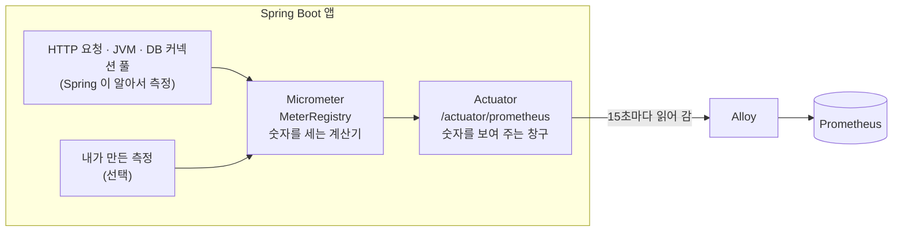

# 2. 메트릭 : Spring Actuator 와 Micrometer

> **한 줄 요약** : **Micrometer** 가 앱 안에서 숫자(요청 수, 응답 시간, 메모리)를 세고, **Actuator** 가 그 숫자를 `/actuator/prometheus` 라는 주소에 걸어 둡니다. 우리는 코드 없이 의존성과 설정만 넣으면 됩니다.
> 
> 처음이라면 [먼저 읽기](00-먼저-읽기.md) 부터 읽어 주세요. 이 숫자가 저장되고 그래프가 되는 곳은 [7. Prometheus](07-prometheus.md) 에 있습니다.

---

## 1. 메트릭이 뭔가

- **메트릭** = 일정 간격으로 잰 **숫자**. 시간 순서로 이으면 그래프가 됩니다
- 로그는 "**무슨 일**이 있었나(문장)", 메트릭은 "**얼마나**(숫자)"
- 로그로 "1분에 요청 몇 개?" 를 알려면 줄을 세야 하지만, 메트릭은 처음부터 **세어 둔 숫자**라서 싸고 빠릅니다

### 무엇을 재야 하나 : 4가지 황금 신호

Google SRE 책이 "사용자에게 영향을 주는 서비스라면 최소한 이 네 가지는 재라" 고 정리한 것입니다.

| 신호 | 뜻 | 비비디에서 보는 숫자 |
| --- | --- | --- |
| **Latency (지연)** | 요청 하나가 **얼마나 걸리나** | API 응답 시간 p95 (`traces_spanmetrics_latency_bucket`) |
| **Traffic (트래픽)** | 요청이 **얼마나 들어오나** | 초당 요청 수 (`http_server_requests_seconds_count`) |
| **Errors (에러)** | 요청이 **얼마나 실패하나** | 5xx 비율 (`status=~"5.."`) |
| **Saturation (포화)** | 자원이 **얼마나 찼나** | 힙 사용률, DB 커넥션 대기, 디스크 사용률 |

- 비비디 알림 규칙 15개도 대부분 이 네 가지 중 하나입니다 ([14. 알림과 온콜](14-알림과-온콜.md))

> 참고 영상 (10분 테코톡) : [몽이의 Metric](https://www.youtube.com/watch?v=mAbG2bY2yiA) (Gauge · Counter · Histogram, 4가지 황금 신호)

---

## 2. 누가 무엇을 하나



| 이름 | 하는 일 | 비유 |
| --- | --- | --- |
| **Micrometer** | 숫자를 세고 보관하는 라이브러리. **"메트릭계의 SLF4J"** 라서 Prometheus · Datadog 등 어디로 보낼지 바꿔도 코드는 그대로 | 계산기 |
| **MeterRegistry** | Micrometer 의 중심. 모든 측정기(Meter)를 모아 둠 | 계산기 본체 |
| **micrometer-registry-prometheus** | 숫자를 **Prometheus 형식**으로 바꿔 줌 | 번역기 |
| **Actuator** | 앱 상태를 HTTP 주소로 보여 주는 Spring Boot 기능. `/actuator/health`, `/actuator/prometheus` 등 | 창구 |

### 의존성 (Gradle)

```groovy
implementation 'org.springframework.boot:spring-boot-starter-actuator'   // Actuator + Micrometer
runtimeOnly    'io.micrometer:micrometer-registry-prometheus'             // Prometheus 형식
```

---

## 3. Actuator

### 엔드포인트

- Actuator 는 앱 상태를 보여 주는 여러 주소(**엔드포인트**)를 가지고 있습니다
    - `/actuator/health` : 살아 있나 (`{"status":"UP"}`)
    - `/actuator/info` : 앱 정보
    - `/actuator/prometheus` : 메트릭 (Prometheus 형식)
    - `/actuator/metrics` : 메트릭 (JSON, 사람이 보기용)
    - `/actuator/loggers` : 로그 레벨 보기 · 바꾸기
- **기본적으로 웹에 다 열려 있지 않습니다.** 열 것을 골라야 합니다

```yaml
management:
  endpoints:
    web:
      exposure:
        include: health,info,prometheus   # 비비디는 이 세 개만 엶
```

### 관리 포트 분리 : 왜 8081 인가

```yaml
management:
  server:
    port: 8081      # Actuator 는 8081, 사용자 요청은 8080
```

- 메트릭에는 **내부 정보**(메모리, DB 풀 크기, API 주소 목록)가 들어 있어서 외부에 보이면 안 됩니다
- 포트를 나누면 사용자용 포트(8080)에는 `/actuator` 가 아예 없습니다
- 비비디는 8081 을 서버 밖으로 열지 않고, **같은 Docker 네트워크의 Alloy 만** `backend:8081` 로 읽습니다

---

## 4. `/actuator/prometheus` 를 열어 보면

```
# HELP http_server_requests_seconds Duration of HTTP server request handling
# TYPE http_server_requests_seconds summary
http_server_requests_seconds_count{method="GET",outcome="SUCCESS",status="200",uri="/api/weddings/{id}"} 1523
http_server_requests_seconds_sum{method="GET",outcome="SUCCESS",status="200",uri="/api/weddings/{id}"} 45.2

# HELP jvm_memory_used_bytes The amount of used memory
# TYPE jvm_memory_used_bytes gauge
jvm_memory_used_bytes{area="heap",id="G1 Eden Space"} 6291456.0

# HELP hikaricp_connections_active Active connections
# TYPE hikaricp_connections_active gauge
hikaricp_connections_active{pool="HikariPool-1"} 3.0
```

- `# HELP` : 설명, `# TYPE` : 종류, 그 아래가 **이름{태그} 값**
- 이 페이지는 **지금 이 순간 값만** 보여 줍니다. 과거 값은 Prometheus 가 15초마다 읽어서 쌓아 둡니다

### Spring 이 알아서 재는 것

| 분류 | 이름 (앞부분) | 예 |
| --- | --- | --- |
| HTTP 요청 | `http.server.requests` | 요청 수, 걸린 시간. 태그 `method`, `uri`, `status`, `outcome`, `exception` |
| JVM | `jvm.` | 힙 메모리, GC 횟수 · 시간, 스레드 수 |
| 시스템 | `system.`, `process.`, `disk.` | CPU 사용률, 업타임, 디스크 남은 양 |
| DB 커넥션 풀 | `hikaricp.` | 사용 중 · 쉬는 중 · **대기 중** 커넥션 |
| Tomcat | `tomcat.` | 스레드 수 (`server.tomcat.mbeanregistry.enabled=true` 일 때만) |

- `uri` 태그에는 실제 주소(`/api/weddings/42`)가 아니라 **주소 틀**(`/api/weddings/{id}`)이 들어갑니다. 그래야 줄 수가 폭발하지 않습니다

> 참고 영상 (10분 테코톡)
> - DB 커넥션 풀 : [폰드의 커넥션 풀](https://www.youtube.com/watch?v=kNAIvfFolAs) · [쿠기의 Connection Pool & Keep-Alive](https://www.youtube.com/watch?v=MBgEhSUOlXo)
> - 요청 스레드 : [푸우의 Tomcat Thread Pool](https://www.youtube.com/watch?v=prniILbdOYA)
> - JVM 메모리 · GC : [어썸오의 JVM Memory Layout](https://www.youtube.com/watch?v=GU254H0N93Y) · [무민의 JVM Stack & Heap](https://www.youtube.com/watch?v=UzaGOXKVhwU) · [가이온의 Garbage Collection](https://www.youtube.com/watch?v=wWu1lNvctic)

---

## 5. 측정기 종류 (Meter)

| 종류 | 뜻 | 예 | Prometheus 에서 |
| --- | --- | --- | --- |
| **Counter** | **늘어나기만** 하는 수 | 로그인 성공 횟수 | `이름_total` |
| **Gauge** | **오르내리는** 현재값 | 큐에 쌓인 작업 수, 커넥션 수 | 그대로 |
| **Timer** | **횟수 + 걸린 시간** | API 응답 시간 | `_count`, `_sum`, `_max` (+ 설정하면 `_bucket`) |
| **DistributionSummary** | 횟수 + 크기 (시간이 아닌 값) | 업로드 파일 크기 | `_count`, `_sum`, `_max` |
| **LongTaskTimer** | **지금 진행 중인** 긴 작업 | 배치 작업 진행 시간 | 진행 중 개수 · 시간 |

- 숫자를 어떻게 읽는지(`rate`, `increase`, p95)는 [7. Prometheus](07-prometheus.md) 4장에 있습니다

### 이름 규칙 : 점 → 밑줄

- Micrometer 이름은 **소문자 + 점** 으로 짓습니다 : `bibbidi.login.success`
- Prometheus 로 나갈 때 **밑줄로 바뀌고, 단위 · 종류 꼬리가 붙습니다**
    - `http.server.requests` (Timer) → `http_server_requests_seconds_count`, `_sum`, `_max`
    - `bibbidi.login.success` (Counter) → `bibbidi_login_success_total`
    - 태그의 점도 밑줄로 : `deployment.environment.name` → `deployment_environment_name`

---

## 6. 내가 직접 재기 (선택)

Spring 이 재 주지 않는 **비즈니스 숫자**가 필요할 때만 씁니다. 비비디는 아직 직접 만든 측정기가 없습니다.

```java
@Component
@RequiredArgsConstructor
class LoginMetrics {
    private final MeterRegistry registry;

    // Counter : 로그인 성공 횟수 (제공자별)
    void loginSucceeded(String provider) {
        Counter.builder("bibbidi.login.success")
                .tag("provider", provider)          // kakao, google
                .register(registry)                 // 같은 이름 + 태그면 기존 것을 돌려줌
                .increment();
    }

    // Timer : 외부 API 호출 시간
    <T> T timeKakaoCall(Supplier<T> call) {
        return Timer.builder("bibbidi.oauth.call")
                .tag("provider", "kakao")
                .register(registry)
                .record(call);
    }
}
```

```java
// Gauge : 현재값을 읽는 방법을 등록해 두면, 읽을 때마다 함수를 불러 값을 가져감
Gauge.builder("bibbidi.pending.jobs", jobQueue, Queue::size).register(registry);
```

### 태그를 고를 때 주의

- **태그 값 종류가 적어야** 합니다. 값 하나마다 줄(시계열)이 하나씩 생깁니다
    - O : `provider=kakao|google`, `status=200|400|500`
    - X : `userId=...`, `email=...`, 실제 URL 경로 (`/api/weddings/42`)
- Micrometer 문서 예 : URI 태그에 ID 를 그대로 넣으면 **없는 리소스마다 새 줄**이 생기므로, 404 는 `NOT_FOUND` 같은 고정 값으로 묶으라고 합니다

### 모든 숫자에 같은 태그 붙이기 (공통 태그)

```yaml
management:
  metrics:
    tags:
      service.name: bibbidi-backend
      deployment.environment.name: ${DEPLOYMENT_ENVIRONMENT_NAME:production}
```

- 모든 메트릭에 서비스 이름 · 환경이 붙어서, 운영 · 개발을 나눠 볼 수 있습니다

---

## 7. 비비디 설정 한눈에

```yaml
# BE/src/main/resources/application.yaml (메트릭 관련 요약)
management:
  server:
    port: 8081                                  # 관리 포트 분리
  endpoints:
    web:
      exposure:
        include: health,info,prometheus         # 열 엔드포인트
  metrics:
    tags:                                       # 공통 태그
      service.name: ...
      deployment.environment.name: ...
```

- 정확한 현재 값은 저장소의 `application.yaml` 과 [비비디 문서 1장](../01-비비디-관측-알림-장애대응.md) 을 확인하세요

---

## 8. 직접 해 보기

로컬에서 앱을 띄운 뒤

```bash
curl http://localhost:8081/actuator/health
curl http://localhost:8081/actuator/prometheus | grep http_server_requests
curl "http://localhost:8081/actuator/prometheus?includedNames=jvm_memory_used_bytes"   # 원하는 이름만
```

- API 를 몇 번 호출한 뒤 다시 보면 `http_server_requests_seconds_count` 숫자가 늘어 있습니다
- 로컬 관리 포트가 8081 이 아니면 `management.server.port` 설정을 확인하세요

---

## 9. 할 수 있지만 비비디는 안 하는 것

| 할 수 있는 것 | 비비디는 | 공식 문서 |
| --- | --- | --- |
| **응답 시간 칸(histogram) 켜기** (`management.metrics.distribution.percentiles-histogram`) | 켜지 않음. API 응답 시간은 Tempo 가 트레이스로 만든 숫자를 씀 ([9. Tempo](09-tempo.md)) | [Spring Boot Metrics](https://docs.spring.io/spring-boot/4.0/reference/actuator/metrics.html) |
| **직접 만든 측정기** (Counter · Timer · Gauge) | 없음 | [Micrometer Meters](https://docs.micrometer.io/micrometer/reference/concepts/meters.html) |
| **Tomcat 스레드 메트릭** | 켜지 않음 (`server.tomcat.mbeanregistry.enabled`) | [Spring Boot Metrics](https://docs.spring.io/spring-boot/4.0/reference/actuator/metrics.html) |
| **Prometheus 대신 다른 곳으로 보내기** (Datadog, OTLP 등) | Prometheus 형식 | [Spring Boot Metrics](https://docs.spring.io/spring-boot/4.0/reference/actuator/metrics.html) |
| **Pushgateway 로 밀어 넣기** (짧게 끝나는 배치용) | 배치 없음 | [Spring Boot Metrics](https://docs.spring.io/spring-boot/4.0/reference/actuator/metrics.html) |
| **다른 엔드포인트 열기** (`loggers`, `env`, `threaddump` 등) | `health`, `info`, `prometheus` 만 | [Actuator Endpoints](https://docs.spring.io/spring-boot/4.0/reference/actuator/endpoints.html) |

---

## 10. 자주 하는 실수

| 증상 | 원인 |
| --- | --- |
| `/actuator/prometheus` 가 404 | `exposure.include` 에 `prometheus` 가 없음, 또는 관리 포트(8081)가 아닌 8080 으로 요청 |
| `/actuator/prometheus` 가 비어 있음 / 없음 | `micrometer-registry-prometheus` 의존성 누락 |
| 메트릭 줄이 수만 개로 늘어남 | 태그에 ID · 사용자 값을 넣음 |
| 만든 Counter 가 Prometheus 에서 이름이 다름 | 점 → 밑줄, `_total` 꼬리 (5장) |
| 운영 · 개발 숫자가 섞임 | 공통 태그(환경) 누락 |

---

## 더 알고 싶다면

- [Spring Boot Metrics](https://docs.spring.io/spring-boot/4.0/reference/actuator/metrics.html) · [Actuator Prometheus 엔드포인트](https://docs.spring.io/spring-boot/4.0/api/rest/actuator/prometheus.html)
- [Micrometer : Meters](https://docs.micrometer.io/micrometer/reference/concepts/meters.html) · [Micrometer : 이름 규칙](https://docs.micrometer.io/micrometer/reference/concepts/naming)
- [Google SRE 책 : Monitoring Distributed Systems (4가지 황금 신호)](https://sre.google/sre-book/monitoring-distributed-systems/)
