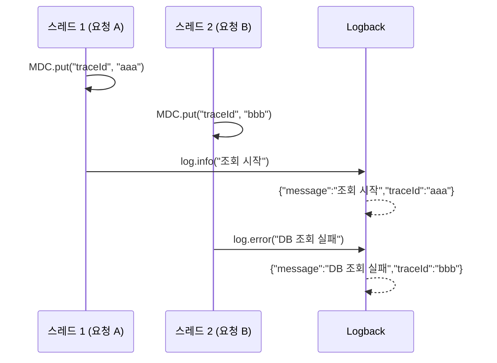
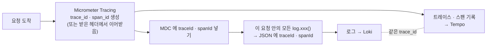

# 3. MDC 와 trace_id : 로그 · 트레이스 · 메트릭을 잇는 열쇠

> **한 줄 요약** : **MDC** 는 "지금 이 요청을 처리하는 동안 찍는 모든 로그에 자동으로 붙는 값" 입니다. Spring 은 여기에 **`traceId` · `spanId`** 를 넣어 주고, 이 번호로 로그와 트레이스를 오갑니다.
> 
> 처음이라면 [먼저 읽기](00-먼저-읽기.md) 와 [1. 로그](01-로그-SLF4J-Logback.md) 부터 읽어 주세요.

---

## 1. 없으면 뭐가 불편한가

요청 여러 개가 동시에 들어오면 로그가 이렇게 섞입니다.

```
10:00:00.001 INFO  체크리스트 조회 시작
10:00:00.002 INFO  체크리스트 조회 시작
10:00:00.010 ERROR DB 조회 실패
10:00:00.011 INFO  체크리스트 조회 완료
```

- `ERROR` 는 **둘 중 어느 요청**에서 났을까요? 알 수 없습니다
- 모든 `log.info()` 에 요청 번호를 직접 넣을 수도 있지만, 메서드마다 번호를 파라미터로 넘겨야 합니다

```java
log.info("[{}] 체크리스트 조회 시작", requestId);   // 모든 곳에 requestId 를 넘겨야 함…
```

**MDC 를 쓰면 한 번 넣어 두고, 그 요청 안의 모든 로그에 자동으로 붙습니다.**

---

## 2. MDC 가 뭔가

- **MDC (Mapped Diagnostic Context)** = 로그에 자동으로 붙일 **key-value 메모장**
- SLF4J 가 제공하고, Logback 이 실제로 구현합니다
- **스레드마다 따로** 있습니다 (내부적으로 `ThreadLocal`)
    - Spring MVC 는 **요청 하나를 스레드 하나**가 처리하므로, "스레드의 메모장" = "요청의 메모장" 이 됩니다



### 기본 사용법

```java
MDC.put("userId", "42");          // 넣기
log.info("주문 생성");             // → 로그에 userId=42 가 자동으로 붙음
MDC.get("userId");                // 꺼내기
MDC.remove("userId");             // 지우기
MDC.clear();                      // 전부 지우기
```

- 사람용 로그 패턴에서는 `%X{userId}` 로 꺼내 찍습니다
- **구조화 로그(ECS JSON)는 MDC 의 모든 값을 JSON 필드로 자동으로 넣습니다** → 비비디는 따로 설정할 것이 없습니다

---

## 3. `traceId` 는 누가 넣나

**Spring 이 자동으로 넣습니다.** 우리가 `MDC.put` 을 부를 일이 없습니다.



- Spring Boot 문서 : Micrometer Tracing 이 있으면 **MDC 의 `traceId` · `spanId` 로 로그에 상관관계 ID 를 넣습니다**
- 그래서 비비디 로그 한 줄에는 이 두 값이 항상 들어 있습니다 (요청 안에서 찍은 경우)

```json
{"log":{"level":"ERROR","logger":"kr.bibbidi.auth.OidcClient"},"message":"token request failed","traceId":"4bf92f3577b34da6a3ce929d0e0e4736","spanId":"00f067aa0ba902b7"}
```

- Alloy 가 이 값을 뽑아 Loki 의 메모(structured metadata) `trace_id`, `span_id` 로 저장합니다 ([8. Loki](08-loki.md))
- Grafana 에서 로그를 펼치면 이 값 옆에 **Tempo 버튼**이 생깁니다 ([10. Grafana](10-grafana.md))

### trace_id · span_id

| 이름 | 뜻 | 예 |
| --- | --- | --- |
| `trace_id` | **요청 하나 전체**의 번호 (32자리 16진수) | `4bf92f3577b34da6a3ce929d0e0e4736` |
| `span_id` | 그 요청 안 **구간 하나**의 번호 (16자리) | `00f067aa0ba902b7` |

- 같은 요청에서 찍은 로그는 `trace_id` 가 같고, 어느 구간(예 : 카카오 호출 중)에서 찍었느냐에 따라 `span_id` 가 다릅니다

### 서버를 넘어갈 때 : traceparent 헤더

- 우리 서버가 다른 서버를 부를 때, `trace_id` 를 **HTTP 헤더**에 실어 보냅니다 (W3C Trace Context 표준, 헤더 이름 `traceparent`)
- 받는 쪽도 트레이싱을 쓰면 같은 `trace_id` 를 이어서 씁니다 → 서버를 넘어서도 한 요청으로 묶임
- 주의 : Spring 이 만들어 주는 `RestClient.Builder` · `RestTemplateBuilder` · `WebClient.Builder` 로 만든 클라이언트만 자동으로 헤더를 붙입니다. `new RestTemplate()` 처럼 직접 만들면 안 붙습니다

---

## 4. 직접 MDC 에 값 넣기 (선택)

`traceId` 말고도 **로그마다 붙이고 싶은 값**이 있으면 직접 넣을 수 있습니다. 예 : 로그인한 회원 ID

```java
@Component
class MemberMdcFilter extends OncePerRequestFilter {
    @Override
    protected void doFilterInternal(HttpServletRequest request, HttpServletResponse response, FilterChain chain)
            throws ServletException, IOException {
        try {
            Long memberId = 현재_로그인한_회원_ID(request);   // 예시
            if (memberId != null) {
                MDC.put("member_id", String.valueOf(memberId));
            }
            chain.doFilter(request, response);
        } finally {
            MDC.remove("member_id");   // 꼭 지우기
        }
    }
}
```

- **`finally` 에서 꼭 지웁니다.** 스레드는 **스레드 풀**에서 재사용되기 때문에, 안 지우면 **다음 요청(다른 사용자)의 로그에 이전 사용자 ID 가 붙습니다**
- 짧은 구간이면 `try-with-resources` 로도 씁니다

```java
try (var ignored = MDC.putCloseable("order_id", orderId)) {
    log.info("주문 처리");     // order_id 가 붙음
}                              // 블록이 끝나면 자동으로 지워짐
```

- 넣은 값은 비비디 구조화 로그 JSON 에 필드로 들어갑니다. 다만 Loki 에서 검색 조건으로 쓰려면 Alloy 가 그 필드를 뽑아야 합니다 (지금은 레벨 · 로거 · trace_id · span_id 만 뽑음). 그 전에는 `| json | member_id="42"` 처럼 본문을 풀어서 찾습니다
- 개인정보에 해당하는 값(이메일, 이름)은 넣지 않습니다

---

## 5. MDC 가 사라지는 경우 : 다른 스레드

MDC 는 **스레드마다** 따로라서, 일을 **다른 스레드에 넘기면 따라가지 않습니다.**

| 상황 | 결과 |
| --- | --- |
| `@Async` 메서드 | 새 스레드 → `traceId` 가 없을 수 있음 |
| `CompletableFuture.supplyAsync(...)`, 직접 만든 `ExecutorService` | 새 스레드 → 없음 |
| `@Scheduled` 스케줄러 | 요청이 아님 → 처음부터 없음 |
| 앱 시작 · 종료 로그 | 요청이 아님 → 없음 |

- 그래서 **"로그에 Tempo 버튼이 없다"** 는 대부분 이 경우입니다
- 다른 스레드로 넘기는 방법 : 넘기기 전에 `MDC.getCopyOfContextMap()` 으로 복사해서, 새 스레드에서 `MDC.setContextMap(...)` 으로 넣고 끝나면 지우기 (Spring 의 `TaskDecorator` 를 쓰면 한곳에서 처리 가능)
- 트레이스 자체를 이어 가려면 Micrometer 의 컨텍스트 전파 기능을 써야 합니다 → [Spring Boot Observability](https://docs.spring.io/spring-boot/4.0/reference/actuator/observability.html)

> 참고 영상 (10분 테코톡) : [레오의 MDC](https://www.youtube.com/watch?v=lkuAxAVgAX0)

---

## 6. 직접 해 보기

1. 로컬에서 API 를 하나 호출하고 콘솔 JSON 에 `traceId` 가 있는지 봅니다
2. 같은 요청에서 찍힌 로그 여러 줄의 `traceId` 가 **모두 같은지** 봅니다
3. 운영에서는 Grafana → Explore → Loki

```logql
{service_name="bibbidi-backend", deployment_environment_name="production"} | trace_id="여기에 trace_id"
```

→ 그 요청에서 찍힌 로그가 시간순으로 전부 나옵니다

---

## 7. 할 수 있지만 비비디는 안 하는 것

| 할 수 있는 것 | 비비디는 | 공식 문서 |
| --- | --- | --- |
| **회원 ID 등 직접 MDC 에 넣기** | 넣지 않음 (`traceId` · `spanId` 만, Spring 이 자동) | [SLF4J MDC](https://slf4j.org/api/org/slf4j/MDC.html) |
| **사람용 로그 패턴에 traceId 모양 바꾸기** (`logging.pattern.correlation`) | 구조화 로그(JSON)라 해당 없음 | [Spring Boot Tracing](https://docs.spring.io/spring-boot/4.0/reference/actuator/tracing.html) |
| **baggage** (trace_id 처럼 서버를 넘어 전달되는 사용자 정의 값) | 사용 안 함 | [Spring Boot Tracing](https://docs.spring.io/spring-boot/4.0/reference/actuator/tracing.html) |
| **비동기 스레드로 MDC · 트레이스 넘기기** | 비동기 처리가 거의 없어 설정 안 함 | [Spring Boot Observability](https://docs.spring.io/spring-boot/4.0/reference/actuator/observability.html) |

---

## 8. 자주 하는 실수

| 증상 | 원인 |
| --- | --- |
| 다른 사용자의 ID 가 로그에 찍힘 | `MDC.remove` 를 `finally` 에서 안 함 (스레드 재사용) |
| 로그에 `traceId` 가 없음 | 요청 밖(스케줄러, 앱 시작) 또는 다른 스레드(`@Async`, 직접 만든 스레드) |
| 외부 서버까지 trace 가 안 이어짐 | HTTP 클라이언트를 Spring 빌더가 아니라 `new` 로 만듦 |
| MDC 에 넣은 값이 Loki 에서 검색이 안 됨 | Alloy 가 뽑는 필드가 아님 → `| json` 으로 풀어서 찾기 |

---

## 더 알고 싶다면

- [SLF4J MDC](https://slf4j.org/api/org/slf4j/MDC.html)
- [Spring Boot Tracing (로그 상관관계 ID)](https://docs.spring.io/spring-boot/4.0/reference/actuator/tracing.html)
- [W3C Trace Context (traceparent 헤더)](https://www.w3.org/TR/trace-context/)
- 다음 : [4. OpenTelemetry 와 OTLP](04-OpenTelemetry와-OTLP.md) — trace_id 를 만들고 보내는 표준
