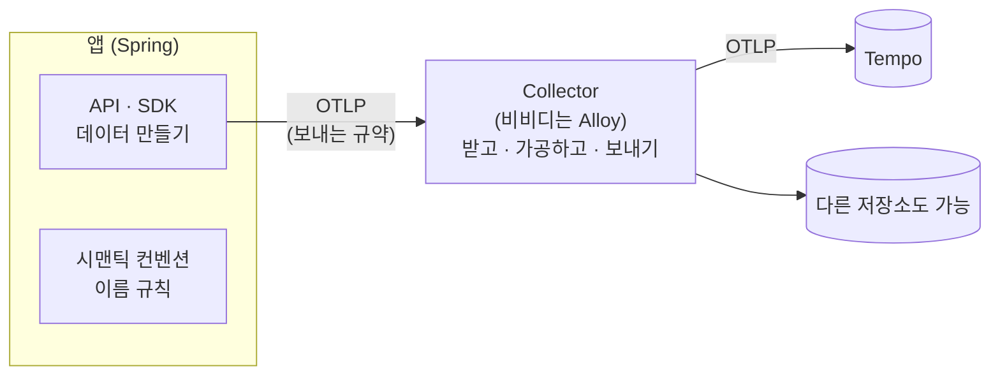
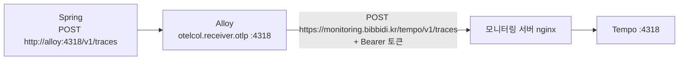

# 4. OpenTelemetry 와 OTLP : 데이터를 만들고 보내는 표준

> **한 줄 요약** : **OpenTelemetry(OTel)** 는 로그 · 메트릭 · 트레이스를 **어떻게 만들고 어떤 이름으로 부를지** 정한 공통 규칙 + 라이브러리이고, **OTLP** 는 그걸 **보낼 때 쓰는 전송 규약(프로토콜)** 입니다. 저장소가 아니라 **"만들고 보내는 쪽"의 표준**입니다.
> 
> 처음이라면 [먼저 읽기](00-먼저-읽기.md) 와 [3. MDC 와 trace_id](03-MDC와-trace_id.md) 부터 읽어 주세요.

---

## 1. 없으면 뭐가 불편한가

트레이싱 도구가 Jaeger, Zipkin, Datadog, New Relic... 처럼 많고, 예전에는 **도구마다 앱에 넣는 라이브러리 · 데이터 형식 · 보내는 방법이 달랐습니다.**

- 저장소를 Zipkin 에서 Tempo 로 바꾸면 → **앱 코드와 의존성을 바꿔야** 했습니다
- 같은 "HTTP 메서드" 를 도구마다 `http.method`, `httpMethod`, `method` 로 다르게 불러서 → 대시보드 · 쿼리를 다시 만들어야 했습니다

OpenTelemetry 는 이걸 **하나의 규칙**으로 맞춥니다. 앱은 OTel 방식으로 만들어 OTLP 로 보내기만 하면, 받는 쪽이 Tempo 든 다른 회사 제품이든 **앱은 그대로**입니다.

- JDBC 표준 덕분에 DB 를 MySQL 에서 PostgreSQL 로 바꿔도 코드가 거의 그대로인 것과 비슷합니다

---

## 2. OpenTelemetry 를 이루는 것



| 구성 | 뜻 | 비비디에서 |
| --- | --- | --- |
| **API · SDK** | 언어별 라이브러리. 트레이스 · 메트릭 · 로그를 만듦 | Spring 이 Micrometer 를 통해 OTel SDK 를 씀 |
| **시맨틱 컨벤션** | 속성 **이름 규칙** (`http.request.method`, `http.response.status_code`, `service.name` 등) | 트레이스 속성, nginx 접근 로그 필드 이름 |
| **OTLP** | 데이터를 **보내는 규약** | Spring → Alloy → Tempo |
| **Collector** | 받아서 가공 · 전달하는 중간 프로그램 | **Alloy** (OTel Collector 배포판) |

- **OTel 은 저장소 · 화면이 아닙니다.** 저장은 Tempo · Prometheus · Loki, 화면은 Grafana 가 합니다
- 다루는 신호 : **Traces, Metrics, Logs** (+ Baggage, Profiles)

### 리소스 속성 : "이 데이터는 누가 만들었나"

모든 데이터에 붙는 **출처 정보**입니다. 비비디는 환경 변수 하나로 줍니다.

```yaml
# BE/compose.prod.yml (backend 일부)
environment:
  OTEL_RESOURCE_ATTRIBUTES: service.name=bibbidi-backend,service.version=1.0.0,service.instance.id=bibbidi-backend-prod,deployment.environment.name=production
```

| 속성 | 뜻 |
| --- | --- |
| `service.name` | 서비스 이름 |
| `service.version` | 버전 |
| `service.instance.id` | 인스턴스 (서버 · 컨테이너 구분) |
| `deployment.environment.name` | 환경 (`production` / `development`) |

- 이 이름들이 **시맨틱 컨벤션**입니다. 그래서 Tempo · Grafana 가 "서비스 이름" 이 어디 있는지 알아서 찾습니다
- TraceQL 에서 `resource.service.name`, `resource.deployment.environment.name` 으로 쓰는 게 바로 이 값입니다 ([9. Tempo](09-tempo.md))

---

## 3. OTLP : 보내는 규약

- **OTLP (OpenTelemetry Protocol)** = 텔레메트리 데이터를 **어떤 모양으로 어떻게 보낼지** 정한 규약
- 두 가지 방식

| 방식 | 기본 포트 | 특징 |
| --- | --- | --- |
| **OTLP/gRPC** | **4317** | gRPC (HTTP/2) |
| **OTLP/HTTP** | **4318** | 일반 HTTP POST. 경로 `/v1/traces`, `/v1/metrics`, `/v1/logs` |

- 내용물은 Protocol Buffers (바이너리) 형식, 압축은 gzip 또는 없음
- **비비디는 HTTP(4318)만 씁니다.** nginx 뒤에서 일반 HTTPS 로 다루기 쉽기 때문입니다



---

## 4. Spring 에서는 어떻게 쓰나

### Micrometer Tracing + OpenTelemetry

- Spring 은 트레이싱도 **Micrometer** 로 감쌉니다 (**Micrometer Tracing** = 트레이싱계의 SLF4J)
- 실제 일은 **OpenTelemetry** 가 합니다 (`micrometer-tracing-bridge-otel` 이 둘을 연결)
- Spring Boot 4 에서는 스타터 하나로 됩니다

```groovy
implementation 'org.springframework.boot:spring-boot-starter-opentelemetry'
```

- 이렇게 하면 Spring 이 **요청마다 자동으로**
    - 트레이스 · 스팬을 만들고 (컨트롤러 요청, Spring 빌더로 만든 HTTP 클라이언트 호출 등)
    - `traceId` · `spanId` 를 MDC 에 넣고 ([3장](03-MDC와-trace_id.md))
    - OTLP 로 보냅니다

### 설정 두 가지

```yaml
management:
  tracing:
    sampling:
      probability: 1.0        # 기본값은 0.1 (10%)! 비비디는 100% 저장
  opentelemetry:
    tracing:
      export:
        otlp:
          endpoint: ${OTEL_EXPORTER_OTLP_ENDPOINT:http://alloy:4318}/v1/traces
```

- **샘플링** : 요청 중 몇 %를 트레이스로 남길지
    - Spring Boot 기본은 **10%** 입니다. 그대로 두면 요청 10개 중 1개만 트레이스가 남습니다
    - 비비디는 **100%** (`1.0`) — 트래픽이 적고, Tempo 가 트레이스로 응답 시간 숫자를 만들기 때문에 ([9. Tempo](09-tempo.md))
- **endpoint** : 보낼 곳. 같은 Docker 네트워크의 Alloy
- 설정 키 이름은 Spring Boot 버전마다 다를 수 있습니다. 현재 값은 저장소 `application.yaml` 과 [비비디 문서 1장](../01-비비디-관측-알림-장애대응.md) 을 확인하세요

### 내가 직접 구간 만들기 (선택)

Spring 이 자동으로 안 잡는 **내부 작업**을 트레이스에 구간으로 보이고 싶을 때 씁니다.

```java
@Component
class ChecklistGenerator {
    private final ObservationRegistry registry;

    ChecklistGenerator(ObservationRegistry registry) { this.registry = registry; }

    void generate(Long weddingId) {
        Observation.createNotStarted("checklist.generate", registry)
                .lowCardinalityKeyValue("type", "default")   // 값 종류가 적은 것만
                .observe(() -> {
                    // 실제 작업
                });
    }
}
```

- `Observation` 하나로 **스팬과 메트릭(Timer)이 함께** 만들어집니다

---

## 5. 보내는 방식 비교 : pull vs push

비비디는 세 데이터를 **서로 다른 방식**으로 모읍니다.

| 데이터 | 방식 | 누가 움직이나 | 형식 |
| --- | --- | --- | --- |
| 메트릭 | **pull** (가져가기) | Alloy 가 15초마다 `/actuator/prometheus` 를 읽어 감 | Prometheus 형식 |
| 트레이스 | **push** (보내기) | Spring 이 요청마다 Alloy 로 보냄 | OTLP |
| 로그 | **읽어 가기** | Alloy 가 Docker 콘솔 출력을 읽어 감 | ECS JSON |

| | pull (가져가기) | push (보내기) |
| --- | --- | --- |
| 장점 | 앱은 보낼 곳을 몰라도 됨. 못 가져가면 "죽었다" 를 바로 앎 (`up=0`) | 짧게 끝나는 작업도 보낼 수 있음. 앱이 방화벽 안에 있어도 됨 |
| 단점 | 가져가는 쪽이 앱 주소를 알아야 함 | 보낼 곳 주소 · 인증을 앱이 알아야 함 |

- 비비디는 **앱 서버 안에서는** 섞어 쓰고, **앱 서버 → 모니터링 서버** 구간은 Alloy 가 전부 **push** 합니다
    - 그래서 모니터링 서버가 앱 서버로 접속할 필요가 없습니다

---

## 6. 직접 해 보기

1. 로컬에서 Alloy 없이 앱을 띄우면 콘솔에 "OTLP 로 보내기 실패" 경고가 보일 수 있습니다 → 보낼 곳(`alloy:4318`)이 없어서입니다. 로컬 프로파일에서는 무시해도 됩니다
2. 운영에서 트레이스가 오는지 : Grafana → Explore → Tempo

```traceql
{ resource.service.name = "bibbidi-backend" && resource.deployment.environment.name = "production" }
```

3. 트레이스 하나를 열어 **Resource** 속성에 2장의 네 가지 값이 있는지 확인합니다

---

## 7. 할 수 있지만 비비디는 안 하는 것

| 할 수 있는 것 | 비비디는 | 공식 문서 |
| --- | --- | --- |
| **메트릭 · 로그도 OTLP 로 보내기** (세 데이터를 모두 한 방식으로) | 메트릭은 Actuator pull, 로그는 콘솔 읽기 | [Alloy : OTLP → LGTM](https://grafana.com/docs/alloy/v1.19/collect/opentelemetry-to-lgtm-stack.md) |
| **OTLP/gRPC (4317)** | HTTP(4318)만 | [OTLP 명세](https://opentelemetry.io/docs/reference/specification/protocol/otlp/) |
| **OTel Java Agent** (코드 · 의존성 없이 JVM 옵션으로 자동 계측) | Spring 스타터 사용 | [OpenTelemetry 문서](https://opentelemetry.io/docs/what-is-opentelemetry/) |
| **일부만 저장** (샘플링 10% 등) | 100% | [Spring Boot Tracing](https://docs.spring.io/spring-boot/4.0/reference/actuator/tracing.html) |
| **Zipkin · Brave 로 보내기** | OTLP | [Spring Boot Tracing](https://docs.spring.io/spring-boot/4.0/reference/actuator/tracing.html) |
| **앱에서 Tempo 로 바로 보내기** (Alloy 없이) | Alloy 를 거침 (토큰 · 주소를 앱이 몰라도 되게) | [6. Alloy](06-alloy.md) |

---

## 8. 자주 하는 실수

| 증상 | 원인 |
| --- | --- |
| 트레이스가 10개 중 1개만 보임 | 샘플링 기본값 10% 그대로 |
| 트레이스가 하나도 안 옴 | endpoint 주소 · 경로(`/v1/traces`) 오류, 또는 Alloy 가 4318 을 안 열었음 |
| Tempo 에서 환경으로 검색이 안 됨 | `OTEL_RESOURCE_ATTRIBUTES` 에 `deployment.environment.name` 누락 |
| 외부 서버 호출이 트레이스에 안 보임 | HTTP 클라이언트를 Spring 빌더 없이 `new` 로 만듦 ([3장](03-MDC와-trace_id.md)) |

---

## 더 알고 싶다면

- [OpenTelemetry 란](https://opentelemetry.io/docs/what-is-opentelemetry/) · [OTLP 명세](https://opentelemetry.io/docs/reference/specification/protocol/otlp/)
- [Spring Boot Tracing](https://docs.spring.io/spring-boot/4.0/reference/actuator/tracing.html)
- [Alloy 의 OTLP 수신 (otelcol.receiver.otlp)](https://grafana.com/docs/alloy/latest/reference/components/otelcol/otelcol.receiver.otlp/)
- 시맨틱 컨벤션 : [OpenTelemetry Semantic Conventions](https://opentelemetry.io/docs/specs/semconv/)
