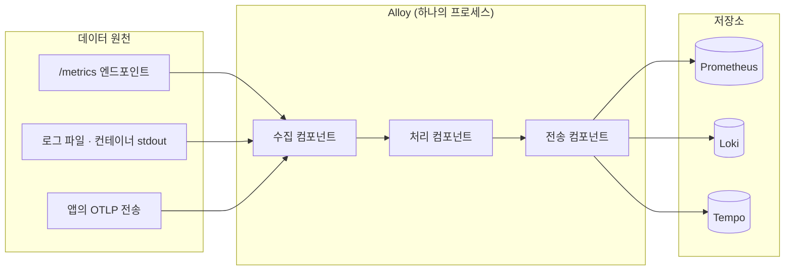
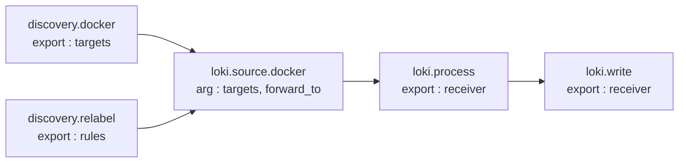
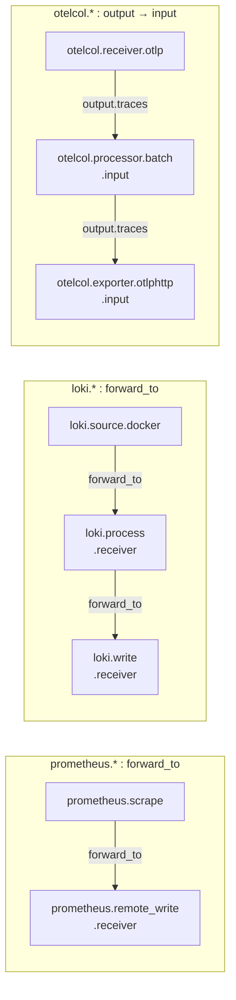

# 부록 6. Alloy 상세

> 본문은 [6. Alloy : 앱 서버에 사는 택배 기사](06-alloy.md) 입니다. 이 부록은 기본값 · 문법 · 내부 동작을 찾아볼 때 씁니다.
> 
> 이 문서는 **도구 자체**를 설명합니다. 비비디 설정값과 파일 위치는 [비비디 관측·알림·장애 대응](../01-비비디-관측-알림-장애대응.md) 1장을 참고해 주세요.
> 
> - 기준 문서 : `grafana.com/docs/alloy/latest/` (조사일 2026-10-10, 문서 버전 v1.20)
> - `otelcol.exporter.otlphttp`, `otelcol.auth.bearer`, `otelcol.exporter.prometheus`, `otelcol.exporter.loki` 는 v1.19 문서로 확인했습니다 (표시 : v1.19)
> - 문서에서 확인하지 못한 내용은 **확인 필요** 로 표시합니다

---

## 6.1 Alloy 는 무엇인가

- Grafana Labs 가 만든 **오픈소스 텔레메트리 수집기**입니다
- 공식 문서는 Alloy 를 **"OpenTelemetry Collector distribution"** 이라고 부릅니다
    - OTel Collector 를 바탕으로, Prometheus 파이프라인을 내장하고 Loki · Pyroscope 를 네이티브로 지원합니다
- 하는 일은 세 가지입니다
    - **수집** : Prometheus 엔드포인트 scrape, OTLP 수신, 로그 파일 tail, Docker · Kubernetes · 클라우드 서비스 디스커버리
    - **처리** : 필터링, 토큰 같은 민감값 마스킹, 라벨 · 메타데이터 추가, 샘플링, 형식 변환(예 : Prometheus → OTel), 라우팅
    - **전달** : Prometheus 호환 DB, Loki, Tempo, Grafana Cloud, OTel 호환 백엔드. 여러 곳에 동시에 보낼 수도 있습니다



### 왜 하나의 수집기인가

- 문서가 말하는 문제는 **collector sprawl** 입니다. 신호마다 수집기가 따로 있으면 다음 비용이 생깁니다
    - 수집기마다 설정 문법, 배포 방식, 장애 양상이 다릅니다
    - 그만큼 CPU · 메모리를 더 씁니다
- Alloy 는 "all signal types in a single deployment with one configuration language" 로 이를 합칩니다. 디버깅 UI 도 하나입니다
- Prometheus 방식과 OTel 방식 중 하나를 고르지 않고 같이 쓸 수 있습니다
- 문서가 직접 밝히는 한계 : **메트릭 scrape 만 필요하면 Prometheus Agent 가 더 단순할 수 있습니다**

### 이전 도구와의 관계

| 도구 | 상태 |
| --- | --- |
| Grafana Agent | 2025-11-01 **지원 종료(EOL)**. 보안 · 버그 수정도 없음. Alloy 로 이전 안내 |
| Promtail | 2026-03-02 **지원 종료(EOL)**. Alloy 로 이전 안내 (`alloy convert --source-format=promtail`) |
| Grafana Agent Flow | Alloy 와 같은 설정 문법. 일부 기능 제거, 메트릭 접두사 `agent_` → `alloy_` |

- 그래서 지금 Grafana 스택에서 로그 · 메트릭 · 트레이스를 모으는 공식 수집기는 사실상 Alloy 하나입니다

### 배포 패턴

- **Edge** : 데이터 원천 가까이 둡니다. 호스트마다 설치하거나 앱 옆 컨테이너로 띄웁니다
- **Gateway** : 중앙에서 모아 받는 지점입니다
- **Hybrid** : edge 에서 거르고 gateway 로 모읍니다
- 비비디는 앱 서버마다 Alloy 를 띄우는 **edge** 방식입니다

---

## 6.2 동작 원리 : 컴포넌트와 파이프라인

### 컴포넌트

- 한 가지 일만 하는 블록입니다. 블록을 적으면 실행 중인 인스턴스가 하나 생깁니다
- 형식 : `컴포넌트이름 "라벨" { ... }`
    - 예 : `prometheus.scrape "bibbidi_backend" { ... }`
    - 이름 + 라벨 조합은 설정 전체에서 유일해야 합니다
- 각 컴포넌트는 두 가지를 가집니다
    - **Arguments** : 블록 안에 적는 설정값 (입력)
    - **Exports** : 실행 중인 컴포넌트가 내놓는 값 (출력). 시간이 지나며 바뀔 수 있습니다

### 파이프라인 = 컴포넌트끼리의 참조

- 한 컴포넌트의 argument 가 다른 컴포넌트의 export 를 참조하면 둘이 연결됩니다
    - 값 참조 : `password = local.file.api_key.content`
    - 데이터 흐름 연결 : `forward_to = [prometheus.remote_write.production.receiver]`
- fan-out(scrape 하나 → remote_write 둘)과 체인(`loki.process` 두 단계)도 됩니다
- 참조 관계는 **DAG(방향 비순환 그래프)** 를 이룹니다
    - 자기 참조, 순환 참조는 오류입니다



### 컴포넌트 컨트롤러

설정 파일을 읽고 컴포넌트를 실제로 돌리는 Alloy 내부 관리자입니다.

- **평가 순서** : 의존 대상이 먼저 평가된 뒤에 평가합니다. 처음 시작할 때 의존성 없는 컴포넌트는 병렬로 평가합니다
- **재평가** : export 가 바뀌면 그것을 참조하는 컴포넌트를 새 값으로 다시 평가합니다. 영향이 끝날 때까지 연쇄적으로 반복합니다
    - 예 : `local.file` 내용이 바뀌면 그걸 참조하는 `prometheus.scrape` 만 다시 평가합니다
- **health 4종** : `Unknown`, `Healthy`, `Unhealthy`, `Exited`
    - 내가 참조하는 대상이 unhealthy 여도 내 health 와는 무관합니다
- **평가 실패 시** : 컴포넌트를 unhealthy 로 표시하고 로그를 남긴 뒤 **마지막으로 정상이던 설정으로 계속 동작**합니다
- **리로드** : `/-/reload` HTTP 요청 또는 `SIGHUP`. 없어진 컴포넌트는 제거, 새 컴포넌트는 생성한 뒤 전체를 재평가합니다
    - 처음 시작할 때 설정 오류가 있으면 바로 종료합니다
    - 리로드 실패 시에는 **이전 설정으로 계속 실행**합니다 → 실패가 눈에 잘 띄지 않습니다

---

## 6.3 설정 문법 (Alloy syntax)

선언형입니다. 의존성을 Alloy 가 풀기 때문에 **블록 순서는 상관없습니다**.

```alloy
// 주석은 // 또는 /* */
prometheus.scrape "app" {                 // 블록 : 이름 + "라벨"
  targets         = [{ __address__ = "backend:8081" }]   // attribute : 이름 = 값
  scrape_interval = "15s"                 // duration 은 문자열
  forward_to      = [prometheus.remote_write.main.receiver]  // 다른 컴포넌트의 export 참조
}

prometheus.remote_write "main" {
  endpoint {                              // 중첩 블록
    url = "https://example.com/api/v1/write"
    bearer_token = sys.env("INGEST_TOKEN")   // 표준 라이브러리 함수
  }
}
```

- **Attribute** : `이름 = 값`, 줄바꿈으로 끝납니다
- **Block** : `이름 { }` 또는 `이름 "라벨" { }`. 라벨은 반드시 큰따옴표
- **식별자** : 문자 · 숫자 · `_`, 숫자로 시작 불가. `my-component`, `my.component` 는 안 됩니다
- **Expression** : 리터럴, 참조, 함수 호출, 산술. 컴포넌트 시작 때와 의존 대상이 바뀔 때 평가됩니다
- **참조 형식** : `<컴포넌트이름>.<라벨>.<export이름>` (예 : `local.file.target.content`)

### 타입

- 기본 : `number`, `string`(큰따옴표), raw string(백틱, 이스케이프 없음), `bool`, `array`, `object`, `null`
- `duration` : `"100ms"`, `"1h30m"` (단위 `h m s ms ns`)
- `secret`
    - UI 에 `(secret)` 으로 가려집니다
    - string → secret 대입은 되지만 secret → string 은 안 됩니다 (`convert.nonsensitive` 로만 가능)
- `capsule("...")`
    - 내부 타입이라 직접 만들 수 없고, **같은 capsule 끼리만** 연결됩니다
    - 예 : `prometheus.remote_write` 의 `receiver` 는 `capsule("prometheus.Receiver")` 라서 메트릭 `forward_to` 에만 넣을 수 있습니다 → 로그 컴포넌트에 잘못 연결하면 설정 오류

### 연산자

- 산술 `+ - * / % ^`, 비교 `== != < <= > >=`, 논리 `&& || !`
- 문자열 `+` 는 이어 붙이기 (예 : `"app-" + sys.env("ENVIRONMENT")`)
- 없는 키를 `[ ]` 로 읽으면 `null`, `.` 으로 읽으면 오류

### 표준 라이브러리 (자주 쓰는 것)

- 네임스페이스 : `array`, `coalesce`, `constants`, `convert`, `encoding`, `file`, `json_path`, `string`, `sys`
- `sys.env("NAME")` : 환경 변수 값. **없으면 오류가 아니라 빈 문자열 `""`** 을 돌려줍니다
- `coalesce(a, b, ...)` : null · 빈 문자열 · 빈 목록 · 빈 객체가 아닌 첫 값을 돌려줍니다. 모두 비면 마지막 인자
    - 환경 변수 기본값 패턴 : `coalesce(sys.env("DOES_NOT_EXIST"), "c")` → `"c"`

---

## 6.4 컴포넌트 계열과 데이터 형식

Alloy 안에는 **서로 다른 데이터 형식**이 흐릅니다. 계열마다 연결 방향도 다릅니다.

| 계열 | 다루는 것 | 연결 방법 |
| --- | --- | --- |
| `discovery.*` | 수집 대상 목록 (`targets`) | 소비자의 `targets` 인자에 export 를 넣음 |
| `prometheus.*` | Prometheus 샘플 | 보내는 쪽 `forward_to = [받는쪽.receiver]` |
| `loki.*` | Loki 로그 엔트리 | 보내는 쪽 `forward_to = [받는쪽.receiver]` |
| `otelcol.*` | OTel 데이터 (메트릭 · 로그 · 트레이스) | 보내는 쪽 `output { traces = [받는쪽.input] }` |



- **otelcol 은 방향이 반대입니다.** `output` 블록에 연결하지 않은 신호는 **조용히 버려집니다** ("by default telemetry is dropped")
- 형식이 다르면 직접 연결할 수 없어서 **변환 컴포넌트**를 거칩니다
    - `otelcol.exporter.prometheus` : OTel 메트릭 → Prometheus 샘플 (v1.19)
        - `service.name` → `job`, `service.instance.id` → `instance`, 리소스 속성 → `target_info` 메트릭
        - delta 메트릭은 버려집니다 (필요하면 `otelcol.processor.deltatocumulative` 먼저)
    - `otelcol.exporter.loki` : OTel 로그 → Loki 엔트리 (v1.19)
        - 속성은 기본적으로 라벨이 되지 않습니다. 힌트 속성으로 지정해야 라벨이 됩니다
- 문서의 OTLP → LGTM 예시 : 메트릭은 `otelcol.exporter.prometheus` → `prometheus.remote_write`, 로그는 `otelcol.exporter.loki` → `loki.write`, 트레이스는 Tempo 가 OTLP 를 그대로 받으므로 `otelcol.exporter.otlphttp` 로 바로 보냅니다

---

## 6.5 자주 쓰는 컴포넌트 상세

문서의 **기본값**을 함께 적습니다. 설정 파일에서 값을 생략하면 이 값이 쓰입니다.

### `prometheus.scrape` : 메트릭 가져오기 (pull)

- 필수 : `targets`, `forward_to` / export 없음
- 기본값
    - `job_name` = 컴포넌트 이름 (예 : `prometheus.scrape.bibbidi_backend`)
    - `scrape_interval = "60s"`, `scrape_timeout = "10s"`, `metrics_path = "/metrics"`
    - `honor_labels = false`, `honor_timestamps = true`
    - `scrape_native_histograms = false`
- 대상 라벨
    - `__address__` 필수, `__scheme__` · `__metrics_path__` · `__param_<name>` 으로 요청을 조정
    - scrape 후 `job`, `instance` 라벨이 붙고, 대상마다 `up` 메트릭(성공 1, 실패 0)이 생깁니다

### `prometheus.remote_write` : 메트릭 보내기 (push)

- 받은 샘플을 **WAL(로컬 디스크 기록)** 에 먼저 쌓고, Remote Write 프로토콜로 보냅니다. export : `receiver`
- `endpoint` 블록 (여러 개 가능, 엔드포인트마다 큐가 따로)
    - `url` 필수, `remote_timeout = "30s"`, `enable_http2 = false`, `send_native_histograms = false`
- `queue_config` 기본값
    - `capacity = 10000`, `max_samples_per_send = 2000`, `batch_send_deadline = "5s"`
    - `min_shards = 1`, `max_shards = 50`
    - `min_backoff = "30ms"`, `max_backoff = "5s"`, `retry_on_http_429 = true`
- WAL
    - 위치 : storage path 아래 컴포넌트별 디렉터리 (기본 storage path `data-alloy/`)
    - 세그먼트 128MB, `truncate_frequency = "2h"`
    - 전송이 막힌 채로 오래 지나 체크포인트된 데이터는 유실됩니다
    - `wal` 디렉터리를 지우면 아직 못 보낸 데이터가 사라집니다

### `discovery.docker` : 컨테이너 찾기

- `host` 필수 (Docker 데몬 주소), `refresh_interval = "1m"`
- export : `targets`. 네트워크 · 포트 조합마다 대상이 하나씩 생깁니다
- 제공하는 메타 라벨 (일부)
    - `__meta_docker_container_id`, `__meta_docker_container_name`
    - `__meta_docker_container_label_<라벨명>` (점 등은 `_` 로 바뀜. `com.example.app` → `..._com_example_app`)
    - `__meta_docker_network_name`, `__meta_docker_port_private` 등

### `discovery.relabel` : 라벨 고쳐 쓰기

- `targets` 의 라벨을 `rule` 순서대로 바꿉니다
- export
    - `output` : 바뀐 targets
    - `rules` : 규칙 묶음. 다른 컴포넌트의 `relabel_rules` 에 넘길 때 씁니다
- `rule` 기본값 : `action = "replace"`, `regex = "(.*)"`, `replacement = "$1"`, `separator = ";"`
- action : `replace`, `keep`, `drop`, `keepequal`, `dropequal`, `labelmap`, `labeldrop`, `labelkeep`, `hashmod`, `lowercase`, `uppercase`

### `loki.source.docker` : 컨테이너 로그 읽기

- 컴포넌트 하나가 Docker 데몬 하나를 읽습니다
- 인자 : `host`, `targets`, `forward_to`, `labels`, `relabel_rules`, `refresh_interval = "60s"`
- **positions(어디까지 읽었는지)** 를 storage path 에 저장 → 재시작 후 이어서 읽습니다
- 같은 컨테이너 ID 대상은 하나로 합칩니다
- 문서 예시 패턴 : `discovery.relabel` 의 `rules` 로 `__meta_docker_container_name` 의 앞 `/` 를 떼어 `service_name` 라벨을 만듭니다

### `loki.process` : 로그 가공

- 인자 `forward_to`, export `receiver`
- **stage 를 설정 파일에 적힌 순서대로** 로그 한 줄마다 실행합니다
- 데이터가 놓이는 곳 세 군데
    - **extracted map** : stage 끼리 공유하는 임시 값 (예 : `stage.json` 이 뽑은 값)
    - **labels** : Loki 에서 색인되는 라벨
    - **structured metadata** : 색인되지 않는 부가 정보 (8장 Loki 참고)
- stage 종류 (일부) : `json`, `logfmt`, `regex`, `pattern`, `match`, `drop`, `labels`, `static_labels`, `label_drop`, `label_keep`, `structured_metadata`, `replace`, `template`, `timestamp`, `multiline`, `output`, `pack`, `limit`, `sampling`, `luhn`, `decolorize`, `metrics`, `tenant`, `truncate`
- 주의
    - `stage.drop` 의 조건들은 **AND** 입니다. OR 이 필요하면 블록을 나눕니다
    - `stage.timestamp` 가 없으면 받은 시각을 그대로 씁니다
    - 버려진 줄 수 : `loki_process_dropped_lines_total`

### `loki.write` : 로그 보내기

- `endpoint` 기본값
    - `batch_size = "1MiB"`, `batch_wait = "1s"`, `remote_timeout = "10s"`
    - `min_backoff_period = "500ms"`, `max_backoff_period = "5m"`, `max_backoff_retries = 10`
    - 4xx 중에서는 **429 만 재시도**합니다
- `__` 로 시작하는 라벨은 보내기 전에 지웁니다
- WAL 은 experimental, 기본 꺼짐

### `otelcol.receiver.otlp` : OTLP 받기

- `grpc { }` / `http { }` 블록을 넣어야 해당 서버가 켜집니다
- 기본 주소 : gRPC `0.0.0.0:4317`, HTTP `0.0.0.0:4318`
- HTTP 경로 : `/v1/traces`, `/v1/metrics`, `/v1/logs`, 요청 본문 최대 `20MiB`
- `output` 블록 필수

### `otelcol.processor.batch` : 묶어서 보내기

- 기본값 : `timeout = "200ms"`, `send_batch_size = 2000`, `send_batch_max_size = 3000`
- `send_batch_size` 는 정확한 크기가 아니라 **보내기 시작하는 기준**입니다
- 문서 권고
    - otelcol 을 쓰는 모든 Alloy 에 batch 를 두기를 강하게 권합니다
    - 데이터를 버리는 처리(샘플링, memory_limiter) **뒤에** 둡니다

### `otelcol.exporter.otlphttp` : OTLP HTTP 로 보내기 (v1.19)

- `client.endpoint` 필수. 신호별 경로(`/v1/traces` 등)는 자동으로 붙습니다
- `client` 기본값 : `compression = "gzip"`, `timeout = "30s"`, 인증은 `auth = otelcol.auth.<종류>.<라벨>.handler`
- `sending_queue` : `enabled = true`, `queue_size = 1000`, `num_consumers = 10` (너무 크면 OOM 위험)
- `retry_on_failure` : `initial_interval = "5s"`, `max_interval = "30s"`, `max_elapsed_time = "5m"`

### `otelcol.auth.bearer` : Bearer 토큰 인증 (v1.19)

- 인자 : `token`(secret, 필수), `scheme = "Bearer"`, `header = "Authorization"`
- export `handler` 를 exporter 의 `client { auth = ... }` 에 넣습니다

---

## 6.6 relabel 과 `__` 라벨

- `__` 로 시작하는 라벨은 **내부용**입니다. 수집 전에 다른 컴포넌트가 지울 수 있습니다
    - `prometheus.scrape` : `__address__` · `__scheme__` · `__metrics_path__` 로 요청을 만든 뒤, `__` 라벨은 지웁니다
    - `loki.write` : 보내기 전에 `__` 라벨을 지웁니다
- 그래서 `__meta_docker_container_name` 같은 값을 **남기려면** relabel 로 일반 라벨에 옮겨야 합니다
- 임시값은 `__tmp` 접두사를 쓰라고 권합니다

```alloy
// 예 : 컨테이너 이름(/bibbidi-backend)에서 / 를 떼어 service_name 으로
discovery.relabel "containers" {
  targets = []
  rule {
    source_labels = ["__meta_docker_container_name"]
    regex         = "/(.*)"
    target_label  = "service_name"
  }
}
```

- 확인 필요 : relabel 정규식이 전체 일치(앵커)인지는 Alloy 문서에 적혀 있지 않습니다

---

## 6.7 디버깅과 운영

### 내장 UI

- 기본 주소 `http://localhost:12345`
    - `alloy run` 의 `--server.http.listen-addr` 기본값이 `127.0.0.1:12345` 라서, **컨테이너에서는** `0.0.0.0:12345` 를 줘야 밖에서 열립니다
- 화면
    - Home : 컴포넌트 목록과 health
    - 컴포넌트 상세 : health, 실제 평가된 인자, exports, 디버그 정보
    - Live Debugging : 컴포넌트를 지나가는 데이터를 실시간으로 봄
    - Graph : experimental (`--stability.level=experimental` 필요)
- Live debugging
    - 기본 꺼짐, `livedebugging { enabled = true }` 로 켭니다
    - 켜 두는 동안은 http 에 TLS 설정을 권합니다 (지나가는 데이터가 보이므로)

### CLI

- `alloy fmt [-w] [-t] <파일>` : 형식 정리. `-t` 는 고칠 게 있으면 0 이 아닌 값으로 종료 (컴포넌트 설정이 맞는지는 검사 안 함)
- `alloy validate <경로>` : 문법 오류, 없는 컴포넌트, 이름 충돌, 필수 속성 누락, 모르는 속성을 검사 (문서 표현 "limited in scope")
- `alloy run` : `--storage.path` 기본 `data-alloy/`, 디렉터리를 주면 안의 `*.alloy` 를 합쳐 하나의 설정으로 씁니다
- `alloy convert` : Promtail · Prometheus · Static 설정을 Alloy 문법으로 변환 (best-effort)

### HTTP 엔드포인트

- `/metrics` : Alloy 자체 메트릭
- `/-/ready` : 준비 전 503
- `/-/healthy` : unhealthy 컴포넌트가 있으면 500 (Kubernetes liveness probe 로 쓰지 말라고 경고)
- `/-/reload` : 설정 다시 읽기 (실패 시 400)

### 자체 메트릭 (컨트롤러)

- `alloy_component_controller_running_components{health_type=...}` : health 별 컴포넌트 수
- `alloy_component_evaluation_seconds`, `alloy_component_evaluation_queue_size`
- 컴포넌트별 메트릭 예 : `loki_source_docker_target_entries_total`, `loki_process_dropped_lines_total`

### 리소스 추정 (문서의 "starting point")

- 메트릭 : 활성 시리즈 100만 개당 CPU 약 0.4코어, 메모리 약 11GiB
- 로그 : 1MiB/s 당 CPU 약 1코어, 메모리 약 120MiB
- 트레이스 : 문서에 수치 없음

---

## 6.8 헷갈리기 쉬운 점

- **otelcol 의 `output` 을 비우면 데이터가 조용히 사라집니다**
- **`sys.env` 는 변수가 없어도 오류를 내지 않습니다.** 빈 값이 라벨에 들어가도 Alloy 는 정상으로 보입니다
- **리로드 실패는 프로세스를 죽이지 않습니다.** UI 나 `/-/healthy` 로 확인해야 합니다
- **WAL 과 positions 는 storage path 에 있습니다.** 컨테이너를 다시 만들어도 유지하려면 그 경로를 볼륨으로 둬야 할 것으로 보입니다 (문서 명시 X, 추론)
- **capsule 타입은 계열끼리 섞을 수 없습니다.** OTel 메트릭을 Prometheus 로 보내려면 변환 컴포넌트가 필요합니다
- **하위 호환은 GA 기능만 보장합니다.** 업스트림(OTel Collector, Prometheus) 변경이 minor 버전에서 바뀔 수 있습니다
    - 예 : v1.11 에서 Prometheus 3.x 반영 → `prometheus.remote_write` 의 `enable_http2` 기본값 `false`, `le` 라벨 값 정규화(`le="1"` → `le="1.0"`)

---

## 6.9 비비디 설정과 비교해 확인할 것

개념 설명 중 비비디 설정과 맞닿는 지점입니다. 수정이 필요한지는 설정 파일을 열어 확인해야 합니다.

- `prometheus.scrape` 기본 주기는 60초 → 비비디는 `15s` 로 명시
- `otelcol.processor.batch` 기본은 200ms · 2000개 → 비비디 문서에는 "5초 또는 512개" 로 적혀 있음 (명시 설정)
- `DEPLOYMENT_ENVIRONMENT_NAME` 이 비어 있으면 `deployment_environment_name=""` 으로 조용히 들어갑니다 → `coalesce` 로 기본값을 줄지 검토
- Alloy 컨테이너의 storage path(WAL · positions) 볼륨 마운트 여부
- 내장 UI(12345) 노출 여부

---

## 용어

- **컴포넌트** : 한 가지 일만 하는 설정 블록이자 실행 단위
- **Arguments / Exports** : 컴포넌트의 입력 / 출력
- **파이프라인** : 컴포넌트를 참조로 이어 만든 데이터 흐름
- **DAG** : 방향 비순환 그래프. 순환 참조가 없는 연결 구조
- **WAL** : Write-Ahead Log. 보내기 전에 디스크에 먼저 남겨 재시작 · 장애 때 유실을 줄이는 기록
- **positions** : 로그를 어디까지 읽었는지 적어 둔 위치 정보
- **relabel** : 대상이나 데이터의 라벨을 규칙에 따라 바꾸는 작업
- **OTLP** : OpenTelemetry 전송 프로토콜 (gRPC 4317 / HTTP 4318)

## 출처

- [Introduction](https://grafana.com/docs/alloy/latest/introduction/) · [How Alloy works](https://grafana.com/docs/alloy/latest/introduction/how-alloy-works/) · [Why Alloy](https://grafana.com/docs/alloy/latest/introduction/why-alloy/) · [OTel in Alloy](https://grafana.com/docs/alloy/latest/introduction/otel_alloy/)
- [Components](https://grafana.com/docs/alloy/latest/get-started/components/) · [Build pipelines](https://grafana.com/docs/alloy/latest/get-started/components/build-pipelines/) · [Component controller](https://grafana.com/docs/alloy/latest/get-started/components/component-controller/)
- [Syntax](https://grafana.com/docs/alloy/latest/get-started/syntax/) · [Expressions](https://grafana.com/docs/alloy/latest/get-started/expressions/) · [Types and values](https://grafana.com/docs/alloy/latest/get-started/expressions/types_and_values/) · [Standard library](https://grafana.com/docs/alloy/latest/reference/stdlib/)
- 컴포넌트 : [prometheus.scrape](https://grafana.com/docs/alloy/latest/reference/components/prometheus/prometheus.scrape/) · [prometheus.remote_write](https://grafana.com/docs/alloy/latest/reference/components/prometheus/prometheus.remote_write/) · [discovery.docker](https://grafana.com/docs/alloy/latest/reference/components/discovery/discovery.docker/) · [discovery.relabel](https://grafana.com/docs/alloy/latest/reference/components/discovery/discovery.relabel/) · [loki.source.docker](https://grafana.com/docs/alloy/latest/reference/components/loki/loki.source.docker/) · [loki.process](https://grafana.com/docs/alloy/latest/reference/components/loki/loki.process/) · [loki.write](https://grafana.com/docs/alloy/latest/reference/components/loki/loki.write/) · [otelcol.receiver.otlp](https://grafana.com/docs/alloy/latest/reference/components/otelcol/otelcol.receiver.otlp/) · [otelcol.processor.batch](https://grafana.com/docs/alloy/latest/reference/components/otelcol/otelcol.processor.batch/) · [otelcol.exporter.otlphttp (v1.19)](https://grafana.com/docs/alloy/v1.19/reference/components/otelcol/otelcol.exporter.otlphttp/) · [otelcol.auth.bearer (v1.19)](https://grafana.com/docs/alloy/v1.19/reference/components/otelcol/otelcol.auth.bearer/)
- [Debug](https://grafana.com/docs/alloy/latest/troubleshoot/debug/) · [CLI](https://grafana.com/docs/alloy/latest/reference/cli/) · [HTTP endpoints](https://grafana.com/docs/alloy/latest/reference/http/) · [Controller metrics](https://grafana.com/docs/alloy/latest/troubleshoot/controller_metrics/) · [Estimate resource usage](https://grafana.com/docs/alloy/latest/set-up/estimate-resource-usage/)
- [Migrate from Promtail](https://grafana.com/docs/alloy/latest/set-up/migrate/from-promtail/) · [Migrate from Flow](https://grafana.com/docs/alloy/latest/set-up/migrate/from-flow/)

## 확인 필요

- v1.13 ~ v1.20 변경 내역 (릴리스 노트가 GitHub CHANGELOG 로만 안내)
- otelcol exporter · auth 컴포넌트의 v1.20 문서 (v1.19 로 대신 확인)
- `loki.source.docker` positions 파일의 정확한 경로
- relabel 정규식의 앵커 여부
