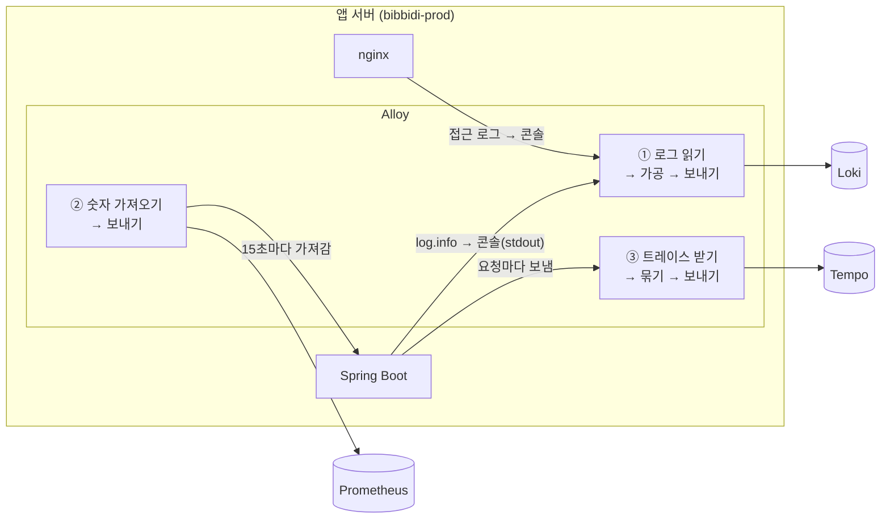

# 6. Alloy : 앱 서버에 사는 택배 기사

> **한 줄 요약** : 앱 서버에서 로그 · 숫자 · 트레이스를 모아, 필요 없는 건 버리고 비밀번호는 가린 뒤, 모니터링 서버로 보내는 프로그램입니다.
> 
> 처음이라면 [먼저 읽기](00-먼저-읽기.md) 부터 읽어 주세요. 기본값 · 내부 동작 같은 깊은 내용은 [부록 : Alloy 상세](06-alloy-상세.md) 에 있습니다.

---

## 1. 없으면 뭐가 불편한가

Alloy 없이도 Spring 이 Loki · Prometheus · Tempo 로 직접 보낼 수는 있습니다. 그런데 그러면 이런 문제가 생깁니다.

- **앱이 모니터링 서버 주소와 비밀 토큰을 알아야 합니다.** 주소가 바뀌면 앱을 다시 배포해야 합니다
- **비밀번호 가리기, DEBUG 로그 버리기 같은 처리를 앱 코드에서 해야 합니다.** nginx 로그는 Spring 이 아니라서 따로 처리해야 합니다
- **nginx 로그는 Spring 이 보낼 수 없습니다**

Alloy 를 앱 옆에 두면 이 일을 **한곳에서** 처리합니다. 앱은 "로그를 콘솔에 찍고, 숫자 판을 열어 두고, 트레이스를 옆 Alloy 에게 넘기기" 만 하면 됩니다.

---

## 2. 그림으로 보기



Alloy 가 하는 일은 세 줄로 정리됩니다.

| | 어디서 | 어떻게 받나 | 어디로 |
| --- | --- | --- | --- |
| ① 로그 | Spring · nginx 의 콘솔 출력 | Alloy 가 **읽어 감** | Loki |
| ② 숫자 | Spring 의 `/actuator/prometheus` | Alloy 가 **15초마다 가져감** | Prometheus |
| ③ 트레이스 | Spring | Spring 이 **보내 줌** | Tempo |

- "가져간다(pull)" 와 "보내 준다(push)" 가 섞여 있다는 점만 기억하면 됩니다
- 셋 다 `https://monitoring.bibbidi.kr` 로 보내고, **같은 비밀 토큰**을 붙입니다. 토큰이 틀리면 모니터링 서버가 거절합니다
    - 토큰을 확인하는 건 모니터링 서버 앞의 nginx 입니다 (리버스 프록시)

> 참고 영상 (10분 테코톡) : nginx 가 낯설다면 [상돌의 Nginx 시작하기](https://www.youtube.com/watch?v=oUroldyG1_s) · [필립, 박스터의 엔진엑스의 Everything](https://www.youtube.com/watch?v=l-7XA6gXqzs)

---

## 3. 로그 한 줄이 Alloy 를 지나가는 길

`OidcClient` 에서 이 로그를 찍었다고 해 봅시다.

```java
log.error("token request failed, Authorization={}", "Bearer eyJhbGciOi...");
```

| 단계 | 무슨 일이 일어나나 | 결과 |
| --- | --- | --- |
| 0 | Spring 이 JSON 한 줄로 콘솔에 찍음 | `{"log":{"level":"ERROR","logger":"...OidcClient"},"message":"token request failed, Authorization=Bearer eyJ...","traceId":"4bf9..."}` |
| 1 | Docker 가 이 줄을 파일에 모아 둠 | |
| 2 | Alloy 가 Docker 에게 "새 로그 줘" 하고 읽어 감 | 어느 컨테이너 로그인지 이름표가 붙음 : `service_name="bibbidi-backend"`, `deployment_environment_name="production"` |
| 3 | JSON 을 풀어서 레벨 · 로거 이름 · `trace_id` 를 뽑음 | 레벨 `ERROR`, 로거 `...OidcClient`, `trace_id` `4bf9...` |
| 4 | 레벨이 **TRACE · DEBUG 면 여기서 버림** | 이 줄은 ERROR 라 통과 |
| 5 | 비밀 값을 가림 | `Authorization=Bearer eyJ...` → `Authorization=[REDACTED]` |
| 6 | 모니터링 서버로 보냄 | Loki 에 저장 |

- 가리는 값 : `access_token`, `refresh_token`, `authorization`, `cookie`, `password`, `passwd`, `Bearer ...`, `Basic ...`
- 주의 : 가려 준다고 비밀번호를 로그에 찍어도 되는 건 아닙니다. 규칙에 없는 이름(예 : `secret=...`)은 그대로 나갑니다

---

## 4. 설정 파일 읽는 법

설정 파일은 `Infra/monitoring/grafana/alloy/config.alloy` 입니다. 처음 보면 낯설지만, 규칙은 두 개뿐입니다.

### 규칙 1 : 블록 하나 = 일 하나

```alloy
prometheus.scrape "bibbidi_backend" {     // 일의 종류 "내가 붙인 이름"
  targets         = [{ __address__ = "backend:8081" }]   // 어디서
  metrics_path    = "/actuator/prometheus"               // 어느 주소를
  scrape_interval = "15s"                                // 얼마마다
  forward_to      = [prometheus.remote_write.monitoring.receiver]  // 가져온 걸 누구에게 넘길지
}
```

- `prometheus.scrape` 는 "숫자 가져오기" 라는 **일의 종류**입니다
- `"bibbidi_backend"` 는 **우리가 붙인 이름**입니다
- 중괄호 안은 그 일의 **설정**입니다

### 규칙 2 : `forward_to` 로 다음 일에 넘긴다

일들을 컨베이어 벨트처럼 이어 붙입니다. 로그 쪽은 이렇게 이어져 있습니다.


자주 보이는 일의 종류는 이 정도입니다.

| 이름 | 하는 일 |
| --- | --- |
| `discovery.docker` | 서버에 떠 있는 컨테이너 목록 찾기 |
| `discovery.relabel` | 이름표 고쳐 쓰기 (예 : 컨테이너 이름 `/bibbidi-backend` → `bibbidi-backend`) |
| `loki.source.docker` | 컨테이너 로그 읽기 |
| `loki.process` | 로그 가공 (JSON 풀기, 버리기, 가리기) |
| `loki.write` | 로그 보내기 |
| `prometheus.scrape` | 숫자 가져오기 |
| `prometheus.remote_write` | 숫자 보내기 |
| `otelcol.receiver.otlp` | 트레이스 받기 (Spring 이 `alloy:4318` 로 보냄) |
| `otelcol.processor.batch` | 트레이스를 모아서 한 번에 보내기 |
| `otelcol.exporter.otlphttp` | 트레이스 보내기 |

- 이름 앞부분만 봐도 알 수 있습니다 : `loki.` 은 로그, `prometheus.` 는 숫자, `otelcol.` 은 트레이스
- `sys.env("이름")` 은 **환경 변수 읽기**입니다. Spring 의 `${...}` 와 같은 역할입니다

> 참고 영상 (10분 테코톡) : 환경 변수로 설정을 바꾸는 방식이 낯설다면 [차니의 Spring Boot Profile과 외부 설정](https://www.youtube.com/watch?v=L6teh1j0IRU)

---

## 5. 꼭 알아야 할 것

### ① DEBUG 로그는 모니터링 서버에 가지 않습니다

- Alloy 가 TRACE · DEBUG 를 버립니다 (양이 많고 운영에서 필요 없어서)
- `log.debug()` 로 찍은 걸 Grafana 에서 찾으면 **없습니다**. 운영에서 봐야 하는 건 `info` 이상으로 찍으세요

### ② 이름표(라벨)는 Alloy 에서 붙습니다

- Grafana 에서 로그를 검색할 때 쓰는 `service_name`, `deployment_environment_name` 같은 이름은 Alloy 설정에서 정해집니다
- 운영 · 개발 구분도 여기서 붙습니다 (`production` / `development`)
- 그래서 **이름표를 바꾸면 기존 검색 · 대시보드 · 알림 쿼리가 결과 없음이 될 수 있습니다**

### ③ 숫자는 Alloy 가 "가지러" 갑니다

- Spring 은 `/actuator/prometheus` 주소에 숫자 판을 걸어 두기만 합니다
- Alloy 가 15초마다 와서 읽어 갑니다. 이 주소는 사용자용 포트(8080)가 아니라 **관리용 포트(8081)** 에 있어서 외부에서는 안 보입니다
- Alloy 가 숫자 판을 못 읽으면 `up` 이라는 값이 0 이 됩니다 → 알림 C2 "backend 수집 실패"

### ④ 설정이 틀려도 조용할 수 있습니다

- 환경 변수가 없으면 Alloy 는 에러를 내지 않고 **빈 값**을 씁니다. 예를 들어 환경 이름 변수가 빠지면 `deployment_environment_name=""` 으로 들어갑니다
- 그래서 설정을 바꾼 뒤에는 **Grafana 에서 데이터가 실제로 들어오는지** 꼭 확인합니다

---

## 6. 직접 해 보기

### Alloy 가 잘 보내고 있나

앱 서버에서 Alloy 로그를 봅니다.

```bash
docker logs alloy --since 10m 2>&1 | grep -iE '401|error'
```

- 아무것도 안 나오면 정상
- `401` 이 보이면 **토큰이 틀린 것**입니다 (`MONITORING_INGEST_TOKEN` 이 모니터링 서버와 다름)

### 숫자를 가져오고 있나

Grafana → Explore → Prometheus 선택 → 아래 입력 → Run query

```promql
up{job="prometheus.scrape.bibbidi_backend"}
```

- 운영 · 개발 각각 `1` 이면 정상, `0` 이거나 아무것도 없으면 수집이 끊긴 것입니다

### 로그를 보내고 있나

Grafana → Explore → Loki 선택

```logql
{service_name="bibbidi-backend", deployment_environment_name="production"}
```

- 최근 로그가 보이면 정상입니다

---

## 7. 할 수 있지만 비비디는 안 하는 것

Alloy 로 할 수 있는 일은 훨씬 많습니다. 아래는 **존재만 알아 두면 되는 것**입니다. 필요해지면 링크에서 찾아보세요.

| 할 수 있는 것 | 비비디는 | 공식 문서 |
| --- | --- | --- |
| **Gateway 방식** : 서버마다 두지 않고 중앙에 Alloy 를 두고 모아 받기 | 서버가 2대라 서버마다 하나씩(edge) 둠 | [How Alloy works](https://grafana.com/docs/alloy/latest/introduction/how-alloy-works/) |
| **클러스터링** : Alloy 여러 대가 수집 대상을 나눠 맡기 | 수집 대상이 적어 불필요 | [prometheus.scrape (clustering 블록)](https://grafana.com/docs/alloy/latest/reference/components/prometheus/prometheus.scrape/) |
| **로그 파일 직접 읽기** : 컨테이너 출력이 아니라 서버의 로그 파일을 읽기 | 로그를 파일로 남기지 않고 콘솔로만 찍음 | [컴포넌트 목록](https://grafana.com/docs/alloy/latest/reference/components/) |
| **Kubernetes · AWS 서비스 자동 발견** | Docker Compose 라 Docker 발견만 씀 | [컴포넌트 목록](https://grafana.com/docs/alloy/latest/reference/components/) |
| **서버 자체 지표 수집** (CPU · 디스크 · 메모리를 리눅스에서 직접) | 앱 서버 디스크 · CPU 는 Spring 이 주는 값으로 봄, 모니터링 · DB 서버는 수집 안 함 | [컴포넌트 목록](https://grafana.com/docs/alloy/latest/reference/components/) |
| **프로파일 · 프론트엔드 · eBPF 수집** (Pyroscope, Faro, Beyla) | 백엔드 로그 · 숫자 · 트레이스만 수집 | [컴포넌트 목록](https://grafana.com/docs/alloy/latest/reference/components/) |
| **메트릭 · 로그도 OTLP 로 받기** (Spring 이 전부 OTLP 로 보내고 Alloy 가 나눠 보내기) | 메트릭은 Actuator 를 가져가는 방식, 로그는 콘솔 읽기 방식 | [OpenTelemetry to LGTM](https://grafana.com/docs/alloy/v1.19/collect/opentelemetry-to-lgtm-stack.md) |
| **OTel Collector 설정 그대로 실행** (OTel Engine, 실험 기능) | Alloy 문법으로 작성 | [OpenTelemetry in Alloy](https://grafana.com/docs/alloy/latest/introduction/otel_alloy/) |
| **로그 전송 WAL** (보내기 전 디스크에 먼저 저장, 실험 기능) | 기본값(끔) 사용 | [loki.write](https://grafana.com/docs/alloy/latest/reference/components/loki/loki.write/) |
| **Live debugging** (지나가는 데이터를 화면에서 실시간 보기) | 켜지 않음 | [Debug](https://grafana.com/docs/alloy/latest/troubleshoot/debug/) |
| **Promtail · Grafana Agent 에서 옮겨 오기** | 처음부터 Alloy 사용 (두 도구는 지원 종료) | [Migrate from Promtail](https://grafana.com/docs/alloy/latest/set-up/migrate/from-promtail/) |

---

## 8. 자주 하는 실수

| 증상 | 원인 |
| --- | --- |
| `log.debug()` 로그가 안 보임 | Alloy 가 DEBUG 를 버림 (정상 동작) |
| 데이터가 전부 안 들어옴 | 토큰 불일치 → Alloy 로그에 401 |
| 새로 띄운 컨테이너 로그가 안 보임 | 수집 대상은 `bibbidi-backend`, `nginx`, `alloy` 뿐 |
| 개발 서버 데이터가 운영에 섞임 / 환경 값이 비어 있음 | 환경 이름 환경 변수 누락 |
| 트레이스가 안 들어옴 | Spring 의 보내는 주소(`OTEL_EXPORTER_OTLP_ENDPOINT`)가 `http://alloy:4318` 이 아님 |

---

## 더 알고 싶다면

- [부록 : Alloy 상세](06-alloy-상세.md) : 컴포넌트별 기본값, 설정 문법 전체, 디버깅 UI, 버전별 변경
- [공식 문서 : Alloy 소개](https://grafana.com/docs/alloy/latest/introduction/)
- [공식 문서 : 파이프라인 만들기](https://grafana.com/docs/alloy/latest/get-started/components/build-pipelines/)
