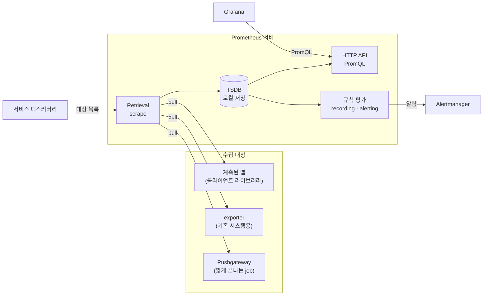
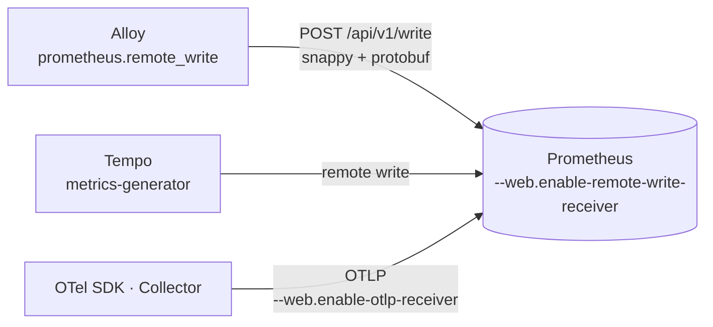
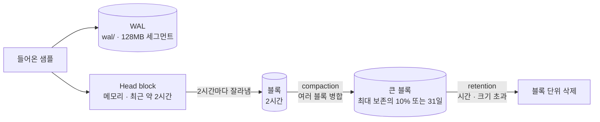

# 부록 7. Prometheus 상세

> 본문은 [7. Prometheus : 숫자를 15초마다 적어 두는 가계부](07-prometheus.md) 입니다. 이 부록은 저장 구조 · PromQL 세부 · 3.x 변경을 찾아볼 때 씁니다.
> 
> 이 문서는 **도구 자체**를 설명합니다. 비비디 설정값과 파일 위치는 [비비디 관측·알림·장애 대응](../01-비비디-관측-알림-장애대응.md) 3장을 참고해 주세요.
> 
> - 기준 문서 : `prometheus.io/docs/` (조사일 2026-10-10, Storage 문서는 release-3.15 빌드)
> - 문서에서 확인하지 못한 내용은 **확인 필요**, 문서 동작에서 끌어낸 설명은 **추론** 으로 표시합니다

---

## 7.1 Prometheus 는 무엇인가

- 오픈소스 **모니터링 · 알림 툴킷**입니다. 2012년 SoundCloud 에서 시작했고, 2016년 Kubernetes 다음으로 CNCF 에 합류했습니다
- **메트릭** : 숫자로 된 측정값. 그 값이 시간에 따라 변하는 기록이 **시계열(time series)** 입니다
    - 예 : 웹 서버의 요청 지연, DB 의 활성 연결 수
- 특징
    - 메트릭 이름 + key/value **라벨**로 시계열을 구분하는 다차원 데이터 모델
    - 이 차원으로 자르고 합치는 쿼리 언어 **PromQL**
    - 분산 저장소 없이 **서버 하나가 독립적으로 동작**
    - 기본 수집은 HTTP **pull**, push 가 필요하면 Pushgateway 를 거침
    - 서비스 디스커버리 또는 정적 설정으로 대상 발견

### 생태계 구성



- **서버** : 시계열을 scrape 해서 저장
- **클라이언트 라이브러리** : 앱 코드에서 메트릭을 만듦 (Spring 은 Micrometer 가 이 역할)
- **exporter** : 직접 계측할 수 없는 시스템(HAProxy, MySQL 등)의 상태를 메트릭으로 바꿔 노출
- **Pushgateway** : 금방 끝나는 배치 job 이 결과를 밀어 넣는 곳
- **Alertmanager** : Prometheus 알림을 묶고 보내는 곳 (비비디는 Grafana Alerting 을 써서 사용하지 않음)

### 왜 pull 인가 (FAQ)

- 모니터링 서버를 필요할 때 더 띄울 수 있습니다
- 대상이 죽었는지 더 확실히 알 수 있습니다 (`up` 이 0 이 됨)
- 대상의 `/metrics` 를 브라우저로 직접 열어 볼 수 있습니다
- 다만 문서도 pull 이 "약간 더 나을 뿐 큰 요점은 아니다" 라고 말합니다

### 잘 맞는 곳 · 안 맞는 곳

- 맞는 곳 : 순수한 숫자 시계열. 서버 중심 모니터링, 마이크로서비스처럼 대상이 자주 바뀌는 구조
- 신뢰성 우선 설계 : 장애 중에도 쓸 수 있도록, 서버마다 네트워크 저장소나 원격 서비스 없이 동작합니다
- 안 맞는 곳 : **요청 단위 과금처럼 100% 정확도가 필요한 곳**. 과금은 별도 시스템, 나머지 모니터링은 Prometheus 를 권합니다

---

## 7.2 데이터 모델

### 시계열 = 메트릭 이름 + 라벨 집합

```
http_server_requests_seconds_count{method="GET", status="200", uri="/api/weddings"}  1523  @1760000000000
└──────────── 메트릭 이름 ─────────┘└──────────────── 라벨 ─────────────────────────┘   값     타임스탬프(ms)
```

- 메트릭 이름 + 라벨 집합이 **시계열 하나를 식별**합니다
- 라벨 값이 하나라도 다르면 **다른 시계열**입니다 (라벨 추가 · 삭제도 마찬가지)
- 메트릭 이름은 내부적으로 `__name__` 라벨입니다 → `{__name__="http_requests_total"}` 로도 같은 시계열을 가리킵니다
- **샘플** : 값(float64 또는 native histogram) 하나 + 밀리초 타임스탬프 하나

### 이름 규칙

- 메트릭 이름 : 측정 대상을 나타내는 이름 (예 : `http_requests_total`)
    - 3.x 는 UTF-8 문자를 모두 허용합니다. 호환을 위해 `[a-zA-Z_:][a-zA-Z0-9_:]*` 를 권장하고, 벗어나면 PromQL 에서 따옴표가 필요합니다
    - 콜론 `:` 은 recording rule 용으로 예약 → 직접 계측에는 쓰지 않습니다
- 라벨 이름 : `__` 로 시작하는 이름은 내부용 예약, 권장 형식 `[a-zA-Z_][a-zA-Z0-9_]*`
- 라벨 값 : 어떤 UTF-8 이든 가능. **빈 값 라벨은 라벨이 없는 것과 같습니다**
- 3.x 기본 이름 검증은 `utf8` 입니다. 2.x 방식이 필요하면 `metric_name_validation_scheme: legacy`

---

## 7.3 메트릭 타입

서버는 타입을 구분해 저장하지 않습니다. native histogram 을 빼면 모두 **타입 없는 숫자 시계열**로 평탄화해 저장합니다. 타입은 "어떻게 읽어야 하는지" 에 대한 약속입니다.

### Counter

- **늘어나기만** 하는 누적값. 프로세스가 재시작될 때만 0 으로 돌아갑니다
- 예 : 처리한 요청 수, 에러 수
- 값 자체보다 **증가 속도(`rate`) · 증가량(`increase`)** 을 봅니다
- 문서 경고 : 줄어들 수 있는 값을 counter 로 노출하지 말 것 (그건 gauge)

### Gauge

- **오르내리는** 현재값. 예 : 메모리 사용량, 활성 DB 커넥션 수, 온도
- 값 자체를 그대로 봅니다

### Histogram (classic)

- 관측값(응답 시간 등)을 미리 정한 **버킷**에 세는 방식. 사실상 "버킷별 counter 묶음" 입니다
- 하나의 histogram 이 세 종류 시계열로 노출됩니다

```
http_request_duration_seconds_bucket{le="0.1"}   240   ← 0.1초 이하 요청 수 (누적)
http_request_duration_seconds_bucket{le="0.5"}   290   ← 0.5초 이하 요청 수 (0.1초 이하 포함)
http_request_duration_seconds_bucket{le="+Inf"}  300   ← 전체 요청 수
http_request_duration_seconds_sum                  42.7  ← 관측값 합계
http_request_duration_seconds_count               300   ← 관측 횟수 (= le="+Inf")
```

- 버킷은 **누적**입니다. 각 버킷은 자기 상한(`le`, less or equal) 이하인 관측을 모두 포함합니다
- 백분위(p95 등)는 서버에서 `histogram_quantile()` 로 계산합니다 (7.6 참고)
- 3.0 부터 `le` · `quantile` 값이 수집 때 정규화됩니다 → `le="1"` 은 `le="1.0"` 이 됩니다. 정수로 적은 쿼리 · 알림은 고쳐야 합니다

### Histogram (native)

- count · sum · 버킷을 **복합 샘플 하나**로 저장합니다. 버킷 경계를 미리 정할 필요가 없고, 해상도가 높고 전송이 원자적입니다
- 클라이언트 라이브러리가 지원하면(현재 Go, Java) classic 보다 권장됩니다
- 3.x 에서는 scrape 설정 `scrape_native_histograms`(기본 `false`)로 켭니다. feature flag `native-histograms` 는 v3.9 부터 아무 동작도 하지 않습니다

### Summary

- 앱 쪽에서 **미리 계산한 분위수**를 노출합니다 : `name{quantile="0.95"}`, `name_sum`, `name_count`
- 앱 안에서 계산하므로 여러 인스턴스 값을 합쳐 다시 분위수를 구할 수 없습니다 → 확인 필요 (문서의 histogram vs summary 가이드 페이지는 읽지 못함)

---

## 7.4 수집 (scrape)

### job 과 instance

- **instance** : scrape 할 수 있는 엔드포인트 하나 (보통 프로세스 하나)
- **job** : 같은 목적의 instance 묶음
- scrape 할 때 자동으로 붙는 라벨
    - `job` : 설정한 job 이름
    - `instance` : 대상 URL 의 `<host>:<port>`
- 수집한 데이터에 이미 같은 이름 라벨이 있으면 `honor_labels`(기본 `false`)에 따라 처리
    - `false` : 대상 쪽 라벨은 `exported_job` 처럼 이름이 바뀌고 서버 쪽 값이 붙음
    - `true` : 대상 쪽 값을 그대로 씀

### scrape 마다 자동으로 생기는 시계열

- `up` : 수집 성공 1, 실패 0 → **대상이 살아 있는지 보는 가장 기본 지표**
- `scrape_duration_seconds` : 수집에 걸린 시간
- `scrape_samples_scraped`, `scrape_samples_post_metric_relabeling`
- `scrape_series_added` : 새로 생긴 시계열 수 (근사치)

### scrape 기본값

- 전역 `scrape_interval` 1m, `scrape_timeout` 10s (간격보다 클 수 없음), `evaluation_interval` 1m
- `metrics_path` `/metrics`, `scheme` `http`, `honor_timestamps` `true`
- 수집 한도 (기본 0 = 무제한)
    - `sample_limit` : relabel 이후 샘플 수가 넘으면 **그 scrape 전체가 실패**
    - `label_limit` 등
- 3.x 변화
    - Content-Type 헤더가 없거나 이상하면 scrape 가 실패합니다 (2.x 는 text 로 처리). 필요하면 `fallback_scrape_protocol`
    - scheme 에 따라 `:80` / `:443` 을 자동으로 붙이지 않습니다

### staleness (오래된 값 처리)

- 쿼리는 **lookback(기본 5분)** 안의 가장 최근 샘플을 씁니다
- scrape 에서 시계열이 사라지거나 대상이 사라지면 곧 **stale 표시**가 들어가고, 그 이후 시점의 쿼리에는 값이 나오지 않습니다
- 대상이 직접 타임스탬프를 붙인 경우에는 기본적으로 5분간 마지막 값이 남습니다

### relabel

- `relabel_configs` : scrape **전에** 대상의 라벨을 바꿈
- `metric_relabel_configs` : scrape **후** 샘플에 적용 (`sample_limit` 이 "metric relabel 이후" 기준이라는 점에서 확인)
- 확인 필요 : action 목록과 기본값 (설정 문서가 잘려 읽지 못함. 같은 개념의 Alloy `discovery.relabel` 은 6장 참고)

---

## 7.5 remote write 와 OTLP 수신

pull 이 기본이지만, 다른 곳에서 **밀어 넣는(push)** 길도 있습니다.



- **remote write 수신**
    - `--web.enable-remote-write-receiver`(기본 false)로 켭니다. 엔드포인트 `/api/v1/write`
    - 2.x 의 feature flag `remote-write-receiver` 를 대체한 정식 플래그입니다
    - 프로토콜 : 1.0(안정) 기본, 2.0(실험) 은 `--web.remote-write-receiver.accepted-protobuf-messages` 로 허용
- **remote write 송신** (Prometheus 가 다른 곳으로 보낼 때) : 3.x 에서 `enable_http2` 기본값 `false`
- **OTLP 수신** : `--web.enable-otlp-receiver`(기본 false). 설정 파일 `otlp` 섹션으로 리소스 속성 승격 등을 정함
- push 를 쓰면 **모니터링 서버가 앱 서버로 접속할 필요가 없습니다** → 방화벽 · 네트워크 구성이 단순해집니다 (비비디가 이 방식)

---

## 7.6 저장소 : TSDB



### 구조

- **Head block** : 지금 들어오는 데이터. **메모리**에 있고 완전히 영속화되지 않았습니다
- **WAL** : head 의 내용을 디스크에 먼저 남긴 기록. 재시작하면 WAL 을 다시 읽어 head 를 복원합니다
    - `wal/` 에 128MB 세그먼트, 압축되지 않아 블록보다 훨씬 큼
    - 최소 3개 파일 유지, 트래픽이 많으면 최소 2시간 분량 유지
- **블록** : 2시간 단위로 잘라 디스크에 저장한 데이터
    - 블록 디렉터리마다 `chunks/`(샘플), `index`(이름 · 라벨 → 시계열), `meta.json`, `tombstones`(API 로 지운 표시)
    - chunk 세그먼트 파일은 최대 512MB
- **compaction** : 2시간 블록을 백그라운드에서 더 큰 블록으로 합칩니다
    - 합친 블록 최대 길이 = 보존 기간의 10% 와 31일 중 작은 값
    - 합치는 동안 원본과 새 블록이 함께 있어 **디스크를 잠시 더 씁니다**

### 보존 (retention)

- 시간 기준 : 시간 · 크기 기준이 둘 다 없으면 **15일**
- 크기 기준 : 기본 0(끔). 단위는 2의 거듭제곱 (1KB = 1024B)
- 둘 다 설정하면 **먼저 닿는 쪽**이 적용됩니다
- 주의할 동작
    - 삭제는 **블록 통째로**만 일어납니다. 블록 하나가 전부 기간을 넘어야 지워집니다
    - 정리 작업은 최대 2시간까지 걸릴 수 있습니다
    - 크기 기준에는 **WAL 과 m-mapped chunk 도 포함**되지만, 지워지는 건 영속 블록뿐입니다
    - 크기 한도는 할당한 디스크의 **80~85% 이하**로 잡으라고 권합니다 (나머지는 compaction 여유분)
- 3.15 명령줄 문서는 `--storage.tsdb.retention.time` · `--storage.tsdb.retention.size` 를 **Deprecated** 로 표시하고 설정 파일 필드를 쓰라고 합니다 (정확한 필드 이름은 확인 필요)

### 용량 계산

```
필요한 디스크 = 보존 시간(초) × 초당 들어오는 샘플 수 × 샘플당 바이트(약 1~2B)
```

- 디스크를 줄이려면 **scrape 간격을 늘리는 것보다 시계열 수를 줄이는 쪽**이 효과적입니다. 한 시계열 안의 샘플은 압축이 잘 되기 때문입니다

### 주의

- 로컬 저장소는 클러스터링 · 복제가 없습니다. **단일 노드 DB** 처럼 다루라고 합니다
- NFS(AWS EFS 포함)는 지원하지 않습니다
- 스냅샷 없이 파일을 복사해 백업하면 마지막 블록 이후(보통 2시간) 데이터를 잃을 수 있습니다

---

## 7.7 exemplar

- 메트릭 값에 그 순간의 **대표 요청 참조(주로 `trace_id`)** 를 붙여 둔 것입니다
    - 예 : "p95 가 2초로 튄 이 점" → "그때 느렸던 요청의 trace_id 는 4bf92f..."
- 저장 방식
    - 모든 시계열이 함께 쓰는 **고정 크기 순환 버퍼(메모리)** 에 저장, 오래된 것부터 밀려납니다
    - `trace_id` 만 담은 exemplar 하나가 약 100바이트
    - 로컬 영속성을 위해 WAL 에도 기록됩니다
    - 버퍼 크기는 설정 파일 `storage.exemplars` 블록 (필드 이름 확인 필요)
- 3.x 에서도 **feature flag** 입니다 : `--enable-feature=exemplar-storage`
- 확인 필요 : 문서는 "scrape 한" exemplar 를 설명합니다. remote write 로 받은 exemplar 의 저장 조건은 따로 확인하지 못했습니다

---

## 7.8 PromQL

### 결과 타입

- **instant vector** : 시계열마다 **한 시점의 값 하나**. 예 : `up`
- **range vector** : 시계열마다 **구간 안의 값 여러 개**. 예 : `http_server_requests_seconds_count[5m]`
- **scalar** : 숫자 하나
- 그래프(range query)의 최종 결과는 instant vector 또는 scalar 여야 합니다 → range vector 는 `rate()` 같은 함수로 다시 instant vector 로 바꿔야 그릴 수 있습니다

### 셀렉터와 매처

```promql
http_server_requests_seconds_count{status=~"5..", uri!~"/actuator.*"}
```

- 매처 : `=` 같음, `!=` 다름, `=~` 정규식 일치, `!~` 정규식 불일치
- 정규식은 **전체 일치**(앵커)입니다. `env=~"prod"` 는 `^prod$`
- 빈 값과 일치하는 매처는 그 라벨이 **없는** 시계열도 고릅니다
- 셀렉터에는 메트릭 이름이나, 빈 문자열과 일치하지 않는 매처가 하나 이상 있어야 합니다 (`{job=~".*"}` 불가, `{job=~".+"}` 가능)
- 3.x : 정규식 `.` 이 줄바꿈도 일치, range 구간은 **왼쪽 열림 · 오른쪽 닫힘**

### lookback 과 시간 수정자

- instant 값은 평가 시점 기준 **5분**(`--query.lookback-delta`) 안의 가장 최근 샘플입니다
- `offset 1h` : 1시간 전 시점으로 옮겨 평가, `@ <unix시간>` : 특정 시점으로 고정
- 기본 한도 : `--query.timeout` 2m, `--query.max-samples` 5천만

### counter 를 다루는 함수

| 함수 | 의미 | 쓰는 곳 |
| --- | --- | --- |
| `rate(x[5m])` | 구간의 **초당 평균 증가율**. 재시작(리셋) 자동 보정, 구간 끝까지 외삽 | 알림, 일반 그래프 |
| `irate(x[5m])` | **마지막 두 점**만으로 계산한 순간 증가율 | 빠르게 변하는 그래프 (알림에는 X) |
| `increase(x[5m])` | 구간 동안의 **증가량** (= rate × 구간 초) | "5분 동안 몇 건" |

- `increase` 는 외삽 때문에 정수 counter 에서도 **소수가 나올 수 있습니다** → 그래서 `round()` 를 씌우기도 합니다
- **rate 를 먼저, 합치기는 나중에** : `sum(rate(x[5m]))` (O), `rate(sum(x)[5m])` (X, 리셋을 감지 못함)

### 집계

```promql
sum by (uri) (rate(http_server_requests_seconds_count[5m]))
```

- `sum`, `avg`, `min`, `max`, `count`, `group`, `count_values`, `stddev`, `stdvar`, `quantile`, `topk`, `bottomk`
- `by (라벨)` : 나열한 라벨만 남기고 나머지로 합침 / `without (라벨)` : 나열한 라벨만 빼고 합침
- `topk(10, ...)` : 값이 큰 10개 시계열. 원래 라벨을 유지합니다. 정렬은 instant query 에서만 적용

### `histogram_quantile` : 백분위 계산

```promql
histogram_quantile(0.95, sum by (le) (rate(http_server_requests_seconds_bucket[5m])))
```

- 순서 : 버킷 `rate` → `le` 를 **남긴 채** 합치기 → 분위수 계산
- 버킷 안에서는 관측이 **균등하게 퍼져 있다고 가정하고 선형 보간**합니다 → 버킷이 넓으면 오차가 큽니다
- 특수 경우
    - 가장 높은 버킷이 `+Inf` 가 아니면 NaN
    - 분위수가 가장 높은 버킷에 걸리면 두 번째로 높은 버킷의 상한을 돌려줌
    - 버킷이 2개 미만이거나 관측이 0 이면 NaN

### 빈 결과와 `or vector(0)`

- 시계열이 하나도 없으면 결과는 **빈 벡터**입니다 (0 이 아님)
    - 예 : 5분 동안 5xx 가 한 번도 없어서 `status="5.."` 시계열이 아예 없는 경우
- `or` 는 왼쪽 결과에 없는 것을 오른쪽에서 채웁니다 → `... or vector(0)` 을 붙이면 빈 결과일 때 **0** 이 나옵니다 (추론 : 문서의 `or` 동작에서 끌어낸 설명, 패턴 자체를 설명한 문서는 확인하지 못함)
- 벡터끼리 산술할 때 **라벨이 맞는 짝이 없는 시계열은 결과에서 빠집니다**

---

## 7.9 카디널리티

- **카디널리티** = 시계열 개수 = 라벨 값 조합의 수
    - 예 : `uri` 50개 × `status` 5개 × `method` 4개 = 시계열 최대 1,000개
- 왜 문제인가
    - 라벨 값이 바뀔 때마다 새 시계열이 생깁니다
    - head block 이 메모리에 있으므로 시계열이 늘면 **메모리**가 늘고, 디스크 · 쿼리 비용도 늘어납니다
    - 수천 개 시계열을 돌려주는 쿼리는 서버에 부담입니다. 결과를 수백 개 이하로 유지하고, 필요하면 recording rule 로 미리 계산하라고 합니다
- 사용자 ID · 이메일 · 요청 ID 처럼 **값이 끝없이 늘어나는 것은 라벨로 쓰지 않습니다** (권고 원문 페이지는 확인 필요)
- 방어 장치 : `sample_limit`, `label_limit`

---

## 7.10 운영

### 설정 파일과 명령줄 플래그

- **명령줄 플래그** : 실행 중에 바꿀 수 없는 시스템 값 (저장 경로, 보존, 기능 플래그, 수신기 활성화)
- **설정 파일** (`prometheus.yml`) : scrape job, 대상, 규칙 파일
- 설정 리로드 : `SIGHUP` 또는 `POST /-/reload`(`--web.enable-lifecycle` 필요). 새 설정이 틀리면 적용되지 않습니다

### 그 밖의 기본값

- `--storage.tsdb.path` 기본 `data/`
- `--web.enable-admin-api` 기본 false (스냅샷 · 삭제 API)
- `--auto-gomemlimit` 기본 켜짐 : 컨테이너(cgroup) 메모리 한도의 90% 를 Go 메모리 한도로 설정
- 로그 형식 (3.x) : `time=... level=INFO source=... msg=...`

### 자체 지표

- Prometheus 도 자기 `/metrics` 를 노출합니다 (예 : `prometheus_tsdb_head_series` 현재 시계열 수, `prometheus_http_requests_total`)
- 확인 필요 : 자체 지표 목록을 설명한 공식 문서는 찾지 못했습니다

---

## 7.11 3.x 에서 바뀐 것

- 웹 UI 를 새로 만듦 (`--enable-feature=old-ui` 로 예전 UI)
- 이름 검증 기본 UTF-8
- `le` · `quantile` 값 정규화 (`"1"` → `"1.0"`)
- 정규식 `.` 이 줄바꿈 일치, range 셀렉터 왼쪽 열림
- 기능 플래그에서 정식 플래그로 : `remote-write-receiver` → `--web.enable-remote-write-receiver`, `agent` → `--agent`
- native histogram 은 scrape 설정 `scrape_native_histograms` 로
- remote write 송신 HTTP/2 기본 꺼짐
- TSDB 형식이 v2.55 에서 바뀌어, 3.x 데이터는 v2.55 이상에서만 읽힘 (다운그레이드 주의)

---

## 7.12 비비디 설정과 비교해 확인할 것

- 보존을 `--storage.tsdb.retention.time=30d`, `--storage.tsdb.retention.size=8GB` 플래그로 설정 중 → 3.15 에서 **deprecated**. 지금은 동작하지만 설정 파일 필드로 옮길 계획이 필요
- 8GB 크기 기준에는 WAL 도 포함, compaction 중 일시 초과 가능 → 디스크(gp3 30GB, Loki · Tempo 공유) 여유 확인
- `--enable-feature=exemplar-storage` 는 3.x 에서도 필요한 플래그 → 유지
- `--web.enable-remote-write-receiver` 는 3.x 정식 플래그 → 그대로 맞음
- remote write 로 받은 exemplar(Tempo `send_exemplars: true`)가 저장되는지 → Grafana 그래프의 exemplar 점으로 실제 확인 필요

---

## 용어

- **시계열** : 메트릭 이름 + 라벨 집합으로 구분되는, 시간순 값의 흐름
- **샘플** : 시계열의 점 하나 (값 + 타임스탬프)
- **scrape** : Prometheus(또는 Alloy)가 대상의 `/metrics` 를 주기적으로 가져가는 것 (pull)
- **remote write** : 다른 프로그램이 Prometheus 로 샘플을 밀어 넣는 프로토콜 (push)
- **head block** : 메모리에 있는 최신 데이터 구간
- **WAL** : 메모리 데이터를 잃지 않으려고 먼저 남기는 디스크 기록
- **compaction** : 작은 블록을 큰 블록으로 합치는 정리 작업
- **lookback** : 한 시점의 값을 찾을 때 뒤돌아보는 최대 시간 (기본 5분)
- **카디널리티** : 시계열(라벨 조합) 개수
- **exemplar** : 메트릭 점에 붙인 대표 요청(trace_id) 참조

## 출처

- [Overview](https://prometheus.io/docs/introduction/overview/) · [FAQ](https://prometheus.io/docs/introduction/faq/)
- [Data model](https://prometheus.io/docs/concepts/data_model/) · [Metric types](https://prometheus.io/docs/concepts/metric_types/) · [Jobs and instances](https://prometheus.io/docs/concepts/jobs_instances/)
- [Configuration](https://prometheus.io/docs/prometheus/latest/configuration/configuration/) · [Command line](https://prometheus.io/docs/prometheus/latest/command-line/prometheus/) · [Feature flags](https://prometheus.io/docs/prometheus/latest/feature_flags/)
- [Storage](https://prometheus.io/docs/prometheus/latest/storage/) · [Migration to 3.x](https://prometheus.io/docs/prometheus/latest/migration/)
- [Querying basics](https://prometheus.io/docs/prometheus/latest/querying/basics/) · [Operators](https://prometheus.io/docs/prometheus/latest/querying/operators/) · [Functions](https://prometheus.io/docs/prometheus/latest/querying/functions/)
- [Remote write spec](https://prometheus.io/docs/specs/remote_write_spec/)

## 확인 필요

- relabel action 목록 · 기본값, 메타 라벨
- retention 설정 파일 필드 이름, `storage.exemplars` 필드 이름과 기본값
- remote write 로 받은 exemplar · native histogram 저장 조건
- 카디널리티 · 라벨 권고 원문 (practices/naming, practices/instrumentation)
- histogram vs summary 선택 가이드 (practices/histograms)
- Prometheus 자체 지표 목록
