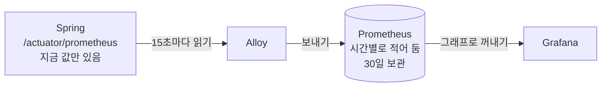

# 7. Prometheus : 숫자를 15초마다 적어 두는 가계부

> **한 줄 요약** : "요청 수 · 메모리 · DB 커넥션 수" 같은 **숫자**를 15초마다 받아 적어 두고, 나중에 그래프로 꺼내 볼 수 있게 해 주는 저장소입니다.
> 
> 처음이라면 [먼저 읽기](00-먼저-읽기.md) 부터 읽어 주세요. 저장 구조 · 쿼리 세부는 [부록 : Prometheus 상세](07-prometheus-상세.md) 에 있습니다.

---

## 1. 없으면 뭐가 불편한가

"지금 1초에 요청이 몇 개 들어와?" 를 로그로 답하려면 이렇게 해야 합니다.

```bash
docker logs bibbidi-backend --since 1m | grep "요청 처리" | wc -l
```

- 매번 로그를 세야 하고, "어제 같은 시간과 비교" 는 거의 불가능합니다
- 메모리 사용량처럼 **로그로 찍지 않는 값**은 아예 알 수 없습니다
- 그렇다고 `log.info("힙 사용량 {}", ...)` 를 15초마다 찍는 건 낭비입니다

숫자는 **숫자 전용 창고**에 따로 모으는 게 훨씬 싸고 빠릅니다. 그게 Prometheus 입니다.

---

## 2. Spring 은 이미 숫자를 세고 있다

Spring Boot Actuator 를 켜면, 앱이 **스스로 숫자를 세서 웹 페이지 하나에 적어 둡니다**. 비비디는 `http://backend:8081/actuator/prometheus` 에 있습니다. 열어 보면 이런 줄이 수백 개 있습니다.

```
# 지금까지 들어온 요청 수 (GET /api/weddings/{id}, 200 응답)
http_server_requests_seconds_count{method="GET",status="200",uri="/api/weddings/{id}"} 1523

# 지금 쓰고 있는 힙 메모리 (바이트)
jvm_memory_used_bytes{area="heap",id="G1 Eden Space"} 4.12E8

# 지금 사용 중인 DB 커넥션 수
hikaricp_connections_active{pool="HikariPool-1"} 3
```

- 이 숫자를 세는 라이브러리가 **Micrometer** 입니다. 우리가 코드를 쓰지 않아도 HTTP 요청, JVM, DB 커넥션 풀 숫자를 알아서 셉니다
- 이 페이지는 **지금 이 순간의 값**만 보여 줍니다. 과거 값은 없습니다
- 그래서 누군가 **15초마다 이 페이지를 읽어서 적어 둬야** 그래프가 됩니다 → Alloy 가 읽고, Prometheus 가 적어 둡니다



---

## 3. 숫자 한 줄 읽는 법

```
http_server_requests_seconds_count{method="GET", status="500", uri="/api/weddings/{id}"}  12
└──────────── 이름 ─────────────┘└─────────────── 이름표(라벨) ─────────────────────┘ 값
```

- **이름** : 무엇을 셌나 (HTTP 요청 수)
- **이름표(라벨)** : 어떤 것을 셌나 (GET 요청, 500 응답, 이 주소)
- **값** : 지금까지 몇 개
- **이름 + 이름표 조합이 다르면 다른 줄**입니다
    - `status="200"` 줄과 `status="500"` 줄은 따로 셉니다
    - 이렇게 따로 세는 줄 하나를 **시계열**이라고 부릅니다 ("시간에 따라 쌓이는 숫자 한 줄")
- Alloy 가 보낼 때 이름표를 더 붙입니다 : `deployment_environment_name="production"` (운영 · 개발 구분)

---

## 4. 숫자는 세 종류

### ① 계속 늘어나기만 하는 숫자 (Counter)

- 예 : 지금까지 들어온 요청 수 `http_server_requests_seconds_count`
- 앱이 재시작하면 0 부터 다시 셉니다
- **그대로 그래프로 그리면 계속 올라가는 선**이라 쓸모가 없습니다
- 그래서 **"최근 5분 동안 얼마나 늘었나"** 로 바꿔서 봅니다

```promql
increase(http_server_requests_seconds_count{status="500"}[5m])   # 최근 5분 동안 생긴 500 응답 수
rate(http_server_requests_seconds_count[5m])                      # 최근 5분 평균, 1초에 몇 개
```

### ② 오르내리는 숫자 (Gauge)

- 예 : 지금 힙 사용량 `jvm_memory_used_bytes`, 지금 DB 커넥션 수 `hikaricp_connections_active`
- **그대로 그래프로 그리면 됩니다**

### ③ 칸별로 나눠 센 숫자 (Histogram) : 응답 시간용

- 응답 시간을 "0.1초 이하 몇 개, 0.5초 이하 몇 개, 1초 이하 몇 개..." 처럼 **칸별로** 셉니다
- 이걸로 **p95** 를 계산합니다
    - p95 = 요청 100개를 빠른 순으로 줄 세웠을 때 **95번째 요청의 시간**
    - "대부분(95%)의 사용자는 이 시간 안에 응답을 받는다" 는 뜻
    - 평균은 아주 느린 요청 몇 개가 묻혀서 안 보이기 때문에 p95 를 씁니다
- 비비디의 API p95 는 Spring 이 아니라 **Tempo 가 트레이스를 세서 만든 숫자**(`traces_spanmetrics_latency_bucket`)로 계산합니다 ([9. Tempo](09-tempo.md) 참고)

> 참고 영상 (10분 테코톡) : 응답 시간 · 지연이 낯설다면 [효오의 Latency & Bandwidth](https://www.youtube.com/watch?v=mFBIwEhvZUY)

---

## 5. 비비디가 자주 보는 숫자

| 숫자 이름 | 뜻 | 종류 |
| --- | --- | --- |
| `up` | Alloy 가 Spring 숫자 페이지를 읽을 수 있나 (1 = 됨, 0 = 안 됨) | - |
| `http_server_requests_seconds_count` | API 요청 수 (`status`, `uri` 이름표) | 늘어나기만 |
| `hikaricp_connections_active` / `_idle` / `_pending` / `_max` | DB 커넥션 : 사용 중 / 쉬는 중 / **기다리는 요청** / 최대 | 오르내림 |
| `jvm_memory_used_bytes` / `jvm_memory_max_bytes` | 힙 사용량 / 최대 | 오르내림 |
| `jvm_gc_live_data_size_bytes` | GC 를 하고 나서도 **남아 있는** 데이터 크기 (계속 오르면 메모리 누수 의심) | 오르내림 |
| `jvm_gc_pause_seconds_*` | GC 때문에 앱이 멈춘 시간 | Histogram |
| `disk_free_bytes` / `disk_total_bytes` | 앱 서버 디스크 남은 양 / 전체 | 오르내림 |
| `traces_spanmetrics_latency_bucket` | API 응답 시간 (Tempo 가 만듦) | Histogram |

> 참고 영상 (10분 테코톡)
> - DB 커넥션 풀 : [폰드의 커넥션 풀](https://www.youtube.com/watch?v=kNAIvfFolAs) · [쿠기의 Connection Pool & Keep-Alive](https://www.youtube.com/watch?v=MBgEhSUOlXo)
> - 요청을 처리하는 스레드 : [푸우의 Tomcat Thread Pool](https://www.youtube.com/watch?v=prniILbdOYA)
> - 힙 · GC : [어썸오의 JVM Memory Layout](https://www.youtube.com/watch?v=GU254H0N93Y) · [무민의 JVM Stack & Heap](https://www.youtube.com/watch?v=UzaGOXKVhwU) · [가이온의 Garbage Collection](https://www.youtube.com/watch?v=wWu1lNvctic)

---

## 6. 숫자 꺼내 보기 : PromQL 기초

PromQL 은 Prometheus 에서 숫자를 꺼내는 검색어입니다. SQL 의 `SELECT` 처럼 생각하면 됩니다.

### 단계 1 : 이름으로 고르기

```promql
up
```

→ `up` 이라는 이름의 줄을 전부 보여 줍니다.

### 단계 2 : 이름표로 좁히기 (SQL 의 WHERE)

```promql
http_server_requests_seconds_count{deployment_environment_name="production", status=~"5.."}
```

- `=` 같다, `!=` 다르다
- `=~` 정규식에 맞다 (`"5.."` = 5 로 시작하는 세 자리 → 500, 502, 503...)
- `!~` 정규식에 안 맞다 (예 : `uri!~"/actuator.*"` = actuator 주소 제외)

### 단계 3 : 늘어나기만 하는 숫자는 `increase` / `rate`

```promql
increase(http_server_requests_seconds_count{status=~"5.."}[5m])
```

- `[5m]` = "최근 5분 치를 가져와서"
- `increase(...)` = "그동안 얼마나 늘었나"

### 단계 4 : 합치기 (SQL 의 SUM + GROUP BY)

```promql
sum by (uri) (rate(http_server_requests_seconds_count{deployment_environment_name="production"}[5m]))
```

- 같은 `uri` 끼리 더해서, **API 별 초당 요청 수**를 보여 줍니다
- `sum` (이름표 상관없이 다 더함), `sum by (uri)` (uri 별로 더함), `topk(10, ...)` (큰 것 10개)

### 단계 5 : p95

```promql
histogram_quantile(0.95, sum by (le) (rate(traces_spanmetrics_latency_bucket{deployment_environment_name="production", span_kind="SPAN_KIND_SERVER"}[5m])))
```

- 길어 보이지만 순서는 이렇습니다 : 칸별 숫자를 5분 기준으로 바꾸고(`rate`) → 칸(`le`)별로 더하고(`sum by (le)`) → 95% 지점을 계산(`histogram_quantile(0.95, ...)`)
- 처음에는 **그대로 복사해서 이름표만 바꿔 쓰면 됩니다**

---

## 7. 꼭 알아야 할 것

### ① "결과 없음" 은 0 이 아닙니다

- 5분 동안 500 에러가 한 번도 없으면 `status="500"` 줄 자체가 없어서 **빈 결과**가 나옵니다
- 그래프가 비어 보이거나, 알림이 "데이터 없음" 으로 빠집니다
- 그래서 뒤에 `or vector(0)` 을 붙입니다 → "없으면 0 으로 쳐 줘"

```promql
sum(increase(http_server_requests_seconds_count{status=~"5.."}[5m])) or vector(0)
```

### ② 이름표에 값이 끝없이 늘어나는 걸 넣으면 안 됩니다

- 이름표 조합마다 줄(시계열)이 하나씩 생기고, 줄마다 메모리를 씁니다
- `userId` 를 이름표로 넣으면 **사용자 수만큼 줄**이 생깁니다 → 모니터링 서버(메모리 2GB)가 버티지 못합니다
- 사용자 ID, 요청 ID, 이메일은 **이름표로 쓰지 않습니다**. 그런 건 로그나 트레이스에서 찾습니다
- 그래서 Alloy 는 한 번에 5,000줄이 넘으면 수집을 포기하도록 막아 뒀습니다 (`sample_limit = 5000`)

### ③ 숫자는 30일만 보관합니다

- 30일이 지나거나 8GB 를 넘으면 오래된 것부터 지웁니다
- 정확한 과금 · 통계용이 아니라 **"지금 괜찮은가"** 를 보는 용도입니다

---

## 8. 직접 해 보기

Grafana → 왼쪽 메뉴 **Explore** → 위쪽에서 데이터소스 **Prometheus** 선택 → 쿼리 입력 → **Run query**

| 해 볼 것 | 쿼리 | 보는 법 |
| --- | --- | --- |
| backend 가 살아 있나 | `up{job="prometheus.scrape.bibbidi_backend"}` | 1 이면 정상 |
| 최근 5분 500 에러 수 | `sum(increase(http_server_requests_seconds_count{deployment_environment_name="production", status=~"5.."}[5m])) or vector(0)` | 0 이면 정상 |
| 힙 사용률 | `sum(jvm_memory_used_bytes{area="heap", deployment_environment_name="production"}) / sum(jvm_memory_max_bytes{area="heap", deployment_environment_name="production"})` | 0.75 를 넘으면 경고 알림 기준 |
| DB 커넥션을 기다리는 요청 | `hikaricp_connections_pending{deployment_environment_name="production"}` | 0 이 정상, 1 이상이면 경고 알림 기준 |

- 쿼리 입력칸 옆 **Builder** 를 누르면 쿼리를 몰라도 메뉴에서 골라 만들 수 있습니다

---

## 9. 할 수 있지만 비비디는 안 하는 것

| 할 수 있는 것 | 비비디는 | 공식 문서 |
| --- | --- | --- |
| **Prometheus 가 앱을 직접 읽기** (원래 기본 방식) | Alloy 가 대신 읽어서 보내 줌 (모니터링 서버가 앱 서버로 접속할 필요 없음) | [Overview](https://prometheus.io/docs/introduction/overview/) |
| **Alertmanager 로 알림 보내기** | Grafana 에서 알림 | [Overview](https://prometheus.io/docs/introduction/overview/) |
| **exporter 로 다른 프로그램 숫자 모으기** (MySQL, 서버 CPU · 디스크 등) | Spring 숫자만 수집. DB 서버 · 모니터링 서버는 AWS CloudWatch 로 일부만 봄 | [Overview](https://prometheus.io/docs/introduction/overview/) |
| **Pushgateway** (잠깐 돌고 끝나는 배치 작업이 숫자를 밀어 넣기) | 배치 작업 없음 | [Overview](https://prometheus.io/docs/introduction/overview/) |
| **장기 보관 · 여러 대로 늘리기** (Mimir, Thanos 같은 원격 저장소) | 서버 한 대, 30일 보관 | [Storage : remote storage](https://prometheus.io/docs/prometheus/latest/storage/) |
| **recording rule** (자주 쓰는 무거운 쿼리를 미리 계산해 저장) | 쿼리가 가벼워 안 씀 | [Configuration](https://prometheus.io/docs/prometheus/latest/configuration/configuration/) |
| **native histogram** (칸을 미리 정하지 않는 새 방식의 응답 시간 저장) | 기존 방식 사용 | [Metric types](https://prometheus.io/docs/concepts/metric_types/) |
| **OTLP 로 직접 받기** | Alloy 가 Prometheus 방식(remote write)으로 보냄 | [Command line flags](https://prometheus.io/docs/prometheus/latest/command-line/prometheus/) |
| **Agent 모드** (저장 없이 모아서 넘기기만) | 저장소로 사용 | [Feature flags](https://prometheus.io/docs/prometheus/latest/feature_flags/) |

---

## 10. 자주 하는 실수

| 증상 | 원인 |
| --- | --- |
| 그래프가 계속 올라가기만 함 | 늘어나기만 하는 숫자를 `increase` / `rate` 없이 그림 |
| 그래프가 비어 있음 | 해당 이름표 조합의 숫자가 아직 한 번도 안 생김 → `or vector(0)` |
| 운영 · 개발 숫자가 합쳐져 보임 | `deployment_environment_name` 조건을 빼먹음 |
| `increase` 결과가 `2.0000001` 처럼 소수 | 정상 (구간 양끝을 추정해서 계산함). 필요하면 `round()` |
| 쿼리가 에러 | 정규식이 `=~` 가 아니라 `=` 로 되어 있거나, 괄호 짝이 안 맞음 |

---

## 더 알고 싶다면

- [부록 : Prometheus 상세](07-prometheus-상세.md) : 저장 구조(WAL, 블록), 보관 동작, PromQL 함수 세부, 3.x 변경
- [공식 문서 : Overview](https://prometheus.io/docs/introduction/overview/)
- [공식 문서 : PromQL 기초](https://prometheus.io/docs/prometheus/latest/querying/basics/)
- 참고 영상 (10분 테코톡) : [몽이의 Metric](https://www.youtube.com/watch?v=mAbG2bY2yiA)
