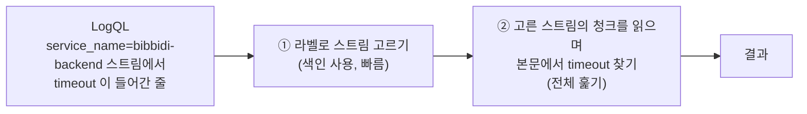
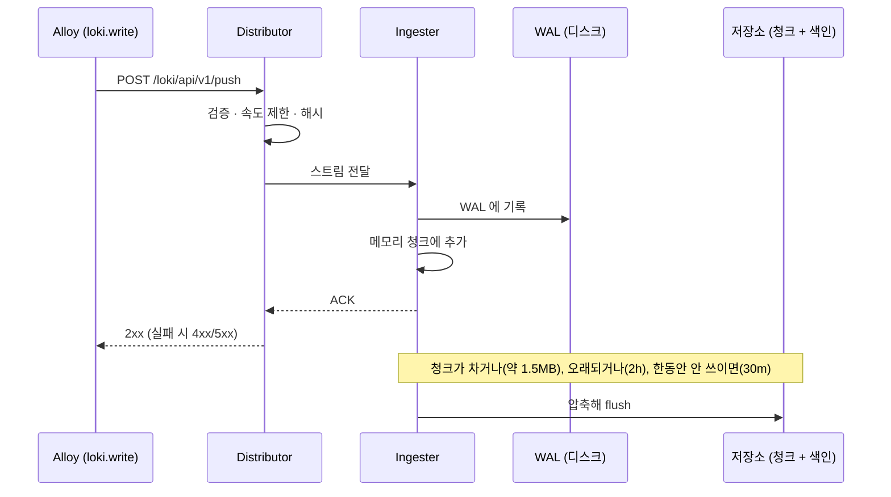
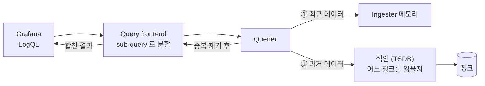
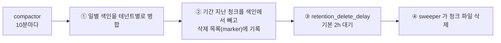

# 부록 8. Loki 상세

> 본문은 [8. Loki : 여러 서버의 로그를 한곳에서 검색하는 곳](08-loki.md) 입니다. 이 부록은 내부 구조 · 제한 값 · LogQL 세부를 찾아볼 때 씁니다.
> 
> 이 문서는 **도구 자체**를 설명합니다. 비비디 설정값과 파일 위치는 [비비디 관측·알림·장애 대응](../01-비비디-관측-알림-장애대응.md) 2장을 참고해 주세요.
> 
> - 기준 문서 : `grafana.com/docs/loki/latest/` (조사일 2026-10-10, 문서 버전 v3.7.x)
> - 문서에서 확인하지 못한 내용은 **확인 필요** 로 표시합니다

---

## 8.1 Loki 는 무엇인가

- **"a horizontally-scalable, highly-available, multi-tenant log aggregation system inspired by Prometheus"**
    - Prometheus 에서 영감을 받은 **로그** 저장 · 조회 시스템입니다
    - Prometheus 와 달리 **push** 로 받습니다 (수집기가 Loki 로 보냄)
- 핵심 설계 : **로그 본문은 색인하지 않고, 라벨만 색인합니다**
    - 색인이 작고, 본문은 압축된 청크로 저장 → 운영이 단순하고 비용이 낮습니다
    - 문서는 이를 "the full contents of every log line" 을 색인하는 다른 로그 시스템과 대비합니다
    - 참고 : 문서에는 Elasticsearch 라는 제품명이 직접 나오지 않습니다. ES 와의 비교는 일반론으로 다뤄야 합니다

### 쿼리는 두 단계로 실행됩니다



- ① 은 색인으로 빠르게, ② 는 해당 청크를 **실제로 읽으며** 찾습니다
- 그래서 **라벨로 범위를 좁힐수록 빠르고**, 넓은 범위 + 본문 검색은 느립니다

### 전체 구성

- **수집기**(예 : Alloy) : 로그를 모아 라벨을 붙여 HTTP 로 push
- **Loki 서버** : 저장과 조회
- **조회** : Grafana, LogCLI, HTTP API
- 알림용 구성요소로 ruler 가 있습니다 (비비디는 Grafana Alerting 사용)

---

## 8.2 데이터 모델

### 로그 스트림과 엔트리

- **로그 스트림** : 같은 라벨 집합을 가진 로그 묶음 ("A log stream is a set of logs which share the same labels")
    - 스트림은 tenant ID + 라벨 집합으로 식별됩니다
    - 스트림에는 **라벨이 최소 하나** 있어야 저장 · 조회됩니다
- **엔트리** : 스트림 안의 로그 한 줄 = **나노초 타임스탬프 + 본문(로그 줄)** (+ structured metadata)

```
스트림 {service_name="bibbidi-backend", deployment_environment_name="production"}
 ├─ 2026-10-10T01:23:45.678000000Z  {"log":{"level":"INFO"},"message":"login ok"}
 ├─ 2026-10-10T01:23:46.012000000Z  {"log":{"level":"ERROR"},"message":"token request failed"}
 └─ ...
스트림 {service_name="nginx", deployment_environment_name="production"}
 └─ ...
```

- 라벨 이름 규칙은 Prometheus 와 같습니다 (`[a-zA-Z_:][a-zA-Z0-9_:]*`). 안 되는 문자는 `_` 로 바뀝니다 (`app.kubernetes.io/name` → `app_kubernetes_io_name`)
- **라벨 값이 하나라도 바뀌면 새 스트림**이 생깁니다

### 카디널리티 = 스트림 수

- 예 : `status_code` 3종 × `action` 5종 = 15 스트림, 여기에 `endpoint` 3종을 더하면 45 스트림
- 카디널리티가 높으면
    - 색인이 커지고
    - **아주 작은 청크 수천 개**가 저장소로 flush 되어 성능이 크게 떨어집니다 ("significant performance degradation")
- 문서가 든 고카디널리티 예 : 타임스탬프, IP, Pod 이름, User ID, Customer ID, **Trace ID**
- 확인 명령 : `logcli series '{}' --since=1h --analyze-labels`

### 라벨 권고 (best practices)

- 기본 색인 라벨 한도 15개, 권장은 **10~15개 이하, 적을수록 좋음**
- 라벨로 좋은 것 : region, cluster, application, namespace, environment 처럼 **값이 적고 잘 안 바뀌는 것**
- 동적 라벨은 아껴서 : "don't add a label for something until you know you need it!"
    - `{app="loki", level="error"}` 보다 `{app="loki"} |= "level=error"` 를 권합니다
- **"Do not extract ephemeral values like a trace ID or an order ID into a label"**
- 로그 레벨, 메시지, 예외 이름은 라벨로 만들 필요가 없습니다

### Structured metadata

- 로그에 붙이는 부가 정보인데 **색인하지 않고, 본문에도 넣지 않습니다**
- 쓰는 곳 : `trace_id`, Pod 이름, user ID 처럼 **값이 매번 다른 것**
- 조회할 때 파서 없이 바로 필터할 수 있습니다 : `{job="example"} | trace_id="0242ac120002"`
- 조건 : **schema v13 이상 + TSDB 색인** (그렇지 않으면 Loki 가 시작하지 않음)
- 한도 : 엔트리당 64KB, 128개. 넘으면 HTTP 400 으로 거부

| 구분 | 라벨 | structured metadata | 본문 |
| --- | --- | --- | --- |
| 색인 | O | X | X |
| 값 종류 | 적어야 함 | 많아도 됨 | - |
| 조회 | `{라벨="값"}` 로 스트림 선택 | `\| 키="값"` 로 필터 | `\|= "문자열"`, 파서 |
| 예 | `service_name`, 환경 | `trace_id`, 로그 레벨 | 원래 로그 한 줄 |

### 자동 `service_name` 라벨

- 스트림에 `service_name` 이 없으면 다음 순서로 처음 값이 있는 라벨을 씁니다 : `service`, `app`, `application`, `app_name`, `name`, `app_kubernetes_io_name`, `container`, `container_name`, ... `job`
- 하나도 없으면 `unknown_service`
- Logs Drilldown 이 이 라벨을 씁니다

### OTLP 로 받을 때

- 정해진 리소스 속성 17개만 라벨이 되고(점 → `_`), 나머지는 structured metadata 가 됩니다
    - 예 : `service.name`, `service.namespace`, `service.instance.id`, `deployment.environment.name`
- 문서는 이 중 `k8s.pod.name` 과 **`service.instance.id`** 를 카디널리티 때문에 "no longer recommended" 기본 라벨이라고 합니다

---

## 8.3 아키텍처

Loki 는 여러 구성요소로 나뉜 하나의 바이너리입니다. 단일 바이너리로 띄우면(monolithic) 이 구성요소가 **한 프로세스 안에서** 모두 돕니다.

### 구성요소

| 구성요소 | 역할 |
| --- | --- |
| **Distributor** | 쓰기 요청 입구. 라벨 · 타임스탬프 · 줄 길이 검증, 라벨 정렬, 속도 제한, 해시로 담당 ingester 결정 |
| **Ingester** | 최근 로그를 **메모리**에 청크로 모았다가 저장소로 flush. 메모리에 있는 데이터로 조회에도 응답 |
| **Query frontend** | 큰 쿼리를 작은 sub-query 로 쪼개 병렬 실행, 결과 합치기, 캐시 |
| **Query scheduler** | 테넌트별 큐 (선택) |
| **Querier** | 실제 조회. ingester(최근) + 저장소(과거)를 함께 읽고 중복 제거 |
| **Index gateway** | 색인(TSDB) 메타데이터 조회 담당 |
| **Compactor** | 색인 파일 병합, **보존 기간 삭제** |
| **Ruler** | recording · alerting 규칙 평가 |

### 쓰기 경로 (write path)



- 복제(`replication_factor`)를 쓰면 여러 ingester 에 보내고 과반(quorum) ACK 를 기다립니다. 문서상 일반적으로 3
- **WAL** : 받은 데이터를 디스크에 먼저 기록 → 재시작 시 다시 읽어 복원. "won't lose data once a write has been acknowledged"
    - 기본 켜짐, 디스크 사용률 90% 를 넘으면 새 쓰기를 거부
    - 디스크 검사는 파일시스템 전체 기준 → WAL 디스크를 다른 데이터와 공유하지 말라고 권합니다
- 청크 flush 기본값 : `chunk_target_size` 1.5MB, `max_chunk_age` 2h, `chunk_idle_period` 30m

### 읽기 경로 (read path)



---

## 8.4 배포 모드

| 모드 | 형태 | 규모 |
| --- | --- | --- |
| **Monolithic** (`-target=all`) | 모든 구성요소가 한 프로세스 | 하루 약 20GB 까지, 실험 · 소규모 |
| Simple Scalable (SSD) | write / read / backend 세 그룹 | 하루 1TB 가까이. **Loki 4.0 에서 제거 예정** |
| Microservices | 구성요소마다 별도 프로세스 | 아주 큰 클러스터, Kubernetes 전제 |

---

## 8.5 저장

### 청크와 색인의 분리

- **색인** : "목차". 라벨 집합 → 어느 청크에 있는지
- **청크** : 라벨 집합별 로그 엔트리 묶음 (압축)
- Loki 2.0 부터 색인과 청크를 같은 저장소(object storage 또는 파일시스템)에 둡니다

### TSDB 색인

- Loki 2.8 부터 권장하는 색인 형식입니다. Prometheus TSDB 설계를 바탕으로 합니다
- 색인에 청크 크기 · 줄 수가 들어 있어, 쿼리할 때 데이터량을 보고 샤드를 나눕니다 (샤드당 약 300~600MB 목표)
- 새 저장 기능은 TSDB 에서만 제공됩니다

### schema_config

```yaml
schema_config:
  configs:
    - from: 2026-10-06        # 이 날짜부터 적용
      store: tsdb             # 유일한 권장
      object_store: filesystem
      schema: v13             # 최신 · 권장
      index:
        prefix: index_
        period: 24h           # 반드시 24h
```

- v13 이 필요한 이유 : structured metadata 와 OTLP 수집이 기본 켜져 있는데, 둘 다 `tsdb` + `v13` 이상이 필요합니다
- schema 를 바꿀 때는 **미래 날짜**의 `from` 으로 새 항목을 **추가**합니다. 기존 데이터는 옛 schema 로 계속 읽습니다

### filesystem 저장의 한계

- **"Grafana Labs does not support the filesystem object store for production environments"**
- 복제가 없어 디스크가 망가지면 데이터를 잃습니다
- 한 디렉터리에 파일이 너무 많아지면 문제가 생길 수 있습니다 (약 550만 청크에서 오류 사례)
- **디스크가 차는 걸 보고 지우지 않습니다.** 삭제는 보존 설정으로만 일어나므로 디스크 관리는 Loki 밖에서 해야 합니다
- 단일 테넌트(`auth_enabled: false`)면 청크가 `fake` 폴더에 저장됩니다

---

## 8.6 보존과 삭제

- **보존을 켜지 않으면 로그는 영원히 남습니다** ("the logs sent to Loki live forever"). `retention_period` 기본 `0s` = 무기한
- 보존은 **compactor** 가 처리합니다



- 지연을 두는 이유 : 다른 구성요소가 새 색인을 받아갈 시간, 설정 실수를 되돌릴 시간
- 주요 키 : `compaction_interval` 10m, `retention_delete_delay` 2h, 보존을 켜면 `delete_request_store` 필수 (filesystem 이면 `filesystem`)
- 스트림별 보존 : `limits_config.retention_stream` 에 셀렉터 · 우선순위 · 기간(최소 24h)
- 기간을 바꿔도 **이미 들어온 로그에 소급되지 않습니다**
- 삭제 API `/loki/api/v1/delete` 는 보존이 켜져 있을 때만 생깁니다

---

## 8.7 제한과 거부

Loki 는 스스로를 보호하려고 일정 조건을 넘는 로그를 **거부**합니다. 거부된 로그는 저장되지 않습니다.

### 주요 한도 (기본값)

- `ingestion_rate_mb` 4MB/s, `ingestion_burst_size_mb` 6MB (테넌트 전체)
- `per_stream_rate_limit` 3MB/s, burst 15MB (스트림 하나)
- `max_global_streams_per_user` 5000 (활성 스트림 수)
- `max_line_size` 256KB
- `reject_old_samples` true, `reject_old_samples_max_age` 168h (7일보다 오래된 로그 거부)
- `creation_grace_period` 10m (10분 넘게 미래인 로그 거부)
- `max_label_names_per_series` 15

### 순서

- 순서가 뒤바뀐 로그도 기본으로 받습니다
- 단, 스트림의 가장 최근 로그보다 `max_chunk_age` 의 절반(기본 1시간) 넘게 오래된 로그는 `too_far_behind` 로 거부합니다

### 거부 사유 확인 : `loki_discarded_samples_total{reason=...}`

| 응답 | reason |
| --- | --- |
| 429 (너무 많음) | `rate_limited`, `per_stream_rate_limit`, `stream_limit` |
| 400 (잘못됨) | `line_too_long`, `invalid_labels`, `too_far_behind`, `greater_than_max_sample_age`, `too_far_in_future`, `max_label_names_per_series`, `structured_metadata_too_large` 등 |
| 413 | `request_body_too_large` |

---

## 8.8 LogQL

### 기본 구조

```
{스트림 셀렉터}  |  파이프라인 (필터 · 파서 · 가공)
└── 필수 ──┘     └────────── 선택 ──────────┘
```

- PromQL 을 몰라도 쓸 수 있지만 문법은 비슷합니다
- 쿼리는 **로그 쿼리**(로그 줄을 돌려줌)와 **메트릭 쿼리**(숫자를 돌려줌) 두 종류입니다

### 로그 쿼리

```logql
{service_name="nginx"} |= "POST" != "/healthz" | json | http_response_status_code >= 500
└─ 스트림 셀렉터 ─────┘└── line filter ───────┘ └ 파서┘└────── label filter ──────────┘
```

- **스트림 셀렉터** : `=`, `!=`, `=~`, `!~` (정규식은 전체 일치)
- **line filter** : 본문 문자열 검색
    - `|=` 포함, `!=` 미포함, `|~` 정규식 일치, `!~` 정규식 불일치
    - 대소문자 구분, `(?i)` 로 무시. 여기 정규식은 **부분 일치**(RE2)
    - **line filter 를 앞에 두면 빠릅니다** : 파서보다 먼저 줄을 걸러내기 때문
- **파서** : 본문을 필드로 풀어 임시 라벨로 만듦
    - `| json` : 중첩 키는 `_` 로 이어 붙임 (`http.response.status_code` → `http_response_status_code`)
    - `| logfmt`, `| pattern "<ip> - - <_> ..."`(regex 보다 빠름), `| regexp "(?P<name>...)"`
    - 파싱에 실패해도 줄은 남고 `__error__` 라벨이 붙습니다
- **label filter** : 문자열 · 숫자 · duration(`300ms`) · bytes(`20MB`) 비교, `and` / `or`
- **가공** : `line_format "{{.message}}"`, `label_format`, `keep`, `drop`

### structured metadata 로 필터

```logql
{service_name="bibbidi-backend"} | trace_id="4bf92f3577b34da6a3ce929d0e0e4736"
```

- 파서 없이 바로 필터합니다
- 3.7 변경 : **파서로 뽑은 라벨이 structured metadata 를 덮어쓰지 않습니다** (같은 이름이 있을 때 주의)

### 메트릭 쿼리

```logql
sum by (service_name) (count_over_time({deployment_environment_name="production"} |= "ERROR" [5m]))
```

- 로그 줄 세기 : `count_over_time`, `rate`, `bytes_over_time`, `bytes_rate`, `absent_over_time`
- 값 뽑아 계산 : `| unwrap 필드` 뒤에 `sum_over_time`, `avg_over_time`, `max_over_time`, `quantile_over_time` 등
    - 예 : `avg_over_time({service_name="nginx"} | json | unwrap http_request_duration [5m])`
    - `count_over_time` 에 unwrap 을 쓰거나, `sum_over_time` 에 unwrap 이 없으면 오류
- 집계 : `sum`, `avg`, `min`, `max`, `count`, `topk` + `by` / `without`
- 데이터가 없을 때를 대비해 `... or vector(0)`

### 조회 한도 (기본값)

- `max_entries_limit_per_query` 5000 (로그 줄 최대), `query_timeout` 1m, `max_query_length` 721h
- `max_query_series` 500 (확인 필요 : 다른 문서는 50000 을 예로 듦)
- `{app=~".*"}` 처럼 빈 값과 일치하는 매처만 있는 쿼리는 거부됩니다

---

## 8.9 캐시

- 종류 : results cache(쿼리 결과), chunks cache(청크) 등
- 백엔드 : Memcached(운영 권장), Redis, **embedded**(프로세스 메모리, 단일 바이너리 · 소규모용)
- Memcached · Redis 가 없으면 chunks cache 와 results cache 에 embedded cache 가 자동으로 켜집니다
- TSDB 는 색인 캐시를 쓰지 않습니다

---

## 8.10 운영

### 자체 메트릭 (`:3100/metrics`)

- 수집량 : `loki_distributor_bytes_received_total`, `loki_distributor_lines_received_total`
- 거부 : `loki_discarded_samples_total{reason}`
- ingester : `loki_ingester_memory_streams`, `loki_ingester_memory_chunks`, `loki_ingester_chunks_flushed_total`
- 보존 : `loki_compactor_apply_retention_last_successful_run_timestamp_seconds` (`boltdb_shipper` 접두사 메트릭은 이름만 옛것이고 TSDB 에서도 나옴)
- 패닉 : `loki_panic_total` (0 이어야 정상)
- 쿼리마다 `metrics.go` 로그 한 줄 (소요 시간, 반환 줄 수, 실행한 LogQL)

### 흔한 오류

- 수집 : 429(한도 초과), `entry too far behind`, `timestamp too old`, 503(ingester 준비 안 됨), `context deadline exceeded`(Alloy 기본 timeout 10s)
- 설정 : "schema v13 is required to store Structured Metadata", "retention period must be >= 24h", `compactor.working_directory` 없음, "no org id"(401 → `auth_enabled: false`)
- 시작 전 설정 검사 : `-verify-config`

### 설정 파일 블록

- `server`, `common`(`path_prefix`, 저장 경로), `schema_config`, `storage_config`(`tsdb_shipper`, `filesystem`), `limits_config`, `compactor`, `query_range`(캐시), `chunk_store_config`

### 수집 클라이언트

- Alloy (Grafana Labs 지원)
- **Promtail 은 2026-03-02 EOL**, 3.7.3 에서 제거
- OTLP : `POST /otlp/v1/logs`, 기존 push API : `POST /loki/api/v1/push` (snappy 압축 protobuf 기본, JSON 도 가능)

---

## 8.11 최근 버전에서 바뀐 것

- 3.0 : 기본 schema v13, structured metadata 기본 켜짐, OTLP 네이티브 지원, 패턴 매치 필터
- 3.5 : 삭제 요청 저장소로 SQLite, Promtail deprecated
- 3.6 : 수평 확장 compactor, SSD 모드 deprecated 예고, Docker 이미지에서 셸 제거(컨테이너 exec 불가)
- 3.7 : 파서 라벨이 structured metadata 를 덮어쓰지 않음(breaking), `loki health` 명령, Promtail 제거(3.7.3)
- 3.7.8 (2026-08-27) : gRPC · containerd · x/net · x/crypto 보안 업데이트

---

## 8.12 비비디 설정과 비교해 확인할 것

- 라벨 `service_instance_id` : OTel 기본 라벨 중 "더는 권장하지 않음" 항목. 비비디는 값이 몇 개뿐이라 당장 문제는 아니지만, 인스턴스가 늘면 카디널리티 요인
- **filesystem 저장은 운영 비지원** : 디스크 장애 = 로그 유실. 14일 보존 로그의 중요도와 함께 판단
- 디스크가 차도 Loki 는 지우지 않음 → 디스크 사용률 알림(모니터링 서버 디스크)이 Prometheus 에 없다는 점과 연결
- 3.7 의 "파서 라벨이 structured metadata 를 덮어쓰지 않음" : `severity_text` 를 structured metadata 로 두고 `| json` 을 함께 쓰는 쿼리가 있다면 결과 확인
- 보존 : `delete_request_store` 설정 여부, 실제 삭제는 14일 + 최대 2시간 지연 후
- W7 Loki 수집 거부 알림 : 위 reason 표를 Runbook 에 연결

---

## 용어

- **스트림** : 같은 라벨 집합을 가진 로그 묶음
- **라벨** : 색인되는 key/value. 스트림을 고르는 데 씀
- **structured metadata** : 색인되지 않는 부가 key/value. `trace_id` 처럼 값이 많은 것에 씀
- **청크** : 스트림의 로그를 압축해 묶은 저장 단위
- **TSDB 색인** : 라벨 → 청크 위치를 담은 목차
- **compactor** : 색인 병합과 보존 삭제를 맡는 구성요소
- **line filter / parser / label filter** : LogQL 파이프라인 단계

## 출처

- [Overview](https://grafana.com/docs/loki/latest/get-started/overview/) · [Architecture](https://grafana.com/docs/loki/latest/get-started/architecture/) · [Components](https://grafana.com/docs/loki/latest/get-started/components/) · [Deployment modes](https://grafana.com/docs/loki/latest/get-started/deployment-modes/)
- [Labels](https://grafana.com/docs/loki/latest/get-started/labels/) · [Label best practices](https://grafana.com/docs/loki/latest/get-started/labels/bp-labels/) · [Cardinality](https://grafana.com/docs/loki/latest/get-started/labels/cardinality/) · [Structured metadata](https://grafana.com/docs/loki/latest/get-started/labels/structured-metadata/)
- [Storage](https://grafana.com/docs/loki/latest/configure/storage/) · [TSDB](https://grafana.com/docs/loki/latest/operations/storage/tsdb/) · [Schema](https://grafana.com/docs/loki/latest/operations/storage/schema/) · [Filesystem](https://grafana.com/docs/loki/latest/operations/storage/filesystem/) · [WAL](https://grafana.com/docs/loki/latest/operations/storage/wal/) · [Retention](https://grafana.com/docs/loki/latest/operations/storage/retention/)
- [Request validation and rate limits](https://grafana.com/docs/loki/latest/operations/request-validation-rate-limits/) · [Troubleshoot ingest](https://grafana.com/docs/loki/latest/operations/troubleshooting/troubleshoot-ingest/) · [Troubleshoot query](https://grafana.com/docs/loki/latest/operations/troubleshooting/troubleshoot-query/)
- [LogQL](https://grafana.com/docs/loki/latest/query/) · [Log queries](https://grafana.com/docs/loki/latest/query/log_queries/) · [Metric queries](https://grafana.com/docs/loki/latest/query/metric_queries/)
- [Caching](https://grafana.com/docs/loki/latest/operations/caching/) · [Meta-monitoring](https://grafana.com/docs/loki/latest/operations/meta-monitoring/) · [Single binary meta-monitoring](https://grafana.com/docs/loki/latest/operations/meta-monitoring/single-binary/)
- [Release notes 3.7](https://grafana.com/docs/loki/latest/release-notes/v3-7/)

## 확인 필요

- 설정 레퍼런스의 기본값 : embedded cache 크기, 청크 압축 알고리즘, `max_query_series`(500 vs 50000)
- 쿼리 성능 best practices 페이지
- HTTP 3100 외 gRPC 포트 기본값
