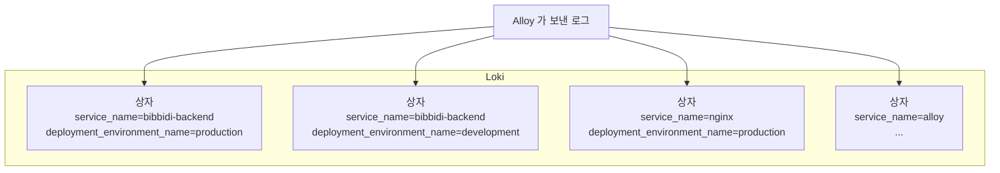

# 8. Loki : 여러 서버의 로그를 한곳에서 검색하는 곳

> **한 줄 요약** : 운영 · 개발 서버의 로그를 한곳에 모아 두고, 브라우저에서 `grep` 처럼 검색하게 해 주는 로그 저장소입니다.
> 
> 처음이라면 [먼저 읽기](00-먼저-읽기.md) 부터 읽어 주세요. 내부 구조 · 제한 값은 [부록 : Loki 상세](08-loki-상세.md) 에 있습니다.

---

## 1. 없으면 뭐가 불편한가

지금은 운영 에러를 보려면 이렇게 합니다.

```bash
ssh bibbidi-prod
docker logs bibbidi-backend --since 1h | grep ERROR
```

- 개발 서버도 보려면 **한 번 더** 접속해야 합니다
- **배포하면 컨테이너가 새로 생겨서 이전 로그가 사라집니다**
- nginx 로그와 Spring 로그를 같이 보려면 터미널 두 개를 띄워야 합니다
- "어제 오후 3시쯤" 같은 시간 범위로 보기 어렵습니다

Loki 를 쓰면 Grafana 에서 이렇게 한 줄로 끝납니다.

```logql
{service_name="bibbidi-backend", deployment_environment_name="production"} |= "ERROR"
```

---

## 2. Loki 는 로그를 이렇게 보관합니다

**이름표 붙은 상자**를 떠올리면 됩니다.



- 로그가 들어오면 **이름표(라벨)** 를 보고 맞는 상자에 **시간순으로** 넣습니다
- 상자 안 로그 한 줄은 **시각 + 본문(원래 로그 한 줄)** 입니다
- 검색할 때는
    1. 먼저 **이름표로 상자를 고르고** (빠름)
    2. 그 상자 안을 **한 줄씩 읽으면서** 글자를 찾습니다 (느림)
- 그래서 **상자를 좁게 고를수록 빠릅니다**

### 다른 로그 저장소와 다른 점

- 많은 로그 시스템은 로그 **본문 전체**에 색인(책 뒤의 찾아보기)을 만듭니다. 그만큼 색인이 커집니다
- Loki 는 **이름표에만 색인**을 만들고 본문은 압축해서 쌓아 둡니다. 공식 문서 표현으로 "작은 색인과 압축된 청크" 라 운영이 단순하고 비용이 낮은 대신, 본문 검색은 상자를 직접 읽습니다
- 비비디처럼 서버가 작고 로그 양이 많지 않으면 Loki 방식이 잘 맞습니다

> 참고 영상 (10분 테코톡) : 비교 대상이 궁금하다면 [다로의 Elasticsearch](https://www.youtube.com/watch?v=0r0-R8NhINs)

---

## 3. 비비디 로그 한 줄이 Loki 에 들어간 모습

Spring 에서 이렇게 찍으면

```java
log.error("token request failed, Authorization={}", "Bearer eyJhbGciOi...");
```

Loki 에는 세 부분으로 나뉘어 저장됩니다.

| 부분 | 내용 | 검색할 때 |
| --- | --- | --- |
| **이름표 (상자)** | `service_name="bibbidi-backend"`<br>`deployment_environment_name="production"`<br>`service_instance_id="bibbidi-backend-prod"` | `{...}` 안에 씀 |
| **메모 (structured metadata)** | `severity_text="ERROR"` (로그 레벨)<br>`scope_name="kr.bibbidi.auth.OidcClient"` (로거 이름)<br>`trace_id="4bf9..."`, `span_id="00f0..."` | `\| severity_text="ERROR"` 처럼 씀 |
| **본문** | `{"log":{"level":"ERROR",...},"message":"token request failed, Authorization=[REDACTED]",...}` | `\|= "글자"` 로 찾음 |

- 비밀 값(`Authorization=...`)은 Alloy 가 보내기 전에 `[REDACTED]` 로 가렸습니다 ([6. Alloy](06-alloy.md))
- `log.debug()` 로그는 Alloy 가 버려서 **Loki 에 없습니다**

### 왜 로그 레벨 · trace_id 는 이름표가 아니라 메모인가

- 이름표 조합마다 상자가 하나씩 생깁니다
- `trace_id` 는 **요청마다 다른 값**입니다. 이걸 이름표로 쓰면 요청 수만큼 상자가 생기고, 몇 줄짜리 작은 상자 수만 개 때문에 **검색이 크게 느려집니다**
- 그래서 값이 계속 바뀌는 것은 **메모(structured metadata)** 에 둡니다. 메모는 검색 조건으로 쓸 수 있지만 상자를 늘리지 않습니다
- 공식 문서 권고 : "trace ID 나 주문 ID 같은 값을 이름표로 만들지 말 것", 이름표는 **10~15개 이하, 적을수록 좋음**

---

## 4. 로그 검색하기 : LogQL 기초

LogQL 은 Loki 에서 로그를 찾는 검색어입니다. **`grep` 을 이어 붙이는 것**과 거의 같습니다.

```
{상자 고르기}  |  거르기  |  거르기  |  ...
```

### 단계 1 : 상자 고르기 (필수)

```logql
{service_name="bibbidi-backend", deployment_environment_name="production"}
```

- 운영 backend 로그 전부. `{}` 는 반드시 있어야 합니다

### 단계 2 : 글자로 거르기 (`grep` 과 같음)

```logql
{service_name="bibbidi-backend", deployment_environment_name="production"} |= "token" != "refresh"
```

| 기호 | 뜻 | grep 으로 치면 |
| --- | --- | --- |
| `\|= "abc"` | abc 가 **들어간** 줄 | `grep abc` |
| `!= "abc"` | abc 가 **안 들어간** 줄 | `grep -v abc` |
| `\|~ "a.c"` | 정규식에 맞는 줄 | `grep -E` |
| `!~ "a.c"` | 정규식에 안 맞는 줄 | `grep -vE` |

- 대소문자를 구분합니다. 무시하려면 `|~ "(?i)error"`

### 단계 3 : 메모(structured metadata)로 거르기

```logql
{service_name="bibbidi-backend", deployment_environment_name="production"} | severity_text=~"(?i)error"
{service_name="bibbidi-backend", deployment_environment_name="production"} | trace_id="4bf92f3577b34da6a3ce929d0e0e4736"
```

- 로그 레벨, 로거 이름, `trace_id` 로 바로 거를 수 있습니다

### 단계 4 : JSON 풀어서 거르기

nginx 로그는 JSON 이라, `| json` 으로 풀면 필드로 조건을 걸 수 있습니다.

```logql
{service_name="nginx", deployment_environment_name="production"} | json | http_response_status_code >= 500
```

- `| json` 은 JSON 의 점(`.`)을 밑줄(`_`)로 바꿔서 필드를 만듭니다 : `http.response.status_code` → `http_response_status_code`

### 단계 5 : 줄 수 세기 (로그를 숫자로)

```logql
sum(count_over_time({service_name="bibbidi-backend", deployment_environment_name="production"} | severity_text=~"(?i)error" [5m]))
```

- "최근 5분 동안 ERROR 로그가 몇 줄?" → 알림 W4 가 이 방식입니다
- `count_over_time(... [5m])` = 5분 동안 줄 수

---

## 5. 꼭 알아야 할 것

### ① 상자를 좁게 골라야 빠릅니다

- 이름표로 **서비스와 환경을 꼭 지정**하세요
- 시간 범위도 좁게 (지난 7일보다 지난 1시간)
- `{deployment_environment_name="production"}` 만 쓰면 backend · nginx · alloy 상자를 전부 읽습니다

### ② 로그는 14일 보관합니다

- 14일이 지나면 Loki 가 자동으로 지웁니다
- 장애 회고에 필요한 로그는 그 전에 따로 남겨 두세요

### ③ 너무 많이 보내면 Loki 가 받기를 거절합니다

- Loki 는 스스로를 보호하려고 "1초에 이만큼 이상" "한 줄이 이보다 길면" "너무 오래된 로그면" 받지 않습니다
- 거절된 로그는 **저장되지 않습니다**. 알림 W7 "Loki 수집 거부" 가 이걸 감시합니다
- 반복문 안에서 `log.info()` 를 찍는 코드가 대표적인 원인입니다

### ④ 로그 레벨 표기가 서비스마다 다릅니다

- backend 는 `ERROR` (대문자), nginx 는 `error` (소문자)
- 그래서 `severity_text=~"(?i)error"` 처럼 대소문자를 무시하고 찾습니다

---

## 6. 직접 해 보기

Grafana → **Explore** → 데이터소스 **Loki** 선택 → 쿼리 입력 → **Run query**

| 해 볼 것 | 쿼리 |
| --- | --- |
| 운영 backend 에러 로그 | `{service_name="bibbidi-backend", deployment_environment_name="production"} \| severity_text=~"(?i)error\|fatal"` |
| nginx 5xx 응답 | `{service_name="nginx", deployment_environment_name="production"} \| json \| http_response_status_code >= 500` |
| 1초 넘게 걸린 요청 (nginx) | `{service_name="nginx", deployment_environment_name="production"} \| json \| http_request_duration > 1` |
| 특정 요청의 모든 로그 | `{service_name="bibbidi-backend", deployment_environment_name="production"} \| trace_id="여기에 trace_id"` |

- 로그 한 줄을 클릭해 펼치면 메모(레벨, 로거, `trace_id`)가 보이고, **Tempo 에서 보기** 버튼으로 같은 요청의 트레이스를 열 수 있습니다 ([10. Grafana](10-grafana.md))
- 쿼리 입력칸의 **Builder** 를 누르면 메뉴에서 골라 만들 수도 있습니다

---

## 7. 할 수 있지만 비비디는 안 하는 것

| 할 수 있는 것 | 비비디는 | 공식 문서 |
| --- | --- | --- |
| **S3 · GCS · Azure 같은 클라우드 저장소에 저장** | 모니터링 서버 디스크에 저장 (공식 문서는 운영에는 클라우드 저장소를 권장) | [Storage](https://grafana.com/docs/loki/latest/configure/storage/) |
| **구성요소를 나눠서 여러 대로 운영** (쓰기 · 읽기 · 백엔드를 따로, MSA 처럼) | 한 프로세스로 전부 실행 (하루 20GB 이하 규모용) | [Deployment modes](https://grafana.com/docs/loki/latest/get-started/deployment-modes/) |
| **여러 팀 · 고객 데이터 분리** (멀티 테넌시) | 한 팀이라 끔 (`auth_enabled: false`) | [Architecture](https://grafana.com/docs/loki/latest/get-started/architecture/) |
| **로그 종류별로 보관 기간 다르게** | 전부 14일 | [Retention](https://grafana.com/docs/loki/latest/operations/storage/retention/) |
| **Loki 자체 알림 규칙** (ruler) | Grafana 에서 알림 | [Components](https://grafana.com/docs/loki/latest/get-started/components/) |
| **Memcached · Redis 캐시** | Loki 프로세스 메모리 캐시만 사용 | [Caching](https://grafana.com/docs/loki/latest/operations/caching/) |
| **로그 패턴 자동 찾기 · 블룸 필터 가속** | 사용 안 함 | [Components](https://grafana.com/docs/loki/latest/get-started/components/) |
| **OTLP 로 직접 받기** | Alloy 가 Loki 방식으로 보냄 | [OpenTelemetry](https://grafana.com/docs/loki/latest/send-data/otel/) |
| **Promtail · Fluent Bit 같은 다른 수집기** | Alloy 사용 (Promtail 은 지원 종료) | [Send data](https://grafana.com/docs/loki/latest/send-data/) |

---

## 8. 자주 하는 실수

| 증상 | 원인 |
| --- | --- |
| `log.debug()` 로그가 없음 | Alloy 가 DEBUG 를 버림 |
| 결과가 하나도 없음 | 이름표 이름 오타, 또는 예전 이름 사용 (`job="bibbidi"`, `compose_service` 는 이제 없음) |
| `{}` 만 쓰면 에러 | 이름표 조건이 최소 하나 필요 |
| 대소문자 때문에 못 찾음 | `\|~ "(?i)..."` 사용 |
| 검색이 너무 느림 | 시간 범위가 넓거나, 상자를 좁히지 않음 |
| 2주 전 로그가 없음 | 14일 보관 |
| `trace_id` 를 `{trace_id="..."}` 로 찾았는데 안 나옴 | `trace_id` 는 이름표가 아니라 메모 → `{...} \| trace_id="..."` |

---

## 더 알고 싶다면

- [부록 : Loki 상세](08-loki-상세.md) : 내부 구성요소, 저장 · 삭제 방식, 거절 사유 목록, LogQL 세부
- [공식 문서 : Loki 개요](https://grafana.com/docs/loki/latest/get-started/overview/)
- [공식 문서 : 라벨 권고](https://grafana.com/docs/loki/latest/get-started/labels/bp-labels/)
- [공식 문서 : LogQL](https://grafana.com/docs/loki/latest/query/)
- 참고 영상 (10분 테코톡) : 로그를 잘 남기는 법 — [아마란스의 로깅](https://www.youtube.com/watch?v=X_iE36En9F4) · [이스트의 로깅](https://www.youtube.com/watch?v=1IMJCg68-lU) · [무늬의 로깅](https://www.youtube.com/watch?v=MxxeKXydn4A) · [검프의 Logging #1](https://www.youtube.com/watch?v=1MD5xbwznlI) · [#2](https://www.youtube.com/watch?v=JqZzy7RyudI)
