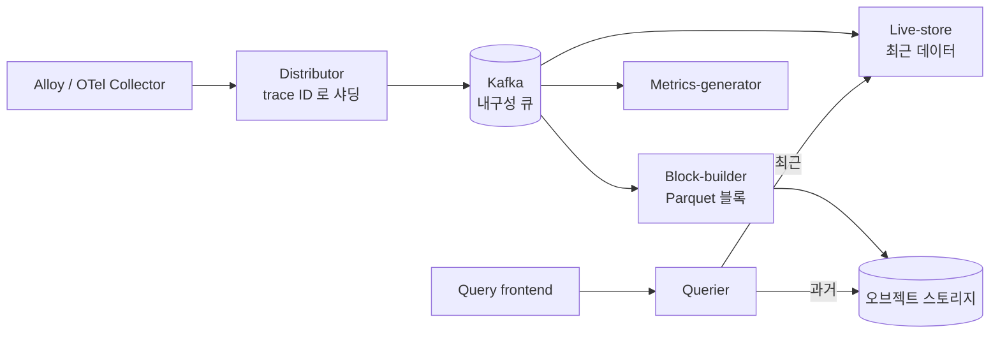
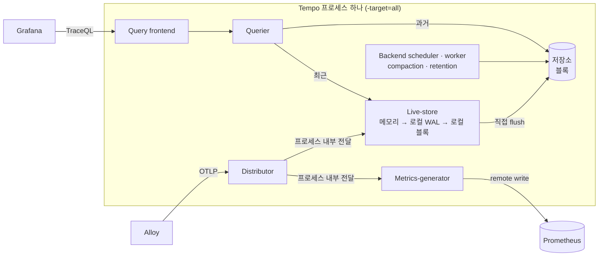
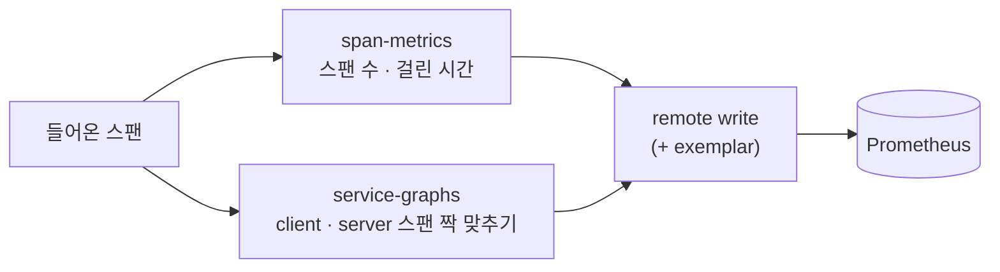

# 부록 9. Tempo 상세

> 본문은 [9. Tempo : 요청 하나의 영수증을 보관하는 곳](09-tempo.md) 입니다. 이 부록은 3.x 내부 구조 · 저장 형식 · TraceQL 전체 문법을 찾아볼 때 씁니다.
> 
> 이 문서는 **도구 자체**를 설명합니다. 비비디 설정값과 파일 위치는 [비비디 관측·알림·장애 대응](../01-비비디-관측-알림-장애대응.md) 4장을 참고해 주세요.
> 
> - 기준 문서 : `grafana.com/docs/tempo/latest/` (조사일 2026-10-10, 문서 버전 v3.1.x)
> - **3.x 에서 아키텍처가 크게 바뀌었습니다.** 2.x 기준 블로그 · 강의 자료(ingester, compactor 설명)는 그대로 맞지 않습니다
> - 문서에서 확인하지 못한 내용은 **확인 필요** 로 표시합니다

---

## 9.1 Tempo 는 무엇인가

- **분산 트레이스 저장소**입니다. 스팬을 받아 **Apache Parquet 블록**으로 저장하고, trace ID 나 **TraceQL** 검색으로 다시 꺼내 줍니다
- 설계 목표
    - 싼 오브젝트 스토리지에 저장
    - 쓰기 경로와 읽기 경로를 따로 확장
    - 컬럼 저장(Parquet)을 이용한 속성 검색
- 세 신호와의 관계 (문서 표현)
    - "Metrics indicate that something is happening" — 메트릭은 **무언가 일어나고 있다**는 것을
    - "Logs let you know what's happening" — 로그는 **무슨 일이 일어나는지**를
    - "Traces provide a map of where something is going wrong" — 트레이스는 **어디서 잘못되는지 지도**를

---

## 9.2 트레이스 데이터 모델

### 트레이스와 스팬

```
trace_id = 4bf92f3577b34da6a3ce929d0e0e4736
│
└─ [server] GET /api/weddings/{id}                       0ms ───────────────── 820ms
     ├─ [internal] WeddingService.find                    5ms ──────── 300ms
     │    └─ [client] SELECT wedding ...  (DB)            10ms ─── 290ms
     └─ [client] GET https://oauth.example.com/userinfo   310ms ──────────── 810ms   status=error
```

- **트레이스** : 요청 하나가 시스템을 지나간 **전체 여정**. 스팬들의 트리입니다
- **스팬** : 트레이스 안의 **작업 한 단위** (HTTP 처리, DB 쿼리, 외부 호출)
    - 시작 시각, 걸린 시간(duration), 이름을 가집니다
    - 루트를 빼면 부모 스팬을 가리킵니다
    - 속성, 이벤트(스팬 중 특정 시점 표시), 다른 스팬으로의 링크를 가질 수 있습니다
- **루트 스팬** : 첫 스팬, 부모가 없음. **자식 스팬** : 부모 안의 하위 작업 · 다운스트림 호출
- **Trace ID** : 요청이 시작될 때 만들어져 그 요청의 모든 스팬에 붙습니다 → 서비스를 넘나들며 같은 요청으로 묶는 열쇠
- 트레이스에는 "끝" 이 없습니다. 늦게 도착하는 스팬이 있을 수 있어 계속 커질 수 있습니다

### 항상 있는 필드 (intrinsic)

| 필드 | 값 |
| --- | --- |
| name | 스팬 이름 (예 : `GET /api/weddings/{id}`) |
| duration | 끝 시각 − 시작 시각 |
| status | `ok`, `error`, `unset` (OTel span status) |
| kind | `server`, `client`, `producer`, `consumer`, `internal`, `unspecified` |

### 속성 (attribute)

- **Resource 속성** : 스팬을 **만든 주체**에 대한 정보. 예 : `service.name`, `service.version`, `deployment.environment.name`
- **Span 속성** : 그 **작업**에 대한 정보. 예 : `http.request.method`, `http.response.status_code`, `db.system`
- Event 속성, Link 속성도 있습니다
- 속성 이름은 OTel **시맨틱 컨벤션**(표준 이름 규칙)을 따릅니다

### 그 밖의 용어

- **Spanset** : TraceQL 쿼리가 트레이스마다 돌려주는 스팬 묶음
- **Exemplar** : 메트릭 점 하나에 trace ID 를 붙인 대표 예시 → 메트릭에서 트레이스로 이동

---

## 9.3 3.x 아키텍처

### 구성요소

| 구성요소 | 역할 | monolithic 에서 |
| --- | --- | --- |
| **Distributor** | 스팬 수신 · 검증, 쓰기 경로로 전달 | O |
| Kafka 호환 큐 | distributor 와 소비자 사이의 내구성 WAL | **X** |
| Block-builder | Kafka 를 읽어 Parquet 블록을 만들어 저장 | **X** |
| **Live-store** | **최근 데이터**를 메모리 · 로컬 WAL 에 들고 조회에 응답 | O |
| **Query frontend** | 쿼리를 작은 job 으로 나눠 병렬 실행 | O |
| **Querier** | live-store(최근) + 저장소 블록(과거)에서 job 실행 | O |
| **Backend scheduler / worker** | compaction(블록 병합), **retention(보존 기간 삭제)**, 블록 목록 관리 | O |
| **Metrics-generator** | 트레이스에서 메트릭(RED, 서비스 그래프) 생성 | O (선택) |

- **compactor 는 없어졌습니다** : "The backend scheduler and worker replace the legacy compactor"
- **ingester 도 없어졌습니다** (3.0 에서 제거, 최근 데이터는 live-store 가 담당)
- 모든 구성요소가 같은 바이너리에 있고 `-target` 으로 무엇을 띄울지 고릅니다

### 분산 모드 (microservices) 의 흐름 — 비교용



- Kafka 가 내구성을 맡기 때문에 쓰기 경로 복제 계수를 1(RF1)로 운영합니다. 2.x 의 RF3 은 데이터를 2~2.5배 중복 저장했다고 설명합니다

### 단일 바이너리 (monolithic) 의 흐름 — 비비디 구성

- `-target=all` 이 기본값이고, 문서에 **"No Kafka is required."** 라고 적혀 있습니다
- **"The distributor pushes trace data in-process directly to the live-store and metrics-generator."**
- **"In monolithic mode, the live-store handles flushing trace data to object storage directly."** → block-builder 가 돌지 않습니다
- 클라이언트 응답(ACK)은 live-store 가 데이터를 받은 뒤 나갑니다



### Live-store 동작

- trace ID 별로 메모리에서 트레이스를 조립합니다
- `max_trace_idle`(기본 5s) 동안 새 스팬이 없으면 로컬 **WAL**(Parquet 형식)로 내려갑니다. WAL 데이터도 TraceQL 로 검색됩니다
- WAL 은 결국 완성된 블록으로 잘립니다
- 기본값 : `max_trace_live` 30s, `max_block_bytes` 50MiB, `max_block_duration` 30s, `complete_block_timeout` 20m, `wal.path` `/var/tempo/live-store/traces`

### monolithic 의 한계

- 모든 구성요소가 자원(CPU · 메모리)을 나눠 씁니다
- 따로 확장할 수 없습니다
- **조회가 몰리면 쓰기 처리량이 떨어지고, 반대도 마찬가지**입니다
- 처리량이 크면 live-store 와 querier 의 메모리 압박으로 OOM 이 날 수 있습니다

---

## 9.4 2.x → 3.x 이전

- 절차 : **설정을 고친 뒤 바이너리 업그레이드**
- 변환 도구 : `tempo-cli migrate config --mode=monolithic old-config.yaml > new-config.yaml`
- 직접 고친다면 `ingester:`, `ingester_client:`, `compactor:`, `metrics_generator_client:` 블록과 `local_blocks` processor 를 지웁니다
- 3.x → 2.x **제자리 다운그레이드는 지원하지 않습니다**
- 3.x 는 2.x 블록(RF3)도 읽습니다. 단, **TraceQL metrics 는 3.x 블록(RF1)만** 읽습니다
- 평평한(legacy) overrides 형식이면 **시작하지 않습니다** → `overrides.defaults` 아래 `ingestion`, `global` 같은 scope 로 옮깁니다
    - 예 : `ingestion_rate_limit_bytes` → `ingestion.rate_limit_bytes`, `max_bytes_per_trace` → `global.max_bytes_per_trace`
- OpenCensus 수신 제거, scalable single binary(SSB) 모드 제거

---

## 9.5 저장

### Parquet 블록

- 트레이스를 **Apache Parquet**(컬럼 형식)으로 저장합니다
    - 컬럼 형식이라 `{ span.http.status_code = 500 }` 같은 검색은 그 컬럼만 읽습니다
- 한 행 = 트레이스 하나, trace ID 순으로 정렬
- intrinsic 과 일부 속성은 전용 컬럼, 나머지 속성은 범용 `Attrs` 컬럼
- **Dedicated columns** : 자주 검색하는 속성을 전용 컬럼으로 올려 빠르게 합니다 (`storage.trace.block.parquet_dedicated_columns`)
- 블록 형식 버전 : vParquet3(3.1 에서 쓰기 거부), vParquet4(지원), **vParquet5(3.1 기본)**. 옛 형식 블록도 계속 읽힙니다

### 블록 안의 파일

```
<tenant-id>/<block-id>/
├── meta.json        블록 ID · 테넌트 · 시작/끝 시각 · 개수. 이 파일이 생겨야 조회에 보임
├── data.parquet     트레이스 데이터
├── bloom-0, ...     "이 trace ID 가 이 블록에 있나?" 를 빠르게 거르는 확률 필터
└── index            trace ID → data.parquet 안 위치
```

### 저장소 종류

- `s3`(MinIO 등 호환 포함), `gcs`, `azure`, `local`
- **local 은 "development and testing" 용도**입니다. 설정 문서도 "object storage is recommended for production workloads" 라고 합니다
    - local 에서 검증한 건 SSD 뿐, HDD 는 테스트하지 않았다고 합니다
- 용량 추정 : 하루 수집 바이트 × 보존 일수

### compaction 과 보존

- **compaction** : 작은 블록을 큰 블록으로 합쳐 블록 수를 줄입니다 (블록 수가 많으면 조회가 느려짐)
- **retention** : 보존 기간이 지난 블록을 지웁니다
- 3.x 에서는 둘 다 **backend scheduler 가 job 을 만들고 backend worker 가 실행**합니다 (scheduler 는 동시에 하나만)
- 기본값 : `block_retention` **336h(14일)**, retention 확인 주기 `backend_scheduler.provider.retention.interval` 1h
- 관련 메트릭 : `tempodb_compaction_outstanding_blocks`, `tempodb_retention_deleted_total`, `tempodb_blocklist_length`(높으면 compaction 이 밀림)
- 확인 필요 : 3.x 에서 `block_retention` 을 넣는 정확한 YAML 경로. 문서는 "Compaction" 설정 블록을 scheduler 와 worker 가 함께 쓴다고만 설명합니다

---

## 9.6 수집

- 받는 프로토콜 : **OTLP gRPC/HTTP(권장)**, Jaeger, Zipkin, Kafka
- OTLP 수신 기본 주소는 **localhost** 입니다 (gRPC `localhost:4317`, HTTP `localhost:4318`) → 다른 호스트 · 컨테이너에서 받으려면 주소를 명시해야 합니다
- 테넌트별 수집 속도 제한을 넘으면 `RATE_LIMITED` 오류
- 샘플링은 Tempo 가 아니라 **보내는 쪽(SDK · 수집기)** 에서 정합니다 (추론 : 문서는 샘플링으로 줄어든 메트릭을 보정하는 `span_multiplier_key` 같은 기능만 설명)

---

## 9.7 TraceQL

### 기본 구조

```traceql
{ resource.service.name = "bibbidi-backend" && status = error } | count() > 2
└────────────── 스팬 셀렉터 (스팬마다 평가) ──────────────┘   └ 파이프라인 ┘
```

- `{ }` 는 조건에 맞는 스팬 묶음(spanset)을 고릅니다. 빈 `{}` 는 모든 스팬
- `|` 로 단계를 이어 트레이스를 걸러냅니다

### 이름 붙이는 법 (scope)

| 접두사 | 의미 | 예 |
| --- | --- | --- |
| `span.` | 스팬 속성 | `span.http.response.status_code` |
| `resource.` | 리소스 속성 | `resource.service.name` |
| `event.` / `link.` / `instrumentation.` | 이벤트 · 링크 · 계측 라이브러리 속성 | |
| `span:` / `trace:` / `event:` / `link:` | intrinsic (콜론) | `span:duration`, `trace:rootService` |
| 접두사 없음 | 대표 intrinsic | `name`, `status`, `kind`, `duration` |

- 속성은 `.`, intrinsic 은 `:` 로 구분합니다
- **scope 를 적으면 필요한 데이터만 읽어 빠릅니다**
- `duration` 은 `span:duration` 과 같습니다. 트레이스 전체 시간은 `trace:duration`
- `trace:` intrinsic 은 스팬 단위보다 빨라 가능하면 우선 쓰라고 권합니다

### 주요 intrinsic

- 스팬 : `span:name`, `span:duration`, `span:status`, `span:statusMessage`, `span:kind`, `span:id`, `span:parentID`, `span:childCount`
- 트레이스 : `trace:duration`, `trace:rootName`, `trace:rootService`, `trace:id`

### 연산자

- 비교 : `=`, `!=`, `>`, `>=`, `<`, `<=`, `=~`, `!~`
    - **정규식은 전체 일치**입니다. 부분 일치는 `".*bar.*"`
- 리터럴 : 숫자, duration(`ns us ms s m h`), 문자열, `nil`(속성 없음)
- **중괄호 안의 `&&` / `||`** : **같은 스팬**이 조건을 만족해야 함
- **중괄호 사이의 `&&` / `||`** : **다른 스팬**이 각각 만족해도 됨
    - `{ A } && { B }` : 트레이스 안에 A 스팬과 B 스팬이 각각 있으면 일치

### 구조 연산자 (오른쪽 스팬을 돌려줌)

- `{A} >> {B}` : B 가 A 의 **후손**
- `{A} > {B}` : B 가 A 의 **직접 자식**
- `{A} << {B}` / `{A} < {B}` : 조상 / 직접 부모
- `{A} ~ {B}` : 형제
- `!>>` 등 부정 연산자는 실험 기능 (가끔 거짓 양성)

### 집계 · 그룹 · 선택

- `count()`, `avg()`, `max()`, `min()`, `sum()`
- `by(필드)` : 그룹으로 나눔
- `select(필드, ...)` : 결과에 필드를 함께 보여 줌

### 예시

```traceql
# 운영 환경의 서버 스팬 중 에러
{ resource.deployment.environment.name = "production" && kind = server && status = error }

# 1초 넘게 걸린 서버 스팬
{ kind = server && duration > 1s }

# 백엔드 요청 아래 어딘가에서 에러가 난 트레이스
{ resource.service.name = "bibbidi-backend" && kind = server } >> { status = error }

# 트레이스 전체가 5초 넘게 걸린 것
{ trace:duration > 5s }

# 에러 스팬을 서비스별로 묶어 2개 넘는 것만
{ status = error } | by(resource.service.name) | count() > 1
```

### TraceQL metrics

- 트레이스에서 바로 시계열을 계산합니다 (3.0 에서 GA)
    - 예 : `{} | rate() by (resource.service.name)`, `{ span:duration < 5ms } | count_over_time() by(resource.service.name) | topk(10)`
- 3.1 : 집계끼리 산술 가능 → 에러 비율 `({status=error} | rate()) / ({} | rate())`
- 최근 데이터는 live-store 가 답합니다 (3.0 에서 `local-blocks` processor 제거)
- 확인 필요 : 함수 전체 목록 (metrics 쿼리 문서는 읽지 못함)

---

## 9.8 Metrics-generator

트레이스를 세어 **Prometheus 메트릭**을 만들고 remote write 로 보냅니다. 내부적으로 Prometheus Agent 가 돕니다.



- processor 는 **기본 꺼짐**. overrides 에서 켭니다 (`overrides.defaults.metrics_generator.processors: [span-metrics, service-graphs]`)
- 3.0 : 사용자 설정 overrides 에 `processors` 가 있으면 런타임 설정과 합치지 않고 **덮어씁니다**
- `metrics_generator.storage.path` 필수, `remote_write` 에 Prometheus 주소 · `send_exemplars`
- 수집 주기 `collection_interval` 15s, 오래된 시계열 정리 `stale_duration` 15m

### span-metrics 가 만드는 것

- `traces_spanmetrics_calls_total` (counter) : 스팬 수 → 요청률 · 에러율
- `traces_spanmetrics_latency` (histogram → `_bucket`, `_sum`, `_count`) : 걸린 시간 → p95 등
- `traces_spanmetrics_size_total` (counter)
- 기본 라벨 : `service`, `span_name`(카디널리티 가장 큰 요인), `span_kind`(`SPAN_KIND_SERVER` 등), `status_code`(`STATUS_CODE_UNSET/OK/ERROR`)
- 기본 버킷(초) : 0.002, 0.004, ... 16.384
- **custom dimensions** : 속성을 라벨로 추가. 이름의 점은 `_` 로 바뀝니다 (`deployment.environment` → `deployment_environment`)
    - 스팬에 그 속성이 없으면 라벨이 **조용히** 생기지 않습니다
- 주의 : Service graph view 문서는 히스토그램 이름을 `traces_spanmetrics_duration_seconds_bucket` 으로 적고 있어 processor 문서(`traces_spanmetrics_latency`)와 다릅니다 → 실제 Prometheus 에서 확인 필요

### service-graphs 가 만드는 것

- client 스팬과 server 스팬(또는 producer · consumer)을 메모리에서 **짝지어** 서비스 간 호출을 기록합니다
    - 짝이 오거나 최대 대기 시간(`wait` 10s)이 지나면 기록
    - 그래서 한 트레이스의 스팬이 **같은 인스턴스**로 와야 합니다
    - DB 는 `db.system` 등 속성으로 판별, 계측 안 된 쪽은 가상 노드(client 기본 이름 `user`)
- 메트릭 : `traces_service_graph_request_total`, `_request_failed_total`, `_request_server_seconds`, `_request_client_seconds`, `_unpaired_spans_total`, `_dropped_spans_total`
- 라벨 : `client`, `server`, `connection_type`

### 카디널리티

- 라벨 값 종류가 늘 때마다 시계열 수는 **곱으로** 늘어납니다 (예 : 고객 100명을 라벨로 넣으면 2.5만 → 250만)
- 고유 ID, 동적 스팬 이름은 피합니다. 템플릿화되지 않은 `http.route` 는 고위험
- 방어 : `max_active_series`, `max_cardinality_per_label`, 스팬 이름 정리(`span_name_sanitization`)
- 관찰 : `tempo_metrics_generator_registry_active_series`

---

## 9.9 Grafana 와의 연결

- **Trace → Logs** : Tempo 데이터소스의 trace to logs 설정. 스팬 속성을 Loki 라벨로 매핑해 같은 trace ID 로그를 엽니다 (10장 참고)
- **Trace → Metrics** : 스팬에서 요청률 · 에러율 · p95 쿼리로 이동
- **Service graph** : 필요한 것 세 가지
    1. Tempo metrics-generator(또는 Alloy)에서 서비스 그래프 메트릭 생성
    2. 그 메트릭을 받는 Prometheus 데이터소스
    3. Tempo 데이터소스의 Service graph 항목에 그 Prometheus 를 연결

---

## 9.10 운영

- 자체 메트릭 (`:3200/metrics`)
    - 수집 : `tempo_distributor_spans_received_total`, `tempo_distributor_bytes_received_total`, `tempo_discarded_spans_total{reason}`
    - live-store : `tempo_live_store_ready`(1 이면 정상), `tempo_live_store_traces_created_total`
    - 조회 : `tempo_query_frontend_queries_total`, `tempo_query_frontend_queue_length`
    - metrics-generator 의 remote write 실패 : `prometheus_remote_storage_samples_failed_total`
- 메모리 : `memory.automemlimit_enabled`(기본 false), 켜면 메모리 한도의 80%(`automemlimit_ratio`)를 Go 메모리 한도로
- 기본 HTTP 포트 3200
- 상태 확인 : `GET /status/backendscheduler`

---

## 9.11 버전별 변경

- **3.0** : Kafka 기반 새 구조가 유일한 경로(ingester · compactor · SSB 제거), TraceQL metrics GA, legacy overrides 거부, OpenCensus 제거, `local-blocks` 제거
- **3.1** : vParquet5 기본, vParquet3 쓰기 설정이면 시작 거부, TraceQL metrics 산술 연산, `traces_service_graph_connection_info` 추가

---

## 9.12 비비디 설정과 비교해 확인할 것

- **local 저장은 개발 · 테스트 용도** : 5일 보존 트레이스의 유실 허용 여부와 함께 판단
- `block_retention: 120h` 가 3.x 설정 구조에서 실제로 적용되는 위치인지 → 블록 수 · 가장 오래된 블록 날짜로 확인
- WAL 경로 : 문서상 `storage.trace.wal.path`(기본 `/var/tempo/wal`)와 `live_store.wal.path`(기본 `/var/tempo/live-store/traces`)가 따로 있음 → 비비디 문서의 `/var/tempo/wal` 이 실제로 쓰이는 경로인지 확인
- `local_blocks` processor 가 설정에 남아 있으면 3.x 에서 지워야 함
- p95 쿼리가 쓰는 `traces_spanmetrics_latency_bucket` 이름이 실제 Prometheus 에 있는지 (문서 간 이름 불일치)
- `deployment.environment.name` dimension → `deployment_environment_name` 라벨 (점 → `_` 규칙으로 추론, 실제 확인)
- monolithic 이라 무거운 TraceQL 조회가 수집에 영향 → 2GB 서버에서 Tempo 메모리(384M 상한) 관찰

---

## 용어

- **트레이스 / 스팬** : 요청 전체 여정 / 그 안의 작업 한 단위
- **루트 스팬** : 부모가 없는 첫 스팬
- **span kind** : 스팬의 역할 (server 는 요청을 받는 쪽, client 는 보내는 쪽)
- **resource / span 속성** : 만든 주체 정보 / 작업 정보
- **live-store** : 3.x 에서 최근 트레이스를 들고 있다가 블록으로 만드는 구성요소
- **블록** : Parquet 로 저장한 트레이스 묶음 (`meta.json`, `data.parquet`, bloom, index)
- **bloom filter** : "없다" 를 빠르게 판단하는 확률 필터
- **TraceQL** : 트레이스 검색 언어
- **span metrics / service graph** : 트레이스에서 만든 RED 메트릭 / 서비스 간 호출 메트릭

## 출처

- [Introduction](https://grafana.com/docs/tempo/latest/introduction/) · [Trace structure](https://grafana.com/docs/tempo/latest/introduction/trace-structure/) · [Telemetry](https://grafana.com/docs/tempo/latest/introduction/telemetry/) · [Glossary](https://grafana.com/docs/tempo/latest/introduction/glossary/) · [Architecture](https://grafana.com/docs/tempo/latest/introduction/architecture/)
- [Deployment modes](https://grafana.com/docs/tempo/latest/reference-tempo-architecture/deployment-modes/) · [Components](https://grafana.com/docs/tempo/latest/reference-tempo-architecture/components/) · [Distributor](https://grafana.com/docs/tempo/latest/reference-tempo-architecture/components/distributor/) · [Live-store](https://grafana.com/docs/tempo/latest/reference-tempo-architecture/components/live-store/) · [Block-builder](https://grafana.com/docs/tempo/latest/reference-tempo-architecture/components/block-builder/) · [Compaction](https://grafana.com/docs/tempo/latest/reference-tempo-architecture/components/compaction/) · [Querier](https://grafana.com/docs/tempo/latest/reference-tempo-architecture/components/querier/)
- [Block format](https://grafana.com/docs/tempo/latest/reference-tempo-architecture/block-format/) · [Object storage](https://grafana.com/docs/tempo/latest/reference-tempo-architecture/object-storage/) · [Configuration](https://grafana.com/docs/tempo/latest/configuration/)
- [Migrate to 3.0](https://grafana.com/docs/tempo/latest/set-up-for-tracing/setup-tempo/migrate-to-3/) · [Upgrade](https://grafana.com/docs/tempo/latest/set-up-for-tracing/setup-tempo/upgrade/)
- [TraceQL](https://grafana.com/docs/tempo/latest/traceql/) · [Construct TraceQL queries](https://grafana.com/docs/tempo/latest/traceql/construct-traceql-queries/)
- [Metrics-generator](https://grafana.com/docs/tempo/latest/metrics-from-traces/metrics-generator/) · [Span metrics](https://grafana.com/docs/tempo/latest/metrics-from-traces/span-metrics/span-metrics-metrics-generator/) · [Service graphs](https://grafana.com/docs/tempo/latest/metrics-from-traces/service_graphs/) · [Cardinality](https://grafana.com/docs/tempo/latest/metrics-from-traces/metrics-generator/cardinality/)
- [Release notes 3.0](https://grafana.com/docs/tempo/latest/release-notes/v3-0/) · [Release notes 3.1](https://grafana.com/docs/tempo/latest/release-notes/v3-1/)

## 확인 필요

- 3.x 에서 `block_retention` 의 정확한 YAML 경로, overrides 전체 구조
- monolithic 에서 실제 쓰이는 WAL 경로
- TraceQL metrics 함수 전체 목록
- 트러블슈팅 문서 (Unable to find traces, metrics-generator, OOM), 권장 리소스
- Jaeger · Zipkin 수신 포트
