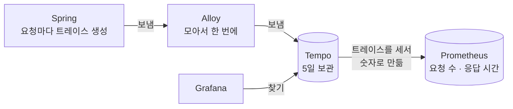

# 9. Tempo : 요청 하나의 영수증을 보관하는 곳

> **한 줄 요약** : 요청 하나가 "어디를 거쳐서, 각 구간에서 몇 ms 걸렸는지" 적힌 기록(트레이스)을 보관하고 찾아 주는 저장소입니다.
> 
> 처음이라면 [먼저 읽기](00-먼저-읽기.md) 부터 읽어 주세요. 내부 구조 · TraceQL 세부는 [부록 : Tempo 상세](09-tempo-상세.md) 에 있습니다.

---

## 1. 없으면 뭐가 불편한가

"카카오 로그인이 3초 걸려요" 라는 제보가 왔습니다. 로그를 보면 이렇습니다.

```
01:23:45.000 INFO  카카오 로그인 콜백 시작
01:23:48.020 INFO  카카오 로그인 콜백 완료
```

- 3초 걸린 건 알겠는데 **어디서** 걸렸는지 모릅니다. 카카오 서버? 우리 DB? 우리 코드?
- 알아내려면 구간마다 시간을 찍는 코드를 넣고 다시 배포해야 합니다

```java
long start = System.currentTimeMillis();
var token = kakaoClient.requestToken(code);
log.info("카카오 토큰 요청 {}ms", System.currentTimeMillis() - start);   // 이걸 모든 곳에?
```

트레이스를 쓰면 **코드를 고치지 않아도** 이런 기록이 요청마다 자동으로 남습니다.

```
GET /api/auth/kakao/callback                          총 3,020ms
 ├─ POST https://kauth.kakao.com/oauth/token  (외부 호출)   2,800ms  ← 여기
 └─ SELECT member ...                         (DB)           150ms
```

> 참고 영상 (10분 테코톡) : "느리다" 를 숫자로 이해하고 싶다면 [효오의 Latency & Bandwidth](https://www.youtube.com/watch?v=mFBIwEhvZUY)

---

## 2. 트레이스와 스팬

```mermaid
gantt
    title 요청 하나 = 트레이스 하나 (trace_id 4bf9...)
    dateFormat x
    axisFormat %L ms
    section 스팬
    GET /api/auth/kakao/callback (server)   :0, 3020
    카카오 토큰 요청 (client)                 :20, 2820
    회원 조회 DB (client)                     :2850, 3000
```



- **트레이스** : 요청 하나의 **전체 기록**. 고유 번호 `trace_id` 를 가집니다
- **스팬** : 트레이스 안의 **구간 하나**. "카카오 토큰 요청", "DB 조회" 같은 단위입니다
    - 시작 시각, 걸린 시간, 이름, 성공 · 실패(status), 부모 스팬을 가집니다
    - 맨 위 스팬(부모가 없는 것)이 요청 전체입니다
- **스팬 종류(kind)**
    - `server` : 우리가 **받은** 요청 (컨트롤러)
    - `client` : 우리가 **보낸** 요청 (외부 API 호출, DB)
    - `internal` : 내부 작업
- 스팬에는 **속성**이 붙습니다
    - 누가 만들었나 (`service.name=bibbidi-backend`, `deployment.environment.name=production`)
    - 무슨 작업이었나 (`http.request.method=POST`, `http.response.status_code=500` 등)

### 누가 만드나

- 우리가 만들지 않습니다. **Spring 이 요청마다 자동으로 만듭니다** (`spring-boot-starter-opentelemetry`)
- 만든 트레이스는 옆의 Alloy 에게 보내고(`http://alloy:4318`), Alloy 가 모니터링 서버의 Tempo 로 보냅니다
- 같은 `trace_id` 가 그 요청의 **로그에도 자동으로 찍힙니다** → 로그와 트레이스를 오갈 수 있습니다

> 참고 영상 (10분 테코톡) : 로그에 `trace_id` 가 자동으로 붙는 원리가 궁금하다면 [레오의 MDC](https://www.youtube.com/watch?v=lkuAxAVgAX0)

---

## 3. 비비디에서 일어나는 일



- **모든 요청을 저장합니다** (100%). 그래서 에러가 아닌 정상 요청의 트레이스도 찾을 수 있습니다
- **5일 동안** 보관합니다
- Tempo 는 들어온 트레이스를 **세어서 숫자도 만듭니다**
    - API 별 요청 수, 에러 수, 응답 시간 → Prometheus 로 보냄
    - 비비디의 **API p95 그래프와 알림(W2, W3)은 이 숫자**로 만듭니다. Spring 코드를 고치지 않고 응답 시간을 볼 수 있는 이유입니다
    - 그래서 나중에 "일부 요청만 저장" 으로 바꾸면 이 숫자도 줄어들어 **알림 기준도 다시 봐야 합니다**

---

## 4. 트레이스 찾기 : TraceQL 기초

TraceQL 은 Tempo 에서 트레이스를 찾는 검색어입니다. **"이런 스팬이 들어 있는 요청을 찾아 줘"** 라고 쓰는 방식입니다.

### 기본 모양

```traceql
{ 조건 }
```

- 중괄호 안 조건에 맞는 **스팬**이 있는 트레이스를 찾습니다

### 이름 붙이는 규칙

| 쓰는 법 | 뜻 | 예 |
| --- | --- | --- |
| `resource.이름` | 스팬을 **만든 쪽** 정보 | `resource.service.name`, `resource.deployment.environment.name` |
| `span.이름` | 그 **작업** 정보 | `span.http.response.status_code` |
| 접두사 없이 | 항상 있는 기본 정보 | `name`(스팬 이름), `status`, `kind`, `duration`(걸린 시간) |

### 예시

```traceql
# 운영에서 에러 난 요청
{ resource.deployment.environment.name = "production" && kind = server && status = error }

# 운영에서 1초 넘게 걸린 요청
{ resource.deployment.environment.name = "production" && kind = server && duration > 1s }

# 특정 API
{ name = "GET /api/weddings/{id}" }

# 요청 전체가 5초 넘게 걸린 것
{ trace:duration > 5s }
```

- `&&` 는 "그리고", `||` 는 "또는"
- 시간은 `500ms`, `1s`, `2m` 처럼 씁니다
- 정규식 `=~` 은 **전체가 맞아야** 합니다. "callback 으로 끝나는" 은 `name =~ ".*/callback"`

### trace_id 로 바로 열기

- Grafana Explore 에서 Tempo 를 고르고 쿼리 종류를 **TraceQL** 로 둔 채 `trace_id` 를 그대로 붙여 넣으면 그 트레이스가 열립니다
- 보통은 Loki 로그에서 **Tempo 에서 보기** 버튼으로 엽니다 ([10. Grafana](10-grafana.md))

---

## 5. 트레이스 화면 읽는 법

트레이스를 열면 막대그래프(워터폴)가 나옵니다.

```
bibbidi-backend  GET /api/auth/kakao/callback       ████████████████████████████████  3.02s
bibbidi-backend    POST kauth.kakao.com/oauth/token  ▕██████████████████████████████    2.80s
bibbidi-backend    SELECT member                                                   ██   150ms
```

- **긴 막대**를 찾습니다 → 거기가 오래 걸린 구간입니다
- **빨간 표시**를 찾습니다 → 거기서 에러가 났습니다 (`status=error`)
- 스팬을 클릭하면 속성(HTTP 상태 코드, 주소 등)이 보입니다
- **Logs for this span** 버튼 → 같은 `trace_id` 의 로그로 이동

---

## 6. 꼭 알아야 할 것

### ① 트레이스는 5일만 보관합니다

- 5일 지난 요청은 찾을 수 없습니다. 로그(14일)보다 짧습니다

### ② `trace_id` 가 로그 · 트레이스 · 숫자를 잇는 열쇠입니다

- 로그 → 트레이스 : 로그의 `trace_id`
- 숫자(그래프) → 트레이스 : 그래프 위의 점(exemplar)에 `trace_id` 가 붙어 있음
- 트레이스 → 로그 : 같은 `trace_id` 로 로그 검색

### ③ 스팬 이름에는 실제 값이 아니라 주소 틀이 들어갑니다

- `GET /api/weddings/123` 이 아니라 `GET /api/weddings/{id}`
- 그래서 API 별로 묶어서 숫자를 만들 수 있습니다

---

## 7. 직접 해 보기

Grafana → **Explore** → 데이터소스 **Tempo** 선택 → 쿼리 종류 **Search** (메뉴에서 고르기) 또는 **TraceQL** (직접 쓰기)

| 해 볼 것 | 쿼리 |
| --- | --- |
| 최근 운영 에러 요청 | `{ resource.deployment.environment.name = "production" && kind = server && status = error }` |
| 1초 넘은 운영 요청 | `{ resource.deployment.environment.name = "production" && kind = server && duration > 1s }` |
| 서비스 지도 | 쿼리 종류 **Service Graph** → 서비스 사이 호출이 그림으로 나옴 |

결과 목록에서 하나를 누르면 5번의 막대그래프가 열립니다.

---

## 8. 할 수 있지만 비비디는 안 하는 것

| 할 수 있는 것 | 비비디는 | 공식 문서 |
| --- | --- | --- |
| **S3 · GCS · Azure 같은 클라우드 저장소에 저장** | 모니터링 서버 디스크에 저장 (공식 문서는 디스크 저장을 개발 · 테스트용으로 안내) | [Object storage](https://grafana.com/docs/tempo/latest/reference-tempo-architecture/object-storage/) |
| **구성요소를 나눠서 여러 대로 운영** (받기 · 저장 · 검색을 따로, 사이에 Kafka 를 두는 MSA 구성) | 한 프로세스로 전부 실행 (Kafka 불필요) | [Deployment modes](https://grafana.com/docs/tempo/latest/reference-tempo-architecture/deployment-modes/) |
| **일부 요청만 저장** (샘플링) | 100% 저장 (예전에 쓰던 샘플링은 제거) | [Span metrics : 샘플링 보정](https://grafana.com/docs/tempo/latest/metrics-from-traces/span-metrics/span-metrics-metrics-generator/) |
| **트레이스로 바로 그래프 만들기** (TraceQL metrics) | 그래프는 Prometheus 숫자로 그림 | [TraceQL](https://grafana.com/docs/tempo/latest/traceql/) |
| **자주 찾는 속성 검색 빠르게** (dedicated columns) | 기본 설정 | [Block format](https://grafana.com/docs/tempo/latest/reference-tempo-architecture/block-format/) |
| **Jaeger · Zipkin 형식으로 받기** | OpenTelemetry(OTLP) 형식만 | [Distributor](https://grafana.com/docs/tempo/latest/reference-tempo-architecture/components/distributor/) |
| **여러 팀 데이터 분리** (멀티 테넌시) | 한 팀이라 안 씀 | [Configuration](https://grafana.com/docs/tempo/latest/configuration/) |

---

## 9. 자주 하는 실수

| 증상 | 원인 |
| --- | --- |
| 일주일 전 요청이 안 나옴 | 5일 보관 |
| 환경 조건을 썼는데 결과 없음 | `deployment.environment.name` 앞에 `resource.` 를 빼먹음 |
| `name =~ "callback"` 이 안 맞음 | 정규식은 전체 일치 → `".*callback"` |
| 로그에서 Tempo 버튼이 안 보임 | 그 로그에 `trace_id` 가 없음 (요청 밖에서 찍힌 로그, 예 : 스케줄러 · 앱 시작 로그) |
| 트레이스가 아예 안 들어옴 | Spring 의 보내는 주소(`OTEL_EXPORTER_OTLP_ENDPOINT`) 또는 Alloy 설정 확인 ([6. Alloy](06-alloy.md)) |

---

## 더 알고 싶다면

- [부록 : Tempo 상세](09-tempo-상세.md) : 3.x 내부 구조, 저장 형식, TraceQL 전체 문법, 트레이스로 숫자 만들기 세부
- [공식 문서 : Tempo 소개](https://grafana.com/docs/tempo/latest/introduction/)
- [공식 문서 : TraceQL 쿼리 만들기](https://grafana.com/docs/tempo/latest/traceql/construct-traceql-queries/)
