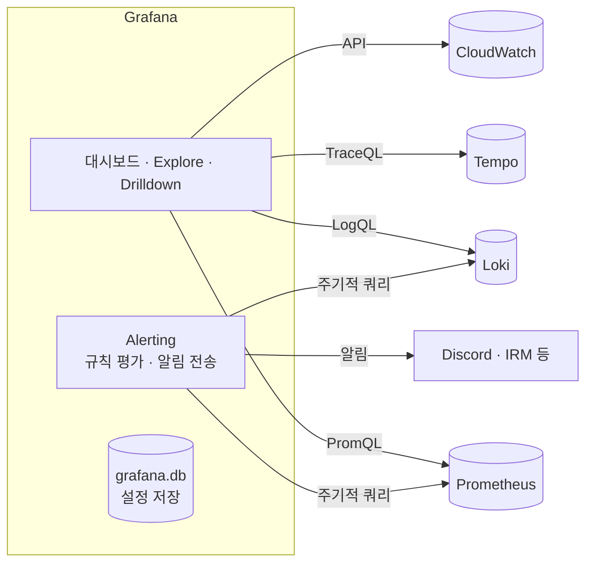
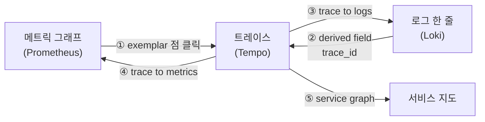
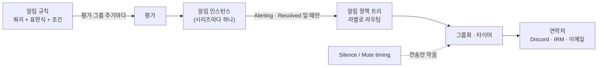
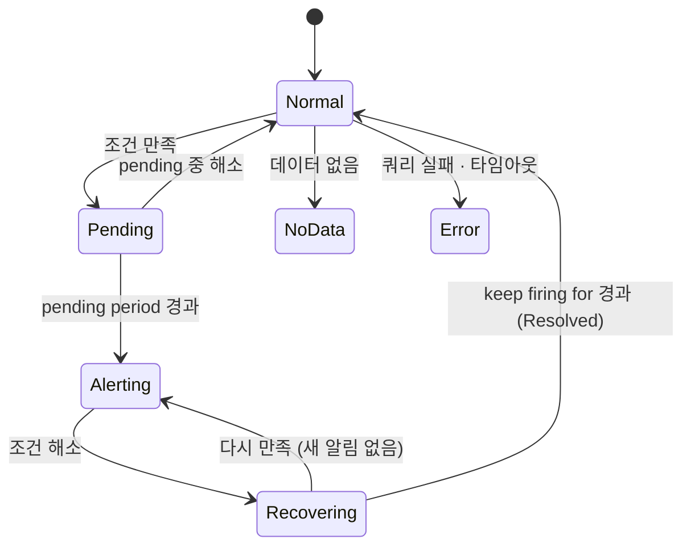

# 부록 10. Grafana 상세

> 본문은 [10. Grafana : 세 창고를 한 화면에서 보는 곳](10-grafana.md) 과 [14. 알림과 온콜](14-알림과-온콜.md) 입니다. 이 부록은 설정 형식 · 알림 상태 · 정책 세부를 찾아볼 때 씁니다.
> 
> 이 문서는 **도구 자체**를 설명합니다. 비비디 설정값과 대시보드 · 알림 규칙은 [비비디 관측·알림·장애 대응](../01-비비디-관측-알림-장애대응.md) 5 · 6장을 참고해 주세요.
> 
> - 기준 문서 : `grafana.com/docs/grafana/latest/` (조사일 2026-10-10, 최신 What's new 13.2)
> - 문서에서 확인하지 못한 내용은 **확인 필요** 로 표시합니다

---

## 10.1 Grafana 는 무엇인가

- 메트릭 · 로그 · 트레이스를 **"query, visualize, alert on, and explore"** 하는 오픈소스 소프트웨어입니다
- **데이터를 저장하지 않습니다.** 데이터가 저장된 곳(Prometheus, Loki, Tempo, DB, 클라우드 서비스)에 **질의해서 보여 줍니다**
    - Grafana 가 자기 DB 에 저장하는 것은 대시보드 · 사용자 · 알림 규칙 같은 **설정**입니다 (10.8 참고)
- 판본

| 판본 | 설명 |
| --- | --- |
| **OSS** | 무료 오픈소스, 직접 설치 · 운영 (비비디) |
| Enterprise | 직접 운영 + 상용 기능(엔터프라이즈 데이터소스, 보고서, 세밀한 권한) + 공식 지원 |
| Cloud | Grafana Labs 가 호스팅. 메트릭 · 로그 · 트레이스 백엔드까지 묶어 제공 |



---

## 10.2 데이터소스

- **데이터소스** = 데이터를 저장하는 백엔드에 대한 **연결 설정** (주소, 인증, 옵션)
- 데이터소스마다 **쿼리 에디터**가 다릅니다 (자동 완성, 시각적 쿼리 빌더 등)
- 내장되지 않은 것은 **플러그인**으로 추가합니다
- 권한
    - 조직 관리자(Org Admin)만 추가 · 삭제할 수 있습니다 (`Connections > Data sources`)
    - 조직의 모든 사용자는 모든 데이터소스를 **조회**할 수 있습니다 (OSS 기준)
- **Default** 데이터소스 : 새 패널 · Explore · 알림 규칙에서 미리 선택됨

### 특수 데이터소스

- **Mixed** : 한 패널에서 쿼리마다 다른 데이터소스를 씀. 병렬 실행, 하나가 실패해도 나머지는 표시
- **Dashboard** : 같은 대시보드의 다른 패널 결과를 재사용 (백엔드 요청을 줄임)
- **Grafana** : 테스트용 임의 데이터(Random walk), 주석 조회 등

### uid

- 데이터소스 · 대시보드 · 폴더마다 고유 식별자 **uid** 가 있습니다
- 패널과 알림 규칙은 데이터소스를 **uid 로 참조**합니다 → uid 가 바뀌면 패널 · 규칙이 깨집니다
- provisioning 에서 uid 를 적지 않으면 Grafana 가 만들어 줍니다 (그래서 고정하려면 직접 적습니다)
- 13.0 부터 **ID 기반 데이터소스 API 가 기본 비활성** → uid 기반 API 를 써야 합니다

---

## 10.3 provisioning : 설정을 파일로

화면에서 클릭하는 대신 **YAML 파일**로 데이터소스 · 대시보드 · 알림 리소스를 만드는 방식입니다. 버전 관리가 되고, 서버를 다시 만들어도 같은 상태가 됩니다.

- 위치 : provisioning 디렉터리 아래 `datasources/`, `dashboards/`, `plugins/`, `alerting/`
- Grafana **시작할 때** 읽습니다

### 데이터소스 provisioning

```yaml
apiVersion: 1
deleteDatasources:            # 먼저 지울 것
  - name: Old Loki
prune: true                   # 파일에서 빠진 프로비저닝 데이터소스 삭제
datasources:
  - name: Prometheus
    type: prometheus          # 필수
    uid: prometheus           # 생략하면 자동 생성 → 고정하려면 적기
    url: http://127.0.0.1:9090
    access: proxy             # 서버(Grafana)가 대신 요청
    isDefault: true           # 조직당 하나
    editable: false           # true 면 화면에서 수정 가능
    jsonData:                 # 데이터소스별 옵션 (평문 저장)
      timeInterval: 15s
      httpHeaderName1: X-Example-Header   # 사용자 정의 헤더 이름은 jsonData 에
    secureJsonData:           # 비밀 값 (secret_key 로 암호화 저장)
      httpHeaderValue1: ${EXAMPLE_TOKEN}  # 헤더 값은 secureJsonData 에
```

- 환경 변수 치환 : `$VAR` 또는 `${VAR}` (값에만 사용)
- `version` : 여러 인스턴스가 같은 DB 를 쓸 때, 낮은 버전 파일이 높은 버전을 덮지 않게 함

### 대시보드 provisioning

```yaml
apiVersion: 1
providers:
  - name: bibbidi
    folder: ''                # 비우면 루트
    type: file
    disableDeletion: false    # true 면 파일을 지워도 대시보드 유지
    updateIntervalSeconds: 10 # 10초 초과면 폴링, 이하면 파일 감시 이벤트
    allowUiUpdates: false     # false 면 화면에서 저장 불가
    options:
      path: /var/lib/grafana/dashboards
```

- JSON 에 uid 가 있으면 그 uid 대시보드를 갱신 → URL 이 유지됩니다
- `allowUiUpdates: true` 여도 화면에서 고친 내용은 **파일로 되돌아가지 않습니다**. 파일이 바뀌면 DB 내용을 덮어씁니다
- 대시보드 v2(동적 대시보드)를 파일로 넣으려면 **Kubernetes 리소스 형식**이어야 합니다
- 알림 리소스 provisioning 은 별도 문서 ("Provision Grafana Alerting resources")

---

## 10.4 대시보드와 패널

### 구성

```
대시보드
├── 변수 ($env 등)               ← 상단 드롭다운
├── 시간 범위 · 자동 새로고침
├── 행(row) / 탭
│   ├── 패널 = 쿼리 + 시각화
│   │   ├── 쿼리 (데이터소스별, 패널당 최대 26개)
│   │   ├── 표현식 (쿼리 결과 계산)
│   │   ├── 변환 (transformation : 합치기 · 필터 · 이름 바꾸기 등)
│   │   └── 시각화 + 옵션 (단위, 임계값, 값 매핑, 오버라이드, 링크)
│   └── ...
└── 대시보드 링크
```

- 패널 = **"composed of a query and a visualization"**
- 시각화 종류 (25종) : Time series, Stat, Gauge, Bar gauge, Bar chart, Table, Logs, Traces, Node graph, Heatmap, Histogram, State timeline, Status history, Pie chart, Text, Alert list, Annotations list, Dashboard list, Canvas, Geomap, Flame graph, Candlestick, Trend, XY chart, News

### 쿼리 옵션 (패널별)

| 옵션 | 의미 | 기본값 |
| --- | --- | --- |
| Max data points | 시리즈당 최대 점 수 | **그래프 픽셀 너비** |
| Min interval | 자동 간격의 최솟값 (보통 scrape 간격) | 자동 |
| Interval | 시간 묶음 간격 → `$__interval` | 너비 기준 자동 |
| Relative time | 이 패널만 다른 시간 범위 | 대시보드 범위 |
| Time shift | 시간 범위를 앞뒤로 이동 | 없음 |

- Max data points 가 패널 너비로 정해지므로 **패널 크기를 바꾸면 결과 점 수가 바뀝니다**. 일정한 결과가 필요하면 고정값을 줍니다

### 변수

- 값을 바꾸면 그 변수를 쓰는 쿼리 · 제목 · 링크가 모두 바뀝니다
- 종류 : Query(데이터소스에서 값 목록), Custom(고정 목록), Text box, Constant, Data source, Interval, Filters(예전 이름 Ad hoc filters), Switch
- URL 에 `var-env=production` 형태로 담겨 링크로 공유됩니다
- Prometheus Query 변수 유형 : Label names, **Label values**, Metrics, Query result, Series query
    - 예전 문법 `label_values(metric, label)` 은 Classic query 로 **deprecated**

### 전역 변수 (Grafana 가 자동 제공)

| 변수 | 의미 |
| --- | --- |
| `$__interval` | `(to − from) / 그래프 픽셀 폭` 근사. 1시간 범위 전체 화면이면 약 2m |
| `$__rate_interval` | Prometheus `rate()` · `increase()` 용. `max($__interval + scrape_interval, 4 × scrape_interval)` |
| `$__range` | 대시보드 시간 범위 길이 (Prometheus · Loki 만) |
| `$__from`, `$__to` | 범위 시작 · 끝 (Unix ms) |
| `$__dashboard`, `$__org`, `$__user` | 대시보드 이름, 조직, 사용자 |

- `$__rate_interval` 의 `scrape_interval` 은 쿼리의 Min step, 없으면 **데이터소스의 Scrape interval 설정**(기본 15s)입니다 → 최소 4개 샘플이 들어가는 구간을 보장
- 확인 필요 : `$__auto` 는 전역 변수 문서에 없습니다 (Loki 쿼리 에디터의 기능으로 보임)

### 13.x 대시보드 변화

- **동적 대시보드 GA (13.0)** : 새 레이아웃 엔진 · 편집 화면 · 스키마가 기본. 기존 대시보드는 **열 때 자동 마이그레이션**
- 행 · 탭으로 묶기, 섹션별 변수(프리뷰), 삭제한 대시보드 복원("Recently deleted")
- **Git Sync GA (13.0)** : 대시보드를 Git 저장소와 연결해 화면에서 커밋 · PR
    - 주의 : 13.0.0 마이그레이션 버그로 Git Sync 를 쓰던 경우 대시보드가 유실될 수 있었음

---

## 10.5 Explore 와 Drilldown

- **Explore** : 대시보드를 만들지 않고 **바로 쿼리해서 보는 곳**. "starting point for querying, analyzing, and aggregating data"
    - 장애 원인을 찾을 때 주로 씁니다
    - 화면을 좌우로 나눠(Split view) 로그와 트레이스를 함께 볼 수 있습니다
- **Drilldown** : **쿼리 없이(queryless)** 클릭으로 탐색하는 앱
    - Metrics Drilldown (PromQL 없이 메트릭 탐색)
    - Logs Drilldown (LogQL 없이 로그량 · 패턴 탐색)
    - Traces Drilldown (트레이스로 만든 RED 지표로 에러 · 지연 조사)
    - Profiles Drilldown
    - 예전 이름 "Explore Logs" 등이 Drilldown 으로 바뀌었습니다

---

## 10.6 신호 사이 이동

세 신호를 이어 주는 것이 Grafana 의 핵심 가치입니다. 각 이동은 **데이터소스 설정**으로 정의합니다.



### ① exemplar (Prometheus → Tempo)

- 메트릭 그래프 위에 **점(별)** 으로 표시되는 대표 요청. 클릭하면 `traceID` 옆 버튼으로 트레이스를 엽니다
- **Prometheus 데이터소스만** 지원
- 설정 : Prometheus 데이터소스의 Exemplars
    - Internal link 켜기 → 대상 Tempo 데이터소스 선택
    - **Label name** : exemplar 에서 trace ID 가 들어 있는 라벨 이름

### ② derived fields (Loki → Tempo)

- 로그에서 값을 뽑아 링크를 만듭니다
    - **Regex** 형 : 본문에서 정규식(캡처 그룹 하나)으로 추출
    - **Label** 형 : 라벨 · 파싱된 라벨 · **structured metadata** 값 사용
- Internal link 를 켜면 트레이싱 데이터소스(Tempo)로 연결. 쿼리에 `${__value.raw}` 로 값 삽입
- Loki 데이터소스 Maximum lines 기본 1000

### ③ trace to logs (Tempo → Loki)

- 스팬에서 "Logs for this span" 으로 관련 로그를 엽니다
- **Tags** : 스팬 속성 → Loki 라벨 매핑
    - 기본 : `cluster`, `hostname`, `namespace`, `pod`, `service.name`(→ `service_name`), `service.namespace`
    - **Loki 라벨 이름과 정확히 같아야 합니다. 다르면 오류 없이 결과가 비어 있습니다**
- Filter by trace ID / span ID, 시간 범위 확장(Span start/end time shift, 기본 0)
- Use custom query : LogQL 직접 작성 (`${__tags}`, `${__trace.traceId}` 등 변수)

### ④ trace to metrics (Tempo → Prometheus)

- 스팬에서 요청률 · 에러율 · 지연 쿼리로 이동
- 시간 범위 확장 기본 `-2m` / `2m`
- Queries 에 이름 + 쿼리를 적고 `$__tags` 로 스팬 속성을 라벨 조건으로 넣습니다
    - 예 : `requests_total{$__tags}` → `requests_total{pod="nginx-554b9", cluster="us-east-1"}`

### ⑤ service graph

- 서비스를 노드, 호출을 선으로 그린 지도. 노드 색 : 초록 성공, 빨강 fault, 노랑 오류, 보라 스로틀링
- 필요한 것 : Tempo metrics-generator 의 서비스 그래프 메트릭 + Prometheus 데이터소스 + Tempo 데이터소스의 Service graph 연결
- 옆의 RED 표는 `traces_spanmetrics_calls_total` 과 `traces_spanmetrics_duration_seconds_bucket` 을 씁니다 (9장의 이름 불일치 참고)

### Correlations

- 데이터소스 설정과 별개로, **Explore 에서** "이 데이터로 저 데이터소스를 조회" 하는 링크를 정의하는 기능
- 현재 Logs 패널과 Table 에서 동작

---

## 10.7 Alerting

### 전체 흐름



### 알림 규칙의 구성

1. **쿼리** : 데이터를 가져옴 (PromQL, LogQL 등). Alerting 을 지원하는 데이터소스만
2. **표현식** (선택, Grafana-managed 전용)
    - **Reduce** : 시계열을 숫자 하나로 (Min, Max, Mean, Median, Sum, Count, Last)
    - **Math** : 산술 (`$A * 100`, `$B > 70`). 여러 쿼리는 **라벨이 같은 것끼리** 짝지음
    - **Threshold** : 숫자를 기준과 비교해 참이면 1 (초과, 미만, 범위 등)
    - **Resample** : 타임스탬프 맞추기
    - **SQL** : 이전 결과를 SQL 로 가공
    - Classic condition : 레거시
3. **조건(condition)** : 위 중 하나를 "발화 조건" 으로 지정 (하나만)
4. **평가 설정** : 평가 그룹(주기), pending period, keep firing for
5. **라벨 · 주석**, No Data · Error 처리, 라우팅

- 쿼리 결과가 시계열 여러 개면 **시계열마다 알림 인스턴스**가 하나씩 생깁니다 (다차원 알림)
    - 예 : 서버별 CPU 쿼리 → 서버 수만큼 인스턴스
- **Recovery threshold** : 발화 기준과 해제 기준을 다르게 둬 깜빡임(flapping)을 줄임
    - 예 : 1000ms 넘으면 발화, 900ms 아래로 내려가야 해제

### 평가와 상태

- **평가 그룹** : 같은 주기로 평가하는 규칙 묶음 (`min_interval` 기본 10s 이상)
- **Pending period** : 조건을 만족한 뒤 Alerting 으로 넘어가기까지 기다리는 시간 (0 이면 바로)
- **Keep firing for** : 조건이 풀린 뒤에도 발화를 유지하는 시간 (0 이면 바로 해제)



| 상태 | 의미 |
| --- | --- |
| Normal | 조건 · No Data · Error 모두 아님 |
| Pending | 조건 만족, pending period 대기 중 |
| Alerting | pending period 이후에도 조건 만족 → **알림 전송** |
| Recovering | 조건 해소, keep firing for 대기 중 |
| No Data | 쿼리 성공했지만 데이터 없음 (pending period 이후) |
| Error | 평가 오류 · 타임아웃 (pending period 이후) |

- 알림이 **나가는 순간**은 두 가지 : Alerting 으로 바뀔 때, Normal(Resolved)로 돌아갈 때
- 규칙을 고치면(주석 · 주기 제외) 인스턴스가 Normal 로 초기화됩니다
- 평가 실패 기준 : `evaluation_timeout` 30s, `max_attempts` 3

### No Data · Error 처리

| 상황 | 선택지 (기본값 굵게) |
| --- | --- |
| No Data | **No Data 상태로** / Alerting / Normal / Keep last state |
| Error | **Error 상태로** / Alerting / Normal / Keep last state |

- 기본 동작이면 원래 규칙과 **별도의 알림**이 생깁니다
    - `alertname=DatasourceNoData` 또는 `DatasourceError`, `datasource_uid`, `rulename` 라벨
    - **원래 규칙의 라벨이 없어서, 원래 알림에 맞춘 정책 · silence 가 적용되지 않을 수 있습니다**
- Keep last state : 잠깐의 데이터소스 장애로 알림이 깜빡이는 것을 막지만, 긴 장애를 놓칠 수 있음
- **stale 인스턴스** : 쿼리는 결과가 있는데 특정 시리즈만 사라진 경우. 기본 **2회 평가** 동안 사라지면 Normal(Resolved)로 바꾸고 `grafana_state_reason=MissingSeries`

### 라벨과 주석

- **라벨** : 알림 인스턴스를 **식별**하고, 검색 · silence · **라우팅**에 씀
    - 사용자 라벨(예 : `severity`, `team`), 쿼리 결과 라벨(예 : `instance`), 예약 라벨(`alertname`, `grafana_folder`, `grafana_` 접두사)
    - 사용자 라벨이 쿼리 라벨과 이름이 같으면 사용자 라벨이 이김
- **주석(annotation)** : 대응하는 사람을 위한 **설명**. 알림 메시지에 포함
    - `summary`, `description`, `runbook_url`, `__dashboardUid__` · `__panelId__`(대시보드 · 패널 연결)
- 둘 다 템플릿으로 값을 넣을 수 있습니다

### 연락처 (contact point)

- 알림을 **어디로 · 어떤 형식으로** 보낼지 담은 단위
- 하나의 연락처에 integration 여러 개 가능 (예 : Discord + 이메일). integration 이 없으면 아무 데도 안 감
- 지원 : Discord, **Grafana IRM**, Slack, Email, Webhook, PagerDuty, Opsgenie, Telegram 등
- 메시지는 기본 형식, 직접 작성, notification template 중 선택

### 알림 정책 (notification policy)

- 라벨로 알림을 연락처에 보내는 **트리**. 맨 위는 **Default policy**(모든 알림과 일치)
- 매처 : `=`, `!=`, `=~`, `!~`, 여러 개면 AND
- 라우팅
    - 위에서부터 일치하는 정책을 찾고, 그 자식으로 계속 내려가 **가장 깊이 일치한 정책 하나**가 처리
    - 일치한 정책을 찾으면 **형제 정책은 보지 않습니다** (Continue matching 을 켜면 봄)
    - 아무 자식도 안 맞으면 Default policy 가 처리 → 알림이 사라지지 않음
- 자식은 부모의 연락처 · 그룹화 · 타이머를 **상속**하고, 필요하면 덮어씁니다

### 그룹화와 타이머

- **Group by** 기본 : `alertname` + `grafana_folder` (규칙 단위로 묶음). `...` 로 그룹화하면 하나씩 따로 보냄

| 타이머 | 기본값 | 의미 |
| --- | --- | --- |
| Group wait | 30s | 새 그룹의 **첫 알림**을 보내기 전 대기 (같이 묶을 알림 모으기) |
| Group interval | 5m | 첫 알림 이후 **그룹에 변화**(새 발화 · 해제)가 있을 때 보내는 주기 |
| Repeat interval | 4h | 변화가 없어도 **아직 발화 중**이라고 다시 알리는 주기 |

- Repeat interval 은 Group interval 의 배수로 올림 조정, 최대 5일

### 알림을 잠시 멈추는 방법

| 방법 | 기간 | 지정 방식 |
| --- | --- | --- |
| **Silence** | 고정된 시작 · 끝 (점검 1회) | 알림 **라벨** 매칭 |
| **Mute timing** | 반복 (주말, 매일 밤) | 정책에 붙임 |
| Active time interval | 반복, 이 시간에**만** 보냄 | 정책에 붙임 |

- 모두 **전송만 막고 평가는 계속**합니다. 겹치면 mute timing 이 우선
- 시간은 시작 포함 · 끝 제외, 위치(타임존)를 고르지 않으면 UTC

### Grafana-managed vs 데이터소스-managed 규칙

- **Grafana-managed** : Grafana 가 저장 · 평가. 여러 데이터소스, 표현식, No Data · Error 처리 지원. 문서가 **권장**
- **데이터소스-managed** : Mimir · Loki 같은 데이터소스의 ruler 에 저장. Prometheus 데이터소스 규칙은 보기만 가능

---

## 10.8 설정과 저장

### 설정 파일

- Debian · RPM 패키지 : **`/etc/grafana/grafana.ini`** (다른 설치는 `defaults.ini` 는 그대로 두고 `custom.ini` 에)
- 줄 앞 `;` 은 주석 → 지워야 적용
- **환경 변수로 덮어쓰기** : `GF_<섹션>_<키>` (대문자, 점 · 대시는 `_`)
    - 예 : `[security] admin_user` → `GF_SECURITY_ADMIN_USER`
    - 새 설정 추가가 아니라 기존 값 덮어쓰기용
- 값 확장 : `$__env{VAR}`, `$__file{경로}`(파일 내용)

### 주요 기본값

- `[server] http_port` **3000**, `serve_from_sub_path` false, `root_url` : 브라우저에서 접속하는 전체 URL (리버스 프록시 뒤면 맞춰야 함)
- `[security] admin_user` **admin**
- `[database] type` **sqlite3** — 문서는 운영 환경에 SQLite 를 권장하지 않고 MySQL · PostgreSQL 을 권합니다
- `[unified_alerting]` `evaluation_timeout` 30s, `max_attempts` 3, `min_interval` 10s
- 13.0 : HTTP 압축(`enable_gzip`) 기본 켜짐

### 백업 (deb · rpm 기준)

| 대상 | 경로 |
| --- | --- |
| 설정 | `/etc/grafana/grafana.ini` |
| 플러그인 | `/var/lib/grafana/plugins` (폴더 통째로) |
| DB | `/var/lib/grafana/grafana.db` |

- SQLite 백업 순서 : **Grafana 를 멈추고** → `grafana.db` 복사 (무결성 때문)
- 업그레이드 전에 DB 를 백업해 두라고 권합니다 (되돌릴 때 필요)
- 확인 필요 : DB 에 무엇이 저장되는지 문서 목록은 찾지 못했습니다 (대시보드 · 사용자 · 알림 규칙 · 연락처 등 화면에서 만든 설정이 들어가는 것으로 보임)

---

## 10.9 사용자 · 권한 · 로그인

### 범위

- **Grafana server admin** : 서버 전체 (조직 · 사용자 관리). 조직 관리자와 별개
- **조직(Organization)** : 모든 사용자는 하나 이상의 조직에 속함. 대시보드 · 데이터소스 · 알림이 조직 단위
- **팀** : 같은 권한이 필요한 사용자 묶음

### 기본 역할

| 역할 | 할 수 있는 것 |
| --- | --- |
| Admin | 조직의 모든 것 (데이터소스, 사용자, 팀, 설정) |
| **Editor** | 대시보드 · 폴더 · 플레이리스트 편집, Explore, 주석 |
| Viewer | 대시보드 보기, 데이터소스 쿼리 |
| No basic role | 권한 없음 |

- Editor 가 **못 하는 것** : 데이터소스 추가 · 수정 · 삭제, 사용자 · 팀 관리, 조직 설정
- 폴더 · 대시보드 단위 권한(Admin / Edit / View)이 조직 역할보다 우선
- 확인 필요 : Editor 의 알림 규칙 편집 범위 (역할 문서에 명시 없음)

### GitHub OAuth

```ini
[auth.github]
enabled = true
client_id = ...
client_secret = ...
scopes = user:email,read:org            ; 기본값
allowed_organizations = my-org          ; 이 조직 구성원만
allow_sign_up = true                    ; 기본 true
role_attribute_path = [login=='octocat'][0] && 'Editor' || 'Viewer'   ; 문서 예시를 Editor 로 바꾼 형태
role_attribute_strict = false           ; true 면 역할을 못 정할 때 로그인 거부
```

- `role_attribute_path` : JMESPath 식. GitHub 사용자 정보(`login` 등)와 팀 목록(`groups`)으로 역할을 정함
    - 문서 예 : `[login=='octocat'][0] && 'Admin' || 'Viewer'`, `contains(groups[*], '@org/team') && 'Editor' || 'Viewer'`
- 역할을 못 정하면 `auto_assign_org_role` 의 역할을 줌 (`role_attribute_strict = true` 면 거부)
- 비밀 값은 환경 변수(`GF_AUTH_GITHUB_CLIENT_SECRET`)로 넣을 수 있습니다

---

## 10.10 운영

- 자체 메트릭 : `/metrics` (`[metrics] enabled`, 필요하면 `basic_auth_username` · `basic_auth_password`)
    - 기본으로 native histogram 과 classic histogram 버킷을 모두 노출
- 13.0 에서 제거 · 변경된 것
    - `grafana-cli`, `grafana-server` **명령** 제거 → `grafana cli`, `grafana server`
    - Image Renderer 플러그인 지원 제거 → 알림 이미지 · 예약 보고서 스크린샷 불가
    - Scenes 이전 대시보드 구조 토글 제거
    - `/api` 경로 deprecated → `/apis`
    - DB 메트릭 `grafana_database_conn_*` deprecated → `go_sql_*`
- 업그레이드 가이드는 버전마다 있습니다 (예 : Upgrade to v13.2)

---

## 10.11 비비디 설정과 비교해 확인할 것

- **DB 가 SQLite** : 문서상 운영 비권장. 알림 규칙 · 대시보드 원본이 `grafana.db` 하나뿐이므로 **백업이 더 중요** (백업 시 서비스 정지 필요)
- **DatasourceError 알림 라우팅** : 비비디는 No data → Normal 이라 `DatasourceNoData` 는 생기지 않고, Error 는 기본값이라 `DatasourceError` 가 생김
    - 규칙이 연락처를 **직접** 고르는 방식이면 `DatasourceError` 도 같은 연락처로 감 (공식 문서)
    - 알림 **정책 트리**로 라우팅하면 원래 규칙의 라벨이 없어 다른 정책(기본 정책)으로 갈 수 있음 → 비비디 규칙이 어느 방식인지 화면에서 확인
- 데이터소스를 provisioning 으로 만들고 uid 고정 → 13.0 의 uid 기반 API 방향과 맞음
- trace to logs 의 Tags 매핑이 Loki 라벨(`service_name`)과 정확히 같은지 (다르면 조용히 결과 없음)
- Prometheus 데이터소스 Scrape interval 이 실제 수집 주기(15s)와 같은지 → `$__rate_interval` 계산에 쓰임
- `grafana-server` 명령 제거 → Runbook · README 의 명령이 `systemctl ... grafana-server` (서비스 이름)인지, 바이너리 명령인지 구분
- Image Renderer 제거 → 알림에 그래프 이미지는 붙지 않음

---

## 용어

- **데이터소스** : 데이터 저장소에 대한 연결 설정
- **uid** : 데이터소스 · 대시보드 · 폴더의 고유 식별자. 패널 · 규칙이 이것으로 참조
- **provisioning** : 설정을 파일로 정의해 시작 시 적용하는 방식
- **패널 / 변수 / 변환** : 쿼리 + 시각화 단위 / 대시보드 전체에 쓰는 값 / 쿼리 결과 가공
- **Explore / Drilldown** : 쿼리로 탐색 / 쿼리 없이 클릭으로 탐색
- **exemplar / derived field / trace to logs** : 신호 사이 이동 링크
- **알림 규칙 / 인스턴스** : 조건 정의 / 시리즈마다 생기는 개별 알림
- **pending period / keep firing for** : 발화 전 대기 / 해제 전 대기
- **연락처 / 알림 정책** : 보낼 곳 / 라벨로 보낼 곳을 고르는 트리
- **group wait / group interval / repeat interval** : 첫 전송 대기 / 변화 전송 주기 / 재알림 주기
- **silence / mute timing** : 일회성 / 반복 전송 중지

## 출처

- [Introduction](https://grafana.com/docs/grafana/latest/introduction/) · [Data sources](https://grafana.com/docs/grafana/latest/datasources/) · [Provisioning](https://grafana.com/docs/grafana/latest/administration/provisioning/)
- [Dashboards](https://grafana.com/docs/grafana/latest/dashboards/) · [Panels and visualizations](https://grafana.com/docs/grafana/latest/panels-visualizations/) · [Query and transform data](https://grafana.com/docs/grafana/latest/visualizations/panels-visualizations/query-transform-data/) · [Variables](https://grafana.com/docs/grafana/latest/dashboards/variables/) · [Global variables](https://grafana.com/docs/grafana/latest/visualizations/dashboards/variables/global-variables/)
- [Explore](https://grafana.com/docs/grafana/latest/explore/) · [Drilldown](https://grafana.com/docs/grafana/latest/visualizations/simplified-exploration/) · [Correlations](https://grafana.com/docs/grafana/latest/administration/correlations/) · [Exemplars](https://grafana.com/docs/grafana/latest/fundamentals/exemplars/)
- [Prometheus 데이터소스 설정](https://grafana.com/docs/grafana/latest/datasources/prometheus/configure/) · [Prometheus template variables](https://grafana.com/docs/grafana/latest/datasources/prometheus/template-variables/) · [Loki 데이터소스 설정](https://grafana.com/docs/grafana/latest/datasources/loki/configure-loki-data-source/) · [Trace to logs](https://grafana.com/docs/grafana/latest/datasources/tempo/configure-tempo-data-source/configure-trace-to-logs/) · [Trace to metrics](https://grafana.com/docs/grafana/latest/datasources/tempo/configure-tempo-data-source/configure-trace-to-metrics/) · [Service graph](https://grafana.com/docs/grafana/latest/datasources/tempo/service-graph/)
- Alerting : [Fundamentals](https://grafana.com/docs/grafana/latest/alerting/fundamentals/) · [Alert rules](https://grafana.com/docs/grafana/latest/alerting/fundamentals/alert-rules/) · [Queries and conditions](https://grafana.com/docs/grafana/latest/alerting/fundamentals/alert-rules/queries-conditions/) · [Labels and annotations](https://grafana.com/docs/grafana/latest/alerting/fundamentals/alert-rules/annotation-label/) · [Rule evaluation](https://grafana.com/docs/grafana/latest/alerting/fundamentals/alert-rule-evaluation/) · [No Data and Error](https://grafana.com/docs/grafana/latest/alerting/fundamentals/alert-rule-evaluation/nodata-and-error-states/) · [Stale instances](https://grafana.com/docs/grafana/latest/alerting/fundamentals/alert-rule-evaluation/stale-alert-instances/) · [Contact points](https://grafana.com/docs/grafana/latest/alerting/fundamentals/notifications/contact-points/) · [Notification policies](https://grafana.com/docs/grafana/latest/alerting/fundamentals/notifications/notification-policies/) · [Grouping](https://grafana.com/docs/grafana/latest/alerting/fundamentals/notifications/group-alert-notifications/) · [Mute timings](https://grafana.com/docs/grafana/latest/alerting/configure-notifications/mute-timings/) · [Data source-managed rules](https://grafana.com/docs/grafana/latest/alerting/alerting-rules/create-data-source-managed-rule/)
- [Configure Grafana](https://grafana.com/docs/grafana/latest/setup-grafana/configure-grafana/) · [Install on Debian](https://grafana.com/docs/grafana/latest/setup-grafana/installation/debian/) · [GitHub OAuth](https://grafana.com/docs/grafana/latest/setup-grafana/configure-access/configure-authentication/github/) · [Roles and permissions](https://grafana.com/docs/grafana/latest/administration/roles-and-permissions/) · [Back up Grafana](https://grafana.com/docs/grafana/latest/administration/back-up-grafana/) · [Set up Grafana monitoring](https://grafana.com/docs/grafana/latest/setup-grafana/set-up-grafana-monitoring/)
- [What's new in 13.0](https://grafana.com/docs/grafana/latest/whatsnew/whats-new-in-v13-0/) · [What's new in 13.2](https://grafana.com/docs/grafana/latest/whatsnew/whats-new-in-v13-2/)

## 확인 필요

- `$__auto` 의 정의
- `grafana.db` 에 저장되는 항목의 공식 목록
- Editor 역할의 알림 규칙 편집 범위
- notification template 문법과 기본 템플릿
- Debian 설치 시 로그 · provisioning 기본 경로 (`/var/log/grafana`, `/etc/grafana/provisioning` 으로 보이나 문서에서 확인 못 함)
- 13.1 변경 사항
