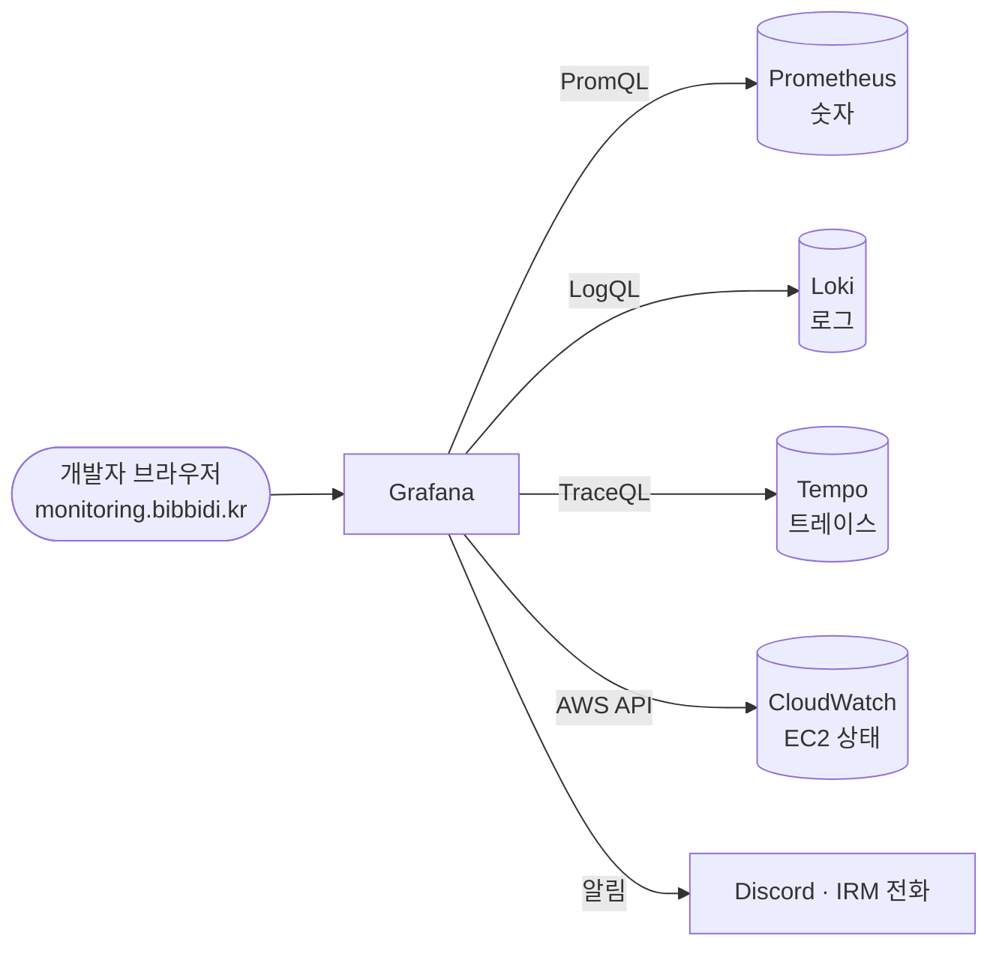

# 10. Grafana : 세 창고를 한 화면에서 보는 곳

> **한 줄 요약** : Prometheus(숫자) · Loki(로그) · Tempo(트레이스)에 저장된 걸 **브라우저 한 화면에서 검색하고 그래프로 보는 곳**입니다. 이상하면 알림도 여기서 보냅니다.
> 
> 처음이라면 [먼저 읽기](00-먼저-읽기.md) 부터 읽어 주세요. 알림은 [14. 알림과 온콜](14-알림과-온콜.md) 에서 따로 다룹니다. 설정 세부는 [부록 : Grafana 상세](10-grafana-상세.md) 에 있습니다.

---

## 1. 없으면 뭐가 불편한가

- Prometheus · Loki · Tempo 는 각자 **API 만 있는 창고**입니다. 사람이 보기 좋은 화면이 없습니다
- 셋을 따로 열면 "이 그래프가 튄 시각의 로그" 를 찾으려고 시간을 복사해 옮겨야 합니다
- Grafana 는 **데이터를 저장하지 않습니다.** 창고에 물어봐서 보여 줄 뿐입니다
    - 그래서 Grafana 를 지워도 숫자 · 로그 · 트레이스는 그대로 있습니다
    - 대신 **대시보드 · 알림 규칙 · 사용자 같은 Grafana 설정**은 Grafana 안(`grafana.db` 파일 하나)에 저장됩니다



---

## 2. 들어가기

- 주소 : `https://monitoring.bibbidi.kr`
- **GitHub 로그인**을 누르면 됩니다. 등록된 팀원만 들어갈 수 있고, 권한은 `Editor` 입니다
    - Editor : 대시보드 보기 · 고치기, Explore 검색 가능 / 데이터소스 · 사용자 관리는 불가
- 팀원 추가는 서버 설정 파일에 GitHub 아이디를 넣어야 합니다 ([비비디 문서](../01-비비디-관측-알림-장애대응.md) 0장)

---

## 3. 화면 네 가지만 알면 됩니다

| 화면 | 언제 쓰나 | 왼쪽 메뉴 |
| --- | --- | --- |
| **대시보드** | 평소 상태 확인, 알림 받았을 때 | Dashboards |
| **Explore** | 직접 검색 (로그 찾기, 트레이스 찾기) | Explore |
| **알림 규칙** | 어떤 알림이 있고 지금 울리는지 | Alerting (Alerts & IRM) |
| **데이터소스** | 창고 연결 설정 (보기만) | Connections > Data sources |

### 대시보드 : 미리 만들어 둔 그래프 모음

비비디는 세 개를 씁니다.

| 대시보드 | 언제 | 무엇을 보나 |
| --- | --- | --- |
| **위험** (`bibbidi-alerts`) | 알림 받았을 때 | 알림 조건 숫자, 에러 로그, 느린 요청 |
| **앱 서버** (`bibbidi-app`) | 평소 | 요청 수, 에러 비율, 응답 시간, DB 커넥션, 힙 |
| **인프라** (`bibbidi-infra`) | 서버 점검 | 디스크, CPU, 모니터링 서버 메모리, EC2 상태 |

- 대시보드 위쪽의 **`env` 드롭다운**으로 운영(`production`) · 개발(`development`)을 바꿉니다
- 오른쪽 위 **시간 범위**(예 : Last 1 hour)를 바꾸면 모든 그래프가 같이 바뀝니다
- 대시보드 안의 네모 하나하나를 **패널**이라고 부릅니다. 패널 = **검색어(쿼리) + 그림 종류**
    - 패널 제목에 마우스를 올려 **Edit** 을 누르면 어떤 쿼리로 그렸는지 볼 수 있습니다. 쿼리를 배우기 가장 좋은 방법입니다

### Explore : 직접 검색하는 곳

- 위쪽에서 창고(데이터소스)를 고르고 검색어를 넣습니다
    - Prometheus → PromQL ([7장](07-prometheus.md)), Loki → LogQL ([8장](08-loki.md)), Tempo → TraceQL ([9장](09-tempo.md))
- 검색어를 몰라도 **Builder** 모드에서 메뉴로 고를 수 있습니다
- **Split** 버튼으로 화면을 좌우로 나눠 로그와 트레이스를 같이 볼 수 있습니다

---

## 4. 이 화면의 진짜 가치 : 클릭으로 오가기

세 창고가 `trace_id` 로 이어져 있어서, **복사 · 붙여넣기 없이 클릭으로** 오갈 수 있습니다.


| 출발 | 누르는 곳 | 도착 |
| --- | --- | --- |
| 로그 한 줄 | 로그를 펼치고 `trace_id` 옆 **Tempo** 버튼 | 그 요청의 트레이스 |
| 트레이스의 스팬 | **Logs for this span** | 같은 `trace_id` 의 로그 |
| 트레이스의 스팬 | **Related metrics** | 그 API 의 요청 수 · 에러율 · 응답 시간 |
| 응답 시간 그래프 | 그래프 위의 **작은 점(exemplar)** | 그 시각에 실제로 느렸던 요청의 트레이스 |

- 이 연결은 데이터소스 설정 파일(`Infra/monitoring/grafana/datasources.yaml`)에 정의돼 있습니다

---

## 5. 직접 해 보기 : 에러 하나 끝까지 따라가기

운영에서 500 에러가 났다고 해 봅시다.

1. **위험 대시보드**를 엽니다 → `env` 를 `production` 으로 → "5xx" 패널에서 언제 몇 건인지 봅니다
2. 같은 대시보드의 **backend ERROR 로그** 패널에서 그 시각의 에러 로그를 찾습니다
    - 직접 찾으려면 Explore → Loki
    ```logql
    {service_name="bibbidi-backend", deployment_environment_name="production"} | severity_text=~"(?i)error"
    ```
3. 로그 한 줄을 펼쳐서 **Tempo** 버튼을 누릅니다 → 그 요청의 트레이스가 열립니다
4. 트레이스에서 **빨간 스팬**(에러)이나 **긴 막대**(느린 구간)를 찾습니다
5. 그 스팬에서 **Logs for this span** 을 누르면 그 요청에서 찍힌 로그가 전부 나옵니다 → 에러 직전에 무슨 일이 있었는지 봅니다

> 참고 영상 (10분 테코톡) : 에러를 어디서 어떻게 잡아 로그를 남기는지 — [러로의 @RestControllerAdvice를 이용한 예외처리](https://www.youtube.com/watch?v=TKjOf_AQ7l4) · [아인, 노아의 에러 핸들링](https://www.youtube.com/watch?v=89WK1xJ7CMU)

---

## 6. 알림은 어디서 오나 (간단히)

- Grafana 가 알림 규칙의 쿼리를 **10초 또는 1분마다** 실행해 보고, 기준을 넘으면 Discord 나 전화로 보냅니다
- 자세한 내용은 [14. 알림과 온콜](14-알림과-온콜.md) 에 있습니다

---

## 7. 꼭 알아야 할 것

### ① 대시보드 · 알림 규칙은 화면에서만 관리되고, 원본은 파일 하나입니다

- 대시보드와 알림 규칙은 저장소에 없고 모니터링 서버의 `/var/lib/grafana/grafana.db` 에만 있습니다
- 화면에서 지우면 **되돌리기 어렵습니다** (13.x 의 "Recently deleted" 로 대시보드는 복원 가능)
- 크게 고치기 전에는 대시보드 설정에서 **JSON 내보내기**로 백업해 두세요

### ② 데이터소스는 화면에서 새로 만들지 않습니다

- 패널과 알림 규칙은 데이터소스를 **고유 ID(uid)** 로 찾습니다
- 데이터소스는 설정 파일로 만들어서 uid 를 `prometheus`, `loki`, `tempo`, `cloudwatch` 로 고정해 뒀습니다
- 화면에서 같은 걸 새로 만들면 uid 가 달라져 **패널이 깨집니다**

### ③ 그래프가 비어 있으면 세 가지를 먼저 보세요

1. 오른쪽 위 **시간 범위** (너무 짧거나, 보관 기간을 넘었거나)
2. **`env` 드롭다운** (개발 환경을 보고 있지 않은지)
3. 검색어의 **이름표 오타**

### ④ CloudWatch 패널은 볼 때마다 돈이 듭니다

- 인프라 대시보드의 EC2 패널은 AWS CloudWatch 에서 가져오고, 조회할 때마다 요금이 생깁니다
- 그래서 자동 새로고침을 5분으로 길게 잡아 뒀습니다

---

## 8. 할 수 있지만 비비디는 안 하는 것

| 할 수 있는 것 | 비비디는 | 공식 문서 |
| --- | --- | --- |
| **MySQL · PostgreSQL 에 설정 저장** (공식 문서는 운영에 이쪽을 권장) | 기본값 SQLite 파일(`grafana.db`) 하나 | [Configure Grafana : database](https://grafana.com/docs/grafana/latest/setup-grafana/configure-grafana/) |
| **Grafana 여러 대로 운영** (고가용성) | 한 대 | [Configure Grafana](https://grafana.com/docs/grafana/latest/setup-grafana/configure-grafana/) |
| **대시보드를 파일 · Git 으로 관리** (provisioning, Git Sync) | 화면에서만 관리 (저장소 보관은 예정) | [Provisioning](https://grafana.com/docs/grafana/latest/administration/provisioning/) · [What's new 13.0 (Git Sync)](https://grafana.com/docs/grafana/latest/whatsnew/whats-new-in-v13-0/) |
| **알림 규칙을 파일로 관리** | 화면에서만 관리 | [Provisioning](https://grafana.com/docs/grafana/latest/administration/provisioning/) |
| **쿼리 없이 클릭으로 탐색** (Metrics · Logs · Traces Drilldown) | 쓸 수는 있지만 안내하지 않음 | [Drilldown](https://grafana.com/docs/grafana/latest/visualizations/simplified-exploration/) |
| **데이터소스 사이 사용자 정의 링크** (Correlations) | 기본 연결(4번)만 사용 | [Correlations](https://grafana.com/docs/grafana/latest/administration/correlations/) |
| **팀 · 폴더별 권한 나누기** | 팀원 전원 Editor | [Roles and permissions](https://grafana.com/docs/grafana/latest/administration/roles-and-permissions/) |
| **Enterprise · Cloud 판** (상용 기능, 호스팅) | 무료 OSS 를 직접 설치 (온콜 IRM 만 Cloud 사용) | [Introduction](https://grafana.com/docs/grafana/latest/introduction/) |

---

## 9. 자주 하는 실수

| 증상 | 원인 |
| --- | --- |
| 그래프가 비어 있음 | 시간 범위 · `env` · 이름표 오타 (7-③) |
| 패널이 "Data source not found" | 데이터소스를 화면에서 새로 만들어 uid 가 바뀜 |
| 로그에서 Tempo 버튼이 없음 | 그 로그에 `trace_id` 가 없음 (요청 밖에서 찍힌 로그) |
| 고친 대시보드가 사라짐 | 저장(Save)을 안 누르고 나감 |
| 로그인이 안 됨 | GitHub 아이디가 서버 설정에 등록되지 않음 |

---

## 더 알고 싶다면

- [부록 : Grafana 상세](10-grafana-상세.md) : 데이터소스 · provisioning 형식, 변수, 알림 상태 · 정책 세부, 설정 파일, 권한, GitHub 로그인 설정
- [공식 문서 : Grafana 소개](https://grafana.com/docs/grafana/latest/introduction/)
- [공식 문서 : Explore](https://grafana.com/docs/grafana/latest/explore/)
