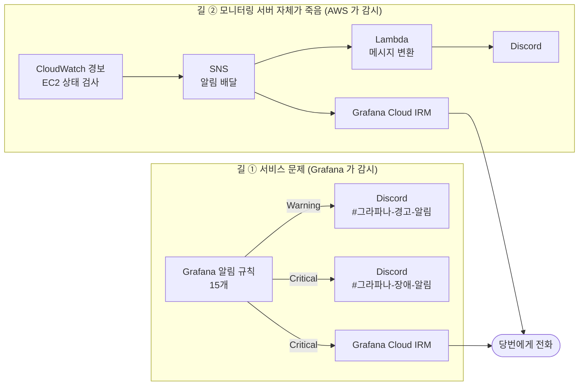
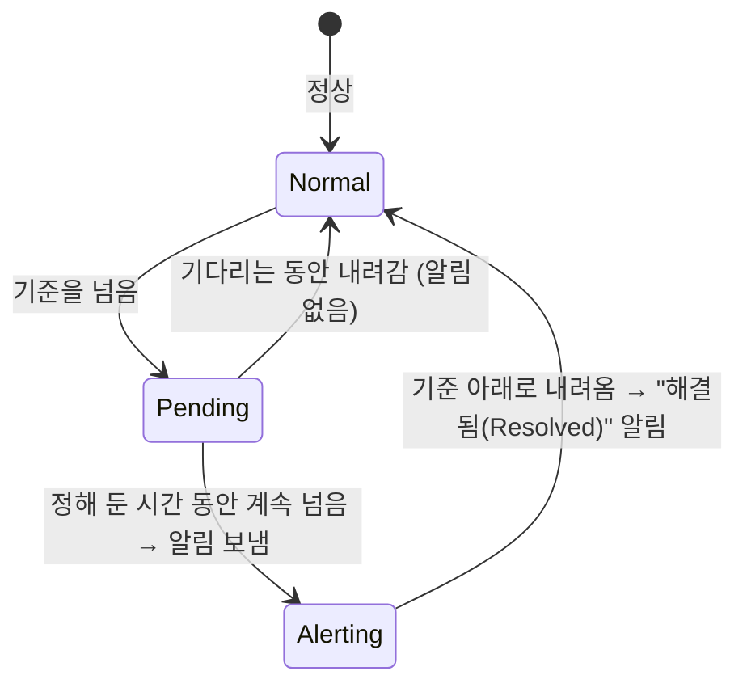
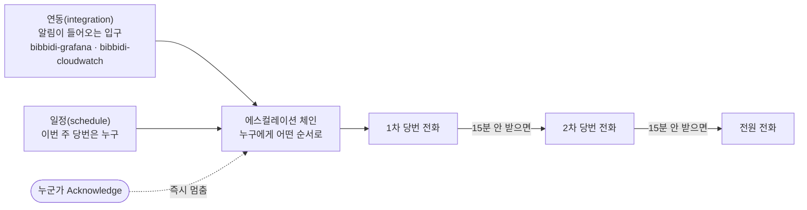
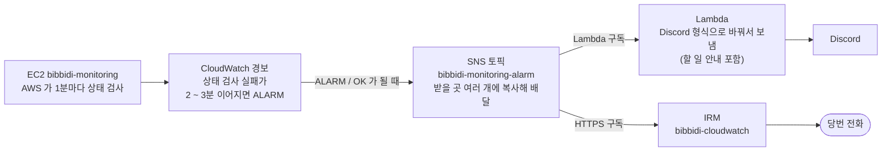

# 14. 알림과 온콜 : 이상하면 누가, 어떻게 알게 되나

> **한 줄 요약** : 그래프를 계속 보고 있을 수는 없으니, **기준을 넘으면 Discord 로 알리고, 심각하면 당번에게 전화를 겁니다.** 모니터링 서버 자체가 죽는 경우는 AWS 가 따로 감시합니다.
> 
> 처음이라면 [먼저 읽기](00-먼저-읽기.md) 와 [10. Grafana](10-grafana.md) 를 먼저 읽어 주세요. 알림 규칙 15개의 조건, 장애 등급, 대응 절차는 [비비디 관측·알림·장애 대응](../01-비비디-관측-알림-장애대응.md) 6 ~ 8장에 있습니다.

---

## 1. 전체 그림

알림이 오는 길은 **두 개**입니다.



| | 무엇을 감시하나 | 누가 감시하나 | 어디로 오나 |
| --- | --- | --- | --- |
| **Warning** | 곧 문제가 될 신호 (에러 1건, 느려짐, 디스크 80% 등) | Grafana | Discord |
| **Critical** | 지금 서비스가 망가짐 (500 반복, backend 다운 등) | Grafana | Discord + **전화** |
| **모니터링 서버 장애** | 모니터링 서버(EC2) 자체가 응답 없음 | AWS CloudWatch | Discord + **전화** |

### 왜 길이 두 개인가

- 알림을 보내는 것도 **모니터링 서버의 Grafana** 입니다
- 모니터링 서버가 죽으면 Grafana 도 죽어서 **"죽었다" 는 알림조차 못 보냅니다**
- 그래서 모니터링 서버는 **바깥(AWS)에서** 따로 감시합니다

> 참고 영상 (10분 테코톡) : 한 대가 죽으면 전체가 멈추는 구조(단일 장애 지점)가 궁금하다면 [포도당의 scale up vs scale out, SPOF](https://www.youtube.com/watch?v=6wPr2jgdDxM)

---

## 2. Discord : 기본 알림 창구

- 모든 알림은 **Discord** 로 옵니다. 팀이 매일 쓰는 곳이라 따로 앱을 설치할 필요가 없습니다
- 채널 두 개
    - `#그라파나-경고-알림` : Warning. 업무 시간에 확인
    - `#그라파나-장애-알림` : Critical. 바로 확인
- 원리 : Discord 채널의 **웹훅(Webhook) 주소**로 메시지를 보냅니다
    - 웹훅 주소 = "이 주소로 메시지를 보내면 이 채널에 글이 올라감" 이라는 비밀 주소
    - Grafana 에는 Discord 연결 기능이 있어서 이 주소만 넣으면 됩니다
- 한계 : Discord 알림은 **놓치기 쉽습니다.** 밤에는 아무도 안 보고, 알림을 꺼 둔 사람도 있습니다 → 그래서 Critical 은 **전화**를 함께 겁니다

---

## 3. Grafana 알림 : 규칙이 울리기까지

### 알림 규칙 = "이 쿼리 결과가 이 기준을 넘으면 알려 줘"

예 : C1 "500 반복"

```promql
sum(increase(http_server_requests_seconds_count{deployment_environment_name="production", status=~"5.."}[5m])) or vector(0)
```

→ 이 값이 **2 이상**이면 알림

- 쿼리는 [7. Prometheus](07-prometheus.md) · [8. Loki](08-loki.md) 에서 배운 것과 같습니다
- 위험 대시보드의 패널이 **알림 규칙과 같은 쿼리**라, 대시보드에서 지금 값을 바로 볼 수 있습니다

### 울리기까지의 순서



1. Grafana 가 규칙의 쿼리를 **주기적으로 실행**합니다 (Critical 10초, Warning 1분마다)
2. 기준을 넘으면 바로 울리지 않고 **Pending(대기)** 상태가 됩니다
3. 정해 둔 시간(예 : 1분) 동안 **계속** 넘어 있으면 **Alerting** 이 되고 알림을 보냅니다
    - 잠깐 튀었다 내려가는 값으로 알림이 쏟아지는 걸 막기 위해서입니다
4. 값이 내려오면 **Resolved(해결됨)** 알림이 한 번 더 옵니다

### 데이터가 없거나 쿼리가 실패하면

| 상황 | 비비디 설정 | 이유 |
| --- | --- | --- |
| **No data** (쿼리는 성공했는데 결과가 없음) | 정상으로 침 | 에러가 0건이면 결과가 없는 게 정상인 규칙이 많음. 데이터가 끊긴 건 C2(backend 수집 실패)가 따로 잡음 |
| **Error** (쿼리 자체가 실패, 30초 넘게 걸림 등) | Error 상태 (기본값) | Grafana 가 `DatasourceError` 라는 **별도 알림**을 만들어 보냄 |

### 보낼 곳 정하기

- **연락처(contact point)** : "어디로 보낼지" 를 묶은 것
    - `discord-warning` : Discord 경고 채널
    - `irm-critical` : IRM(전화) + Discord 장애 채널
- **알림 정책(notification policy)** : 라벨을 보고 연락처를 고르는 규칙
- 비비디는 **규칙마다 보낼 곳을 직접 고릅니다**
    - Critical 규칙 → `bibbidi-critical` → `irm-critical`
    - Warning 규칙 → `bibbidi-warning` → `discord-warning`
    - 아무것도 안 고르면 기본 정책 → `discord-warning`
    - 그래서 **새 규칙을 만들 때 보낼 곳 선택을 빼먹으면**, Critical 이어도 전화가 안 가고 경고 채널로만 갑니다

### 같은 알림이 계속 오지 않게

- **묶기** : 같은 규칙의 알림은 한 메시지로 묶어 보냅니다 (Grafana 기본값 : 첫 알림 전 30초 동안 모음)
- **반복** : 해결되지 않고 계속 울리면 다시 알립니다 (Grafana 기본값 : 4시간마다)
- **잠시 끄기**
    - **Silence** : 정해진 시간 동안 특정 알림 끄기 (예 : 점검하는 1시간)
    - **Mute timing** : 매주 반복되는 시간대 끄기 (예 : 매일 새벽)
    - 둘 다 **알림만 안 보낼 뿐 감시는 계속**합니다

---

## 4. Grafana Cloud IRM : 당번에게 전화 걸기

Discord 는 놓치기 쉬워서, Critical 은 **사람이 받을 때까지 전화를 거는 서비스**를 씁니다. 이게 **온콜(on-call)** 입니다.

- **IRM** = Incident Response & Management. Grafana Labs 가 운영하는 클라우드 서비스입니다
- 비비디 모니터링은 직접 설치한 Grafana 를 쓰지만, **온콜만 Grafana Cloud(무료)** 를 씁니다
    - 직접 전화를 걸려면 전화 회사 연동(Twilio 등)과 비용이 필요한데, IRM 무료 플랜에 전화 · 앱 푸시가 포함돼 있습니다
    - 무료 플랜 : 사용자 **3명**까지 (비비디는 서버 개발자 3명)

### 구성요소



| 이름 | 뜻 | 비비디 |
| --- | --- | --- |
| **연동(integration)** | 알림이 들어오는 **입구 주소** | `bibbidi-grafana` (Grafana 에서), `bibbidi-cloudwatch` (AWS SNS 에서) |
| **일정(schedule)** | 언제 누가 당번인지 | 1차 · 2차 당번, **매주 월요일 10시 교대**, 24시간 |
| **에스컬레이션 체인** | 누구에게, 어떤 순서로, 몇 분 간격으로 | 1차 전화 → 15분 → 2차 전화 → 15분 → 전원 전화 |
| **Acknowledge** | "내가 받았다, 대응 중" 표시 | 누르는 순간 **다음 사람에게 넘어가지 않음** |
| **개인 알림 규칙** | 나에게 어떤 방법으로 알릴지 | 일반 = 앱 푸시, 중요 = 전화 → 푸시 |

- 체인은 **누군가 Acknowledge 하거나, 해결되거나, 모든 단계가 끝날 때까지** 계속 진행합니다
- 그래서 전화를 받았으면 **IRM 앱에서 Acknowledge 를 꼭 누릅니다.** 안 누르면 15분 뒤 다른 사람에게 전화가 갑니다
- 당번을 바꾸고 싶으면 일정에서 **override(대신 서기)** 로 지정합니다

### 비용 주의

- IRM 은 "그 달에 **활성 사용자**가 몇 명이었나" 로 요금을 셉니다
- **일정이나 체인에 이름만 올라가 있어도** 그 달의 활성 사용자로 셉니다
- 그래서 4번째 사람을 일정에 넣는 순간 유료가 됩니다 (비비디 문서 기준 1명당 월 $20, 정확한 가격은 공식 가격 페이지 확인)

---

## 5. 모니터링 서버 감시 : CloudWatch → SNS → Lambda

모니터링 서버가 죽었을 때의 길입니다. **세 개의 AWS 서비스**가 이어져 있습니다.



### ① CloudWatch 경보 : "이상한가?" 판단

- **CloudWatch** 는 AWS 의 모니터링 서비스입니다. EC2 를 만들면 기본 지표(CPU, 네트워크, 상태 검사)가 자동으로 쌓입니다
- **EC2 상태 검사** : AWS 가 **1분마다** 서버를 점검합니다
    - **시스템 상태 검사** : AWS 쪽 물리 장비 문제 (전원, 네트워크, 하드웨어) → 대응 : **중지 후 시작** (다른 장비로 옮겨짐)
    - **인스턴스 상태 검사** : 우리 서버 OS 문제 (메모리 고갈, 파일 시스템 손상 등) → 대응 : **재부팅**
- **경보(alarm)** : "이 지표가 이 기준을 N번 넘으면 ALARM" 이라는 규칙
    - 상태 3가지 : `OK`(정상), `ALARM`(이상), `INSUFFICIENT_DATA`(데이터 부족)
    - 비비디 : 시스템 검사 **2분 연속** 실패, 인스턴스 검사 **3분 연속** 실패면 ALARM
    - **상태가 바뀔 때** 행동합니다 (ALARM 이 될 때 한 번, OK 로 돌아올 때 한 번)

### ② SNS : "누구에게 배달할까"

- **SNS(Simple Notification Service)** 는 **방송국** 같은 서비스입니다
    - **토픽(topic)** 에 메시지를 한 번 보내면
    - 그 토픽을 **구독(subscription)** 한 곳 **모두에게** 복사해서 배달합니다
- 받을 수 있는 곳 : Lambda, HTTPS 주소, 이메일, SMS, SQS 등
- 비비디 토픽 `bibbidi-monitoring-alarm` 의 구독자 두 개
    - Lambda (→ Discord)
    - HTTPS 주소 (→ IRM 연동 주소)
- CloudWatch 경보는 SNS 토픽 하나만 알면 되고, 받을 곳을 늘릴 때는 **구독만 추가**하면 됩니다

### ③ Lambda : "Discord 가 알아듣게 바꾸기"

- **Lambda** 는 서버 없이 **함수 하나만 올려 두면, 이벤트가 올 때 AWS 가 실행해 주는** 서비스입니다
- 왜 필요한가 : SNS 가 보내는 메시지는 **SNS 형식의 JSON** 이고, Discord 웹훅은 **Discord 형식의 JSON** 만 받습니다. 그리고 SNS 는 HTTPS 주소로 보내기 전에 "구독 확인" 을 받아야 하는데, Discord 웹훅은 이 확인을 해 줄 수 없습니다
    - 그래서 가운데에서 **SNS 메시지를 받아 Discord 형식으로 바꿔 보내는** 함수가 필요합니다
- SNS 가 Lambda 를 부를 때 넘겨주는 값

```python
def lambda_handler(event, context):
    for record in event["Records"]:
        message = record["Sns"]["Message"]   # CloudWatch 경보 내용(JSON 문자열)
        # → 경보 이름 · 상태를 읽어 Discord 메시지로 바꾸고, 할 일 안내를 붙여 웹훅으로 보냄
```

- 비비디 코드 : `Infra/monitoring/lambda/lambda_function.py` (Python 3.13, 콘솔에서 직접 배포)
- 주의 : SNS 는 같은 메시지를 **두 번 보낼 수도 있다** 고 문서에 적혀 있습니다 (최소 한 번 배달). Discord 에 같은 메시지가 두 번 와도 이상한 게 아닙니다

### 이 길의 한계

- 서버(EC2)는 살아 있는데 **Grafana 프로그램만 죽은 경우는 못 잡습니다.** AWS 는 서버 OS 까지만 봅니다 → 예정 : 바깥에서 주소로 접속해 보는 점검(Synthetic Monitoring)
- **자동 복구는 안 됩니다.** CloudWatch 경보에 "자동 재부팅 · 복구" 를 걸 수 있지만, 계정 권한이 없어서 사람이 직접 합니다

---

## 6. 알림을 받으면

1. **전화**를 받았으면 IRM 앱에서 **Acknowledge** (다음 사람에게 안 넘어가게)
2. Discord 알림의 링크로 **위험 대시보드**를 엽니다
3. 등급을 판단하고 대응합니다 → [비비디 문서 7장 장애 등급, 8장 대응 절차](../01-비비디-관측-알림-장애대응.md)
4. 최근 배포가 있었다면 **롤백부터** 검토합니다

> 참고 영상 (10분 테코톡) : 롤백 · 배포 방식이 낯설다면 [비타의 애플리케이션 배포 전략](https://www.youtube.com/watch?v=wN1hnub6gyY) · [테니의 무중단 배포](https://www.youtube.com/watch?v=kgvBlruQEKU) · [도비의 CI/CD와 Github Action](https://www.youtube.com/watch?v=SKILL1pT6f4)

---

## 7. 꼭 알아야 할 것

### ① 알림은 운영만 감시합니다

- 모든 규칙이 `deployment_environment_name="production"` 만 봅니다. 개발 서버 문제로는 알림이 오지 않습니다

### ② 알림 규칙 원본은 Grafana 안에만 있습니다

- 규칙 · 연락처 · 정책은 저장소에 없고, 모니터링 서버의 `grafana.db` 에만 있습니다
- 화면에서 고치면 바로 적용되고, 지우면 되살리기 어렵습니다

### ③ 전화를 받으면 Acknowledge

- 안 누르면 15분 뒤 2차 당번에게, 30분 뒤 전원에게 전화가 갑니다

### ④ 비밀 값은 문서에 쓰지 않습니다

- Discord 웹훅 주소, IRM 연동 주소는 아는 사람 누구나 알림을 보낼 수 있는 **비밀 주소**입니다
- 저장소 · 문서 · 채팅에 남기지 않습니다

---

## 8. 할 수 있지만 비비디는 안 하는 것 (대안)

### 알림 창구 대안

Grafana 연락처는 Discord 말고도 여러 곳을 지원합니다.

| 대안 | 특징 | 비비디는 | 공식 문서 |
| --- | --- | --- | --- |
| **Slack** | 개발팀에서 가장 흔함. IRM 과도 깊게 연동 | 팀 메신저가 Discord | [Contact points](https://grafana.com/docs/grafana/latest/alerting/fundamentals/notifications/contact-points/) |
| **Microsoft Teams · Telegram · 이메일** | 팀이 쓰는 곳에 맞춰 선택 | 사용 안 함 | [Contact points](https://grafana.com/docs/grafana/latest/alerting/fundamentals/notifications/contact-points/) |
| **Webhook** | 아무 주소로나 JSON 을 보냄 (직접 만든 서버 등) | IRM 연동에만 사용 | [Contact points](https://grafana.com/docs/grafana/latest/alerting/fundamentals/notifications/contact-points/) |

### 온콜(전화) 대안

| 대안 | 상태 · 특징 | 비비디는 | 링크 |
| --- | --- | --- | --- |
| **PagerDuty** | 온콜 서비스의 대표. 무료 플랜 5명, 월 전화 · SMS 100건, 일정 · 체인 1개씩 (제3자 정리 기준, 공식 가격 페이지 확인 필요) | Grafana 와 한 화면에서 쓰려고 IRM 선택 | [PagerDuty 무료 플랜 정리 (CostBench)](https://www.costbench.com/software/developer-tools/pagerduty/free-plan/) |
| **Opsgenie** (Atlassian) | **신규 판매 2025-06-04 중단, 2027-04-05 서비스 종료** 예정 (제3자 정리 기준) | 선택지 아님 | [Opsgenie 종료 정리 (Hyperping)](https://hyperping.com/blog/opsgenie-end-of-life) |
| **Grafana OnCall OSS** (직접 설치하는 무료판) | 2025-03 유지보수 모드, **2026-03-24 아카이브**. 클라우드 연결이 끊겨 전화 · 앱 푸시를 쓰려면 자체 Twilio 계정 필요 | 사용 불가 → Cloud IRM 사용 | [Grafana OnCall OSS](https://grafana.com/docs/oncall/latest/set-up/open-source/) |
| **Discord 만 쓰기** | 비용 0, 설정 단순 | 밤 · 주말에 놓칠 위험이 커서 Critical 은 전화 추가 | - |

### 감시 방식 대안

| 대안 | 무엇인가 | 비비디는 | 링크 |
| --- | --- | --- | --- |
| **Prometheus Alertmanager** | Prometheus 쪽에서 알림 규칙을 돌리는 도구 | Grafana 알림 사용 (로그 · 숫자를 한곳에서) | [Prometheus Overview](https://prometheus.io/docs/introduction/overview/) |
| **데이터소스 쪽 알림 규칙** (Loki ruler 등) | 규칙을 Grafana 가 아니라 저장소에서 평가 | Grafana 쪽 규칙 사용 (공식 문서도 권장) | [Data source-managed rules](https://grafana.com/docs/grafana/latest/alerting/alerting-rules/create-data-source-managed-rule/) |
| **EC2 애플리케이션 상태 검사** | AWS 가 HTTP · HTTPS 응답까지 확인하는 선택 검사 | 사용 안 함 (Grafana 만 죽은 경우를 잡을 후보) | [EC2 상태 검사](https://docs.aws.amazon.com/AWSEC2/latest/UserGuide/monitoring-system-instance-status-check.html) |
| **CloudWatch 경보로 자동 복구 · 재부팅** | ALARM 이 되면 AWS 가 EC2 를 자동으로 복구 · 재부팅 | 계정 권한이 없어 사람이 직접 | [EC2 상태 검사](https://docs.aws.amazon.com/AWSEC2/latest/UserGuide/monitoring-system-instance-status-check.html) |
| **바깥에서 주소 점검** (Synthetic Monitoring) | 외부에서 주기적으로 접속해 응답 확인 | **예정** | [비비디 문서 6장](../01-비비디-관측-알림-장애대응.md) |
| **SNS 로 바로 이메일 · SMS** | Lambda 없이 SNS 구독만으로 보냄 | Discord 로 받으려고 Lambda 사용 | [SNS Subscribe](https://docs.aws.amazon.com/sns/latest/api/API_Subscribe.html) |

---

## 9. 자주 하는 실수

| 증상 | 원인 |
| --- | --- |
| Critical 규칙인데 전화가 안 옴 | 규칙에서 보낼 곳을 안 골라 기본 정책(경고 채널)으로 감 |
| 같은 사람에게 전화가 계속 옴 / 2차 당번에게 넘어감 | Acknowledge 를 안 누름 |
| 에러가 났는데 알림이 없음 | 개발 환경 문제 (운영만 감시), 또는 pending 시간 안에 값이 내려감 |
| `DatasourceError` 라는 모르는 알림 | 규칙의 쿼리 자체가 실패함 (데이터소스 연결 · 쿼리 시간 초과) |
| 모니터링 서버가 죽었는데 Grafana 알림이 없음 | 정상. Grafana 도 같이 죽음 → CloudWatch 경보로 옴 |
| Discord 에 같은 CloudWatch 메시지가 두 번 | SNS 는 "최소 한 번" 배달이라 중복 가능 |
| 이번 달 IRM 이 유료가 됨 | 일정 · 체인에 4번째 사람을 넣음 |

---

## 더 알고 싶다면

- [부록 : Grafana 상세](10-grafana-상세.md) 7장 : 알림 상태 · 정책 · 그룹화 타이머 세부
- [비비디 관측·알림·장애 대응](../01-비비디-관측-알림-장애대응.md) 6 ~ 8장 : 규칙 15개 조건, 장애 등급, 대응 절차
- 공식 문서 : [Grafana Alerting](https://grafana.com/docs/grafana/latest/alerting/fundamentals/) · [IRM 에스컬레이션 체인](https://grafana.com/docs/grafana-cloud/observe-and-act/respond-to-incidents/irm/escalation-and-routing/escalation-chains.md) · [IRM 알림 받기](https://grafana.com/docs/grafana-cloud/observe-and-act/respond-to-incidents/irm/notify-responders/) · [IRM 요금 계산](https://grafana.com/docs/grafana-cloud/cost-management-and-billing/manage-invoices/understand-your-invoice/irm-invoice/)
- 공식 문서 (AWS) : [CloudWatch 경보와 누락 데이터](https://docs.aws.amazon.com/AmazonCloudWatch/latest/monitoring/alarms-and-missing-data.html) · [EC2 상태 검사](https://docs.aws.amazon.com/AWSEC2/latest/UserGuide/monitoring-system-instance-status-check.html) · [SNS 구독 종류](https://docs.aws.amazon.com/sns/latest/api/API_Subscribe.html) · [SNS 로 Lambda 실행](https://docs.aws.amazon.com/lambda/latest/dg/with-sns.html)
