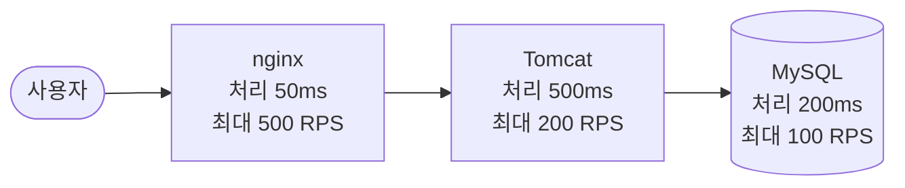

# 19. 성능 테스트와 지연 : 얼마나 빠르고, 얼마나 버티나

> **한 줄 요약** : **성능 테스트**는 일부러 요청을 많이 보내서 "얼마나 빨리 응답하나(응답 시간)" 와 "얼마나 많이 처리하나(처리량)" 를 재고, **어디가 먼저 막히는지(병목)** 찾는 일입니다. 모니터링은 그 병목을 **눈으로 보는 도구**입니다.
> 
> 처음이라면 [먼저 읽기](00-먼저-읽기.md), [2. 메트릭](02-메트릭-Actuator-Micrometer.md), [7. Prometheus](07-prometheus.md) 를 먼저 읽어 주세요. 비비디의 k6 실습은 발표 5부에서 다룹니다.

---

## 1. 용어부터 : 지연 · 대역폭 · 처리량 · 응답 시간

고속도로에 비유합니다.

| 용어 | 뜻 | 고속도로로 치면 | 단위 |
| --- | --- | --- | --- |
| **지연 (Latency)** | 데이터가 한 곳에서 다른 곳까지 **가는 데 걸리는 시간** | 차 한 대가 서울에서 부산까지 걸리는 시간 | ms |
| **대역폭 (Bandwidth)** | 일정 시간에 **최대로** 보낼 수 있는 데이터 양 | 차선 수 (한 번에 지나갈 수 있는 최대 차량) | bps (Mbps, Gbps) |
| **처리량 (Throughput)** | 일정 시간에 **실제로** 처리한 양 | 실제로 1시간에 지나간 차량 수 | RPS, TPS |
| **응답 시간 (Response time)** | 요청을 보내고 **응답을 받기까지** 걸린 전체 시간 | 출발해서 볼일 보고 돌아오기까지 | ms |

- **RPS / TPS** : Requests (Transactions) Per Second. 1초에 처리한 요청 수

### 대역폭을 늘리면 지연이 줄어드나?

- **꼭 그렇지는 않습니다.** 차선을 10개로 늘려도, 톨게이트 한 곳이 막히면 뒤차들은 계속 기다립니다
- 지연은 **가장 막히는 곳**에 좌우됩니다. 그래서 대역폭보다 **지연(어디서 기다리나)을 먼저** 봐야 합니다
- 지연을 줄이는 대표적인 방법 : 사용자와 서버의 **거리를 줄이기**(CDN), **캐시**(브라우저 · 서버), 연결 재사용, 불필요한 왕복 줄이기

### 직접 재 보기

```bash
ping -c 5 google.com      # 왕복 지연(ms)을 5번 재고 평균 · 편차를 보여 줌
```

- 브라우저 개발자 도구 → Network → Throttling(예 : Slow 3G)으로 느린 네트워크에서 화면이 어떻게 보이는지 볼 수 있습니다

> 참고 영상 (10분 테코톡) : [효오의 Latency & Bandwidth](https://www.youtube.com/watch?v=mFBIwEhvZUY)

---

## 2. 왜 성능 테스트를 하나

- **느리면 사용자가 떠납니다.** 응답 대기 시간이 길수록 이탈률이 크게 오른다는 조사가 여럿 있습니다
- 사용자가 늘면 **동시에 들어오는 요청**이 늘고, 서버 자원(CPU, 메모리, 스레드, DB 커넥션)은 정해져 있어서
    1. 응답이 점점 느려지고
    2. 결국 **장애**가 납니다
- 그래서 **배포 전에** 미리
    - 목표(예 : "초당 100건을 처리하면서 p95 300ms 이내") 를 만족하는지
    - 어디까지 버티는지, 넘으면 어떻게 망가지고 **다시 살아나는지**
    를 확인합니다

---

## 3. 응답 시간과 처리량은 다르게 계산됩니다

요청 하나가 nginx → Tomcat(Spring) → MySQL 을 지나간다고 해 봅시다.



| | 계산 | 이 예에서 | 개선하려면 |
| --- | --- | --- | --- |
| **응답 시간** | 각 구간 시간의 **합** | 50 + 500 + 200 = **750ms** | **가장 오래 걸리는 구간**부터 (어느 구간을 줄여도 합이 줄어듦) |
| **처리량** | 각 구간 처리량 중 **가장 작은 값** | min(500, 200, 100) = **100 RPS** | **가장 작은 구간(병목)** 만. 다른 곳을 늘려도 소용없음 |

- **병목(bottleneck)** = 처리량이 가장 낮아서 전체를 막는 구간
    - MySQL 을 300 RPS 로 올리면 → 병목이 Tomcat(200)으로 **옮겨 갑니다**
    - 병목이 아닌 nginx 를 1000 RPS 로 올려도 → 전체는 그대로 100 RPS
- 응답 시간에는 **기다리는 시간**도 들어 있습니다. 앞 구간이 막히면 뒤 요청은 줄을 서고, 그만큼 응답 시간이 늘어납니다

### 어느 구간이 오래 걸리는지 어떻게 아나 → 모니터링

- 각 구간의 시간을 보려면 구간마다 측정이 있어야 합니다
- 비비디에서는
    - **트레이스**(Tempo) : 요청 하나에서 DB · 외부 호출 · 우리 코드가 각각 몇 ms 인지 ([9. Tempo](09-tempo.md))
    - **메트릭**(Prometheus) : 커넥션 대기, 힙 · GC, CPU ([7. Prometheus](07-prometheus.md))
- 원인에 따라 해결이 다릅니다 : 느린 쿼리 → 인덱스 · 쿼리 개선, N+1 → 패치 조인, 객체를 너무 많이 만들어 GC 가 잦음 → 코드 개선, 커넥션 부족 → 풀 크기 · 쿼리 시간

---

## 4. 몇 명이 동시에 쓸 수 있나 : Little's Law

```
동시 사용자 수 ≈ 처리량(TPS) × (응답 시간 + Think Time)
```

- **Think Time** = 사용자가 화면을 보고 다음 요청을 보내기까지 **생각하는 시간** (목록을 훑는 1초, 상세 페이지를 읽는 10초 등)
- 예 : 처리량 100 TPS, 응답 시간 0.2초, Think Time 1초
    - 100 × (0.2 + 1) = **약 120명**이 동시에 써도 버틴다는 뜻
- 목표 사용자 수(예 : 우테코 크루 대상이면 수백 명)와 비교합니다
    - 모자라면 → 병목 개선
    - **지나치게 넘치면** → 서버를 너무 크게 잡은 것일 수 있음 (비용 낭비)

---

## 5. 성능 테스트 종류

```
동시 사용자
  ▲
  │                      ╱  Breakpoint : 무너질 때까지 계속 올림
  │     ┌──────────┐   ╱    Stress    : 평소보다 높게 유지
  │    ╱            ╲ ╱
  │   ╱ ┌────────┐   ╲      Average-load : 평소 수준 유지
  │  ╱ ╱          ╲   ╲
  │ ╱ ╱            ╲   ╲    Spike : 짧게 확 올렸다 내림 (  ╱╲  )
  │──── Smoke : 아주 낮게 ───────────────
  └───────────────────────────────────────▶ 시간
     올리기(ramp-up)   유지      내리기
```

| 종류 | 무엇을 확인하나 | 부하 · 시간 | 언제 |
| --- | --- | --- | --- |
| **Smoke** | 스크립트가 잘 도는지, 최소 부하에서 정상인지 | 아주 낮음 · 몇 초 ~ 몇 분 | **항상 먼저**, 코드가 바뀔 때마다 |
| **Average-load (부하 테스트)** | 평소 수준에서 목표를 만족하나 | 평균 수준 · 5 ~ 60분 | 가장 기본 |
| **Stress** | 평소보다 많을 때(예 : 50% 이상 더) 어떻게 되나, **망가진 뒤 회복하나** | 평균 이상 · 5 ~ 60분 | 부하 테스트 **다음에** |
| **Soak (내구)** | **오래** 돌리면 문제가 생기나 (메모리 누수 등) | 평균 · 몇 시간 | 장시간 운영 전 |
| **Spike** | **갑자기 확** 몰리면 버티나 (쿠폰 이벤트 등) | 매우 높음 · 몇 분 | 이벤트 전 |
| **Breakpoint (중단점)** | 조금씩 올려서 **어디서 무너지나** (한계점) | 무너질 때까지 증가 | 한계를 알고 싶을 때 |

- 순서 : **Smoke → Average-load → 필요한 것 골라서** (오래 쓰는 서비스면 Soak, 몰리는 서비스면 Spike · Stress)
- 부하는 **천천히 올리고(ramp-up) → 유지하고 → 천천히 내립니다.** 오르내리기를 반복하면 원인을 찾기 어렵습니다
- Stress 를 먼저 하면 병목이 여러 개 한꺼번에 터져서 **어디가 먼저 막혔는지** 찾기 어렵습니다

### 결과 그래프 읽기

- 부하를 올려도 **처리량(TPS)이 더 안 오르고 평평해지는 지점** = **임계점**. 그 지점의 병목이 한계를 정합니다
- 처리량이 **평평하다가 오히려 뚝 떨어지는 구간** = 병목이 두 개 이상 **겹친** 상태 (예 : Tomcat 스레드와 DB 커넥션 풀이 동시에 모자람). 짧은 테스트에서는 안 보일 수 있어 **30분 ~ 1시간** 길게 돌려 봅니다
- 응답이 아예 안 오면 서버가 멈춘 것(hang). Stress 테스트에서는 **언제 멈췄나**보다 **얼마 만에 회복했나, 안전하게 종료됐나(graceful shutdown)** 를 봅니다

> 참고 영상 (10분 테코톡) : [이프의 성능 테스트](https://www.youtube.com/watch?v=IcSdPhxCn9Y) (응답 시간 · 병목 · Little's Law · 부하 vs 스트레스) · [베베, 허브의 성능 테스트](https://www.youtube.com/watch?v=3cTn53dtzJI) (처리량 vs 응답 시간 · 테스트 종류 · 도구 비교 · 실습)

---

## 6. 테스트 계획 세우기

시작 전에 이것부터 정합니다.

1. **목표 응답 시간** : 예 "p95 300ms 이하" (넘으면 실패로 침)
2. **최대 동시 사용자** : 가장 붐빌 때 몇 명인가 (가입자 수 · 서비스 특성에서 추정, 여유 있게)
3. **시나리오** : 어떤 API 를 어떤 순서로, **Think Time** 은 얼마 (예 : 1초)
4. **부하 모양** : ramp-up 시간, 유지 시간, 최대 사용자
5. **어디서** : **운영이 아니라 개발 서버**에서

### 도구

| 도구 | 스크립트 | 특징 |
| --- | --- | --- |
| **JMeter** (Apache) | GUI / XML | 오래되고 안정적, 프로토콜이 다양함. GUI 는 무겁고 테스트할 때는 CLI 권장 |
| **k6** (Grafana Labs) | JavaScript | 문서가 깔끔, 가벼움, **Grafana · Prometheus 와 연동이 쉬움** |
| **nGrinder** (네이버) | Groovy / Jython | 한국어 지원, 웹 화면에서 바로 실행, controller · agent 를 따로 띄움 |

- 비비디는 모니터링이 Grafana 계열이라 **k6** 를 씁니다 (발표 5부)

---

## 7. 테스트 중에 Grafana 에서 볼 것

부하를 거는 동안 **앱 서버 대시보드**(`env=development`)를 띄워 둡니다.

| 보는 것 | 숫자 | 이렇게 되면 |
| --- | --- | --- |
| 처리량 | 초당 요청 수 | 부하를 올려도 안 오르면 → 임계점 |
| 응답 시간 | p50 · p95 · p99 | p95 가 목표를 넘는 시점의 사용자 수 기록 |
| 에러 | 5xx 비율 | 늘기 시작하면 → 한계 |
| DB 커넥션 | `hikaricp_connections_pending` | 0 보다 크면 → 커넥션 풀이 병목 |
| JVM | 힙, GC 일시 정지 | GC 가 잦고 길면 → 메모리 · 객체 생성 문제 |
| CPU | `process_cpu_usage`, `system_cpu_usage` | 100% 근처면 → CPU 병목 |
| 느린 요청 | Tempo 에서 `duration > 1s` | 트레이스로 어느 구간이 늘었는지 확인 |

- k6 결과를 **Prometheus 로 보내서** 같은 Grafana 화면에 함께 그릴 수 있습니다 (발표 5부)

### 주의

- **운영에서 하지 않습니다.** 실제 사용자에게 영향이 갑니다
- 비비디 알림은 운영만 감시하므로 개발 서버 테스트로는 알림이 오지 않습니다. 대신 대시보드를 직접 봅니다
- 트레이스 100% 저장이라 부하 테스트 요청도 **전부 모니터링 서버로 갑니다** → 모니터링 서버(메모리 2GB)와 Loki 수집 한도(거절, W7)를 함께 지켜봅니다

---

## 8. 할 수 있지만 비비디는 안 하는 것

| 할 수 있는 것 | 비비디는 | 공식 문서 |
| --- | --- | --- |
| **k6 결과를 Prometheus 로 실시간 전송** | 발표 5부에서 다룸 | [k6 : Prometheus remote write](https://grafana.com/docs/k6/latest/results-output/real-time/prometheus-remote-write/) |
| **여러 대에서 나눠 부하 걸기** (분산 테스트, k6 operator 등) | 한 대에서 실행 | [k6 Testing guides](https://grafana.com/docs/k6/latest/testing-guides/test-types/) |
| **Grafana Cloud k6** (클라우드에서 부하 생성) | 오픈소스 CLI 만 | [k6 Testing guides](https://grafana.com/docs/k6/latest/testing-guides/test-types/) |
| **브라우저 부하 테스트** (k6 browser) | API 서버만 테스트 | [k6 Testing guides](https://grafana.com/docs/k6/latest/testing-guides/test-types/) |
| **CDN · 캐시로 지연 줄이기** | 사용 안 함 | - |

---

## 9. 자주 하는 실수

| 실수 | 왜 문제인가 |
| --- | --- |
| Smoke 없이 바로 큰 부하 | 스크립트 오류인지 서버 문제인지 구분이 안 됨 |
| Think Time 0 | 사용자 한 명이 1초에 수십 번 요청하는 비현실적인 부하 |
| 병목이 아닌 곳을 개선 | 처리량이 그대로 (3장) |
| 평균 응답 시간만 봄 | 느린 소수가 묻힘 → p95 · p99 를 봄 |
| 5 ~ 10분만 돌림 | 겹친 병목 · 메모리 누수를 못 봄 |
| 운영 서버에 테스트 | 실제 사용자 장애 |

---

## 더 알고 싶다면

- [k6 : 부하 테스트 종류](https://grafana.com/docs/k6/latest/testing-guides/test-types/)
- [k6 : Prometheus remote write](https://grafana.com/docs/k6/latest/results-output/real-time/prometheus-remote-write/)
- [Google SRE 책 : 4가지 황금 신호 (지연 · 트래픽 · 에러 · 포화)](https://sre.google/sre-book/monitoring-distributed-systems/)
